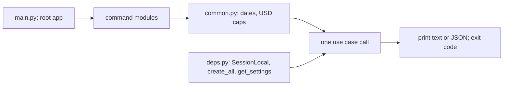

<!-- code-doc
module: src/app/cli/main.py
covers:
  - src/app/cli/*.py
-->
# CLI `ai-news`

Operator commands; how to run them: `docs/cli.md`. What each command does belongs to the doc of its
feature (Code map).

## Behavior

- `main.py` only assembles: each command module has its own Typer app; a module app without a
  name adds its commands at the top level, a group (`archive`, `bulletin`, `world`,
  `daily-signals-entities`) is added by name. Command names and options are the CLI contract.
  Tests: `test_every_command_is_registered`.
- A command checks its options, calls use cases and prints; it calls no repository and never
  commits. Tests: `test_entry_points_import_from_storage_only_row_types`,
  `test_entry_points_do_not_commit`.
- `deps.py` is the CLI composition root: the only `cli/` module that imports `SessionLocal` and
  `create_all`. Commands read `deps.SessionLocal`, `deps.create_all` and `deps.get_settings` at
  call time and hand the session factory (or a session) to the use case. Tests:
  `test_composition_roots_import_only_session_and_create_all`.
- Shared option checks live in `common.py`: a bad date or USD amount, or an amount above the cap,
  is a usage error (exit 2) before any session opens. Tests: `test_dates_and_usd_validation`,
  `test_bad_arguments_exit_2`.

## Decisions

- decided 2026-11-11 (agent): one module per command group, so a command change touches one
  small file; `cli/main.py` had grown to 729 lines and 58 imports.
- decided 2026-11-11 (agent): the composition root is `deps.py`, not `main.py`: `main.py`
  imports the command modules, so they cannot import it back; tests patch one module.
- decided 2026-11-11 (agent): the plain `period-signals` run (week, then month) is
  `run_week_and_month` in `usecases/periodic/period_run.py`; the command only picks it.
- decided 2026-11-11 (agent): `ai-news --help` lists top-level commands by module; their names,
  options and help texts did not change.

## Invariants

- No command imports `app.storage` except row types; only `deps.py` imports `SessionLocal` and
  `create_all`.
- No command commits.
- A command that turns a runtime failure into a summary logs it with its traceback. Tests:
  `test_daily_runtime_failure_exits_zero`.

## Code map

| Module | Commands | Feature doc |
| --- | --- | --- |
| `main.py` | root app, callback | - |
| `deps.py` | composition root | - |
| `common.py` | `echo_json`, `parse_day`, `completed_day`, `check_usd`, `day_within_cap` | - |
| `articles.py` | `sources`, `fetch`, `top`, `search`, `prune` | `../usecases/ingestion/pipeline.md`, `../usecases/archive/capture.md` |
| `site.py` | `serve`, `page-views` | `../web/pages.md` |
| `daily.py` | `daily-publish`, `daily-signals`, `daily-signals-entities` | `../usecases/daily/enrichment.md`, `../usecases/daily/signals.md` |
| `periods.py` | `period-signals` | `../core/periodic/signals_period.md` |
| `candidates.py` | `import-candidates`, `validate-candidates`, `review-batch-outcomes` | `../usecases/sources/onboarding.md` |
| `archive.py` | `archive` group | `../usecases/archive/capture.md` |
| `bulletin.py` | `bulletin` group | `../usecases/bulletin/daily.md` |
| `world.py` | `world` group | `../core/world/world.md` |

A new command goes into the module of its feature; a new module is added to the loop or the group
list in `main.py`.

## Tests

Command tests live with their feature (`tests/unit/test_cli_*.py`, `tests/unit/test_bulletin_*.py`,
`tests/unit/test_world_*.py`, `tests/unit/test_article_archive.py`, `tests/unit/test_page_views.py`);
they patch `deps` for the database and settings and the command module for its use cases. Layer
rules: `tests/unit/test_layer_imports.py`.
