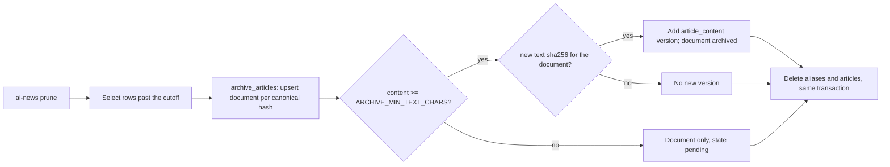

<!-- code-doc
module: src/app/core/archive/capture.py
covers:
  - src/app/core/archive/*.py
  - src/app/storage/archive.py
  - src/app/storage/migrations/versions/*article_archive*.py
-->
# Article archive

Private, permanent copy of collected articles: one document per canonical URL hash and
append-only text versions. Retention and cleanup never delete it. Spec:
`specs/016-article-archive/spec.md` (phase 1: storage and archive-before-prune).

## Behavior

- `archive_articles` makes one `ArchiveDocument` per `url_canonical_hash` with the article's
  metadata and adds an `ArchiveText` (`origin = article_content`, `ARTICLE_CONTENT_VERSION`) only
  when the content has at least `ARCHIVE_MIN_TEXT_CHARS`. A document with a version is `archived`,
  without one `pending`. No network. Tests: `test_sync_creates_document_and_content_version`.
- A version is added only when its SHA-256 differs from every stored version of the document; older
  versions stay. Tests: `test_sync_versions_only_on_text_change`.
- A hash that was pruned and collected again reuses its document: metadata and `article_id` are
  updated, `first_seen_at` is kept. Tests: `test_recollected_article_reuses_document`.
- `ArticleRepo.prune_older_than` archives every row it is about to delete, in the same transaction,
  before the delete; a rollback undoes both. `count_older_than` and `prune --dry-run` write
  nothing. Tests: `test_prune_archives_rows_before_delete`, `test_prune_archive_rolls_back_with_delete`,
  `test_prune_dry_run_does_not_archive`.
- Prune and `purge_evidence` never delete archive rows; only `ArchiveRepo.purge` with `apply=True`
  does (the CLI comes in phase 2). Tests: `test_prune_and_evidence_purge_keep_archive_rows`,
  `test_archive_repo_purge_status_and_size`.
- No module under `src/app/web` (pages, API, MCP) imports `app.core.archive` or
  `app.storage.archive`. Tests: `test_archive_not_imported_by_web_or_mcp`.
- The migration creates both tables only when missing and its downgrade drops them. Tests:
  `test_article_archive_migration_round_trip`.

## Decisions

- Same database, two tables, no foreign key to `articles` or `sources`: backups already cover the
  database, and documents must outlive their articles (plan.md, "Where the archive lives").
- Stored content is copied under `ARTICLE_CONTENT_VERSION`, because ingestion does not record which
  extractor produced `articles.content` (plan.md, data model).
- decided 2026-10-23 (agent): `ArchiveRepo.size_bytes` uses `pg_total_relation_size` on PostgreSQL
  and the summed text length elsewhere; SQLite has no per-table size without the optional `dbstat`.
- decided 2026-10-23 (agent): `document_id` has a plain foreign key without cascade; `purge` deletes
  versions explicitly, so SQLite (foreign keys off) and PostgreSQL behave the same.

## Invariants

- Archive rows are deleted only by `ArchiveRepo.purge` with `apply=True`.
- `archive_texts` is append-only; `(document_id, text_sha256)` is unique.
- One document per `url_canonical_hash`.
- Raw HTML is never stored in the archive tables.

## Code map

- `capture.py`: constants and `archive_articles` (sync of stored articles, no network).
- `storage/archive.py`: `ArchiveRepo` (upsert document, add version by hash, purge selection,
  state counts, size).
- `storage/models_sql.py`: `ArchiveDocument`, `ArchiveText` (tables `archive_documents`,
  `archive_texts`).
- `storage/migrations/versions/e7b4c2a9d150_add_article_archive.py`: additive migration after
  `c3a8e5d27f14`.
- `storage/article_repo.py`: `prune_older_than` calls `archive_articles` before its deletes.

## Tests

- `tests/unit/test_article_archive.py`: sync, versions, re-collection, prune, evidence purge, repo
  purge/status/size, web import guard.
- `tests/unit/test_daily_signals_migration.py`: migration round trip.
