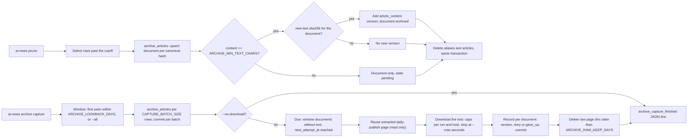

<!-- code-doc
module: src/app/core/archive/capture.py
covers:
  - src/app/core/archive/*.py
  - src/app/storage/article_evidence_cache.py
  - src/app/storage/archive.py
  - src/app/storage/migrations/versions/*article_archive*.py
  - scripts/run_daily_archive_job.sh
-->
# Article archive

Private, permanent copy of collected articles: one document per canonical URL hash and
append-only text versions. Retention and cleanup never delete it. Spec:
`specs/016-article-archive/spec.md` (phases 1-4: storage, archive-before-prune, seed and
operator commands, downloads with retries, nightly job).

## Behavior

- `archive_articles` makes one `ArchiveDocument` per `url_canonical_hash` with the article's
  metadata and adds an `ArchiveText` (`origin = article_content`, `ARTICLE_CONTENT_VERSION`) only
  when the content has at least `ARCHIVE_MIN_TEXT_CHARS`. A document with a version is `archived`,
  without one `pending`. No network. Tests: `test_sync_creates_document_and_content_version`.
- A version is added only when its SHA-256 differs from every stored version of the document; older
  versions stay. Tests: `test_sync_versions_only_on_text_change`.
- A hash that was pruned and collected again reuses its document: metadata and `article_id` are
  updated, `first_seen_at` is kept. Tests: `test_recollected_article_reuses_document`.
- `ArticleRepo.prune_older_than` archives every row it is about to delete, in the same transaction,
  before the delete; a rollback undoes both. `count_older_than` and `prune --dry-run` write
  nothing. Tests: `test_prune_archives_rows_before_delete`, `test_prune_archive_rolls_back_with_delete`,
  `test_prune_dry_run_does_not_archive`.
- `ai-news archive capture` syncs articles discovered within `ARCHIVE_LOOKBACK_DAYS` (all
  articles with `--all`) through `archive_articles`, in batches of `CAPTURE_BATCH_SIZE` with a
  commit per batch. With `--no-download` it stops there and makes no network request. Tests:
  `test_capture_window_and_seed_make_no_requests`.
- Due documents: `next_attempt_at` empty or reached, and either `pending` and first seen in the
  same window as the coverage (every pending document with `--all`) or `failed` of any age, so the
  retry schedule can finish after the window; newest first, alternating hosts so one host does not
  hold every worker. Tests:
  `test_capture_window_and_seed_make_no_requests`, `test_capture_retry_schedule_then_gives_up`.
- A due document whose URL has a completed attempt with quality `extracted`, at least
  `ARCHIVE_MIN_TEXT_CHARS` and a text hash matching its evidence in the daily-publish cache
  (`DAILY_CACHE_ROOT`) gets that text as an `origin = source_page` version without a request. The
  capture only reads that cache. Tests: `test_capture_reuses_daily_publish_page`.
- The rest is downloaded through `SourcePageDownloader` on `ARCHIVE_CACHE_ROOT` (robots.txt, crawl
  delay, per-host pacing, redirects, body limit, 429/503 pause, the declared bot user agent `DEFAULT_USER_AGENT`; robots.txt rules are
  matched against `BOT_TOKEN`, so `User-agent: ai-news-collector` and `*` groups apply) with
  `ARCHIVE_DOWNLOAD_CONCURRENCY` workers. An extracted page of at least `ARCHIVE_MIN_TEXT_CHARS`
  becomes an `origin = source_page` version with `EXTRACTION_VERSION`, final URL and HTTP status;
  the document is `archived`. Tests: `test_capture_downloads_and_archives_page`.
- At most `ARCHIVE_MAX_DOWNLOADS` downloads per run and `ARCHIVE_MAX_PER_HOST` per host
  (`skipped_cap`); no download starts after `--max-seconds` (`skipped_time`). Skipped documents
  are unchanged. Tests: `test_capture_respects_caps_and_time`.
- `PERMANENT_ISSUES` set `gave_up` at once. A robots result counts as permanent only when the
  cached robots.txt answered 200, 404 or 410; an unavailable robots.txt is a retryable
  `robots_unavailable`. Tests: `test_capture_gives_up_on_permanent_issues`.
- Any other failure sets `failed` and `next_attempt_at = now + ARCHIVE_RETRY_DELAYS[attempts - 1]`;
  the failure after the last delay sets `gave_up`. `last_issue` keeps the latest issue, an
  HTTP status issue before quality issues. Tests:
  `test_capture_retry_schedule_then_gives_up`.
- A retry deletes that URL's page directory in `ARCHIVE_CACHE_ROOT` before downloading again; the
  daily-publish cache is never written or cleared. A pending document whose page was downloaded by
  a killed run is recorded from that attempt without a new request. Tests:
  `test_capture_retry_clears_only_archive_cache`, `test_capture_resumes_attempt_of_killed_run`.
- The downloader reports an outage when connection failures (`ConnectError` or any httpx timeout:
  `ConnectTimeout`, `ReadTimeout`, ...) hit `OUTAGE_HOSTS` different hosts with no successful
  response in between, so a network or DNS outage that only times out is not told from a few slow
  hosts by the error type. Tests: `test_capture_timeouts_are_an_outage`,
  `test_capture_few_timeouts_are_per_document`.
- When the downloader reports an outage, documents without an attempt or failed only by the
  `OUTAGE_ISSUES` (`download_outage`, `ConnectError`, the timeout classes) keep their state and attempts, and their cache entries are
  deleted so the next run retries them. Tests: `test_capture_outage_keeps_attempts`.
- After the downloads the capture deletes page directories in `ARCHIVE_CACHE_ROOT` older than
  `ARCHIVE_RAW_KEEP_DAYS` and robots files older than `ARCHIVE_ROBOTS_KEEP_HOURS`. Tests:
  `test_capture_deletes_old_raw_pages`.
- A page directory in the source-page caches holds one copy of the page, `body.bin`, next to
  response.json, evidence.json, text.txt and attempt.json; extraction decodes `body.bin` and
  writes no page.html. Directories written earlier may still hold a page.html; nothing reads it.
  Tests: `test_page_dir_keeps_one_copy_of_the_page`,
  `test_extract_saved_reads_old_dir_that_still_has_page_html`.
- `ai-news archive dedupe-cache` counts, and with `--apply` deletes, the page.html of every
  directory in `ARCHIVE_CACHE_ROOT` and `DAILY_CACHE_ROOT` that has `body.bin` and response.json
  (`dedupe_page_cache`); other files and directories are untouched. Dry run by default. Tests:
  `test_dedupe_page_cache_dry_run_then_apply`.
- The capture ends with one `archive_capture_finished` JSON log line, which the CLI also prints:
  `window_days` (null with `--all`), `articles_synced`, `window_documents` and `window_archived`
  (documents first seen in the window), `coverage_pct`, `new_versions` by origin, `cache_reused`,
  `downloads`, `failed` by issue, `gave_up`, `skipped_cap`, `skipped_time`, `outage`,
  `outage_kept`, `raw_dirs_deleted`, `archive_bytes`, `archive_size_warning` (from
  `ARCHIVE_SIZE_WARN_BYTES`). Tests: `test_capture_summary_reports_coverage`.
- The capture runs nightly as its own systemd job `ai-news-daily-archive` at 03:00 UTC
  (`TimeoutStartSec=3600`, log `logs/daily-archive.log`), after fetch (01:00) and digest (02:00).
  `run_daily_archive_job.sh` uses the release image from `.last_deploy_image`, waits at most
  1800 s for the shared host lock, runs `archive capture --max-seconds 1500` in the named container
  `ai-news-archive` under `timeout -k 30 1680`, removes that container after a failure or timeout,
  and always exits 0 with one stderr line on a lock timeout, failure or timeout, so it never changes
  the fetch or digest jobs. It sends the CLI's stdout to /dev/null, so `logs/daily-archive.log`
  holds the summary once (the log line on stderr). Tests: `test_archive_job_script_is_isolated`,
  `test_install_timers_includes_archive`.
- `ai-news archive status` is read-only and prints counts by state, versions, size, coverage per
  first-seen day of the last `ARCHIVE_LOOKBACK_DAYS` and the top hosts without text. Tests:
  `test_capture_summary_reports_coverage`.
- `ai-news archive import-db --source-url URL` archives articles of another database (a restored
  dump) whose `url_canonical_hash` is in neither the current `articles` nor `archive_documents`, so
  an existing document never gets an older text. The source is only read (columns that
  `archive_articles` needs, plus `source_key` from its own `sources`); rows go as transient
  `Article` objects through `archive_articles` in batches of `CAPTURE_BATCH_SIZE`, one commit per
  batch. Dry run by default (`source_articles`, `selected`, `selected_with_text`); `--apply` adds
  `documents` and `new_versions`. A missing SQLite file or a source without `articles` exits 2
  without writing. Tests: `test_import_db_archives_only_missing_hashes`,
  `test_import_db_dry_run_writes_nothing`.
- Prune and `purge_evidence` never delete archive rows; only `ArchiveRepo.purge` with `apply=True`
  does. `ai-news archive purge` takes exactly one of `--url`, `--source`, `--host` (else exit 2),
  prints document and version counts, and deletes only with `--apply`. Tests:
  `test_prune_and_evidence_purge_keep_archive_rows`, `test_archive_repo_purge_status_and_size`,
  `test_archive_purge_dry_run_and_apply`.
- No module under `src/app/web` (pages, API, MCP) imports `app.core.archive` or
  `app.storage.archive`. Tests: `test_archive_not_imported_by_web_or_mcp`.
- The migration creates both tables only when missing and its downgrade drops them. Tests:
  `test_article_archive_migration_round_trip`.

## Decisions

- The nightly job, not the CLI, drops the stdout summary: operators running `archive capture` by
  hand still see it.
- decided by the owner 2026-10-28: one declared bot user agent (`DEFAULT_USER_AGENT`, product token
  `BOT_TOKEN`) instead of a browser string, for fetch, archive, evidence, robots.txt and the source
  probe. Measured: no blocked host got worse; www.intel.com answered 403 to the Chrome string and
  200 to the bot. Tests: `test_every_client_sends_the_bot_user_agent`,
  `test_robots_matches_the_bot_token`.
- decided 2026-10-31 (agent): drop page.html instead of `body.bin`: it was the decoded copy of
  `body.bin` (identical for UTF-8 pages, measured on prod: ~1.9 GB of duplicates), only `body.bin`
  is checked against `body_sha256`, and no code reads page.html.
- Same database, two tables, no foreign key to `articles` or `sources`: backups already cover the
  database, and documents must outlive their articles (plan.md, "Where the archive lives").
- Stored content is copied under `ARTICLE_CONTENT_VERSION`, because ingestion does not record which
  extractor produced `articles.content` (plan.md, data model).
- decided 2026-10-23 (agent): `ArchiveRepo.size_bytes` uses `pg_total_relation_size` on PostgreSQL
  and the summed text length elsewhere; SQLite has no per-table size without the optional `dbstat`.
- decided 2026-10-23 (agent): `document_id` has a plain foreign key without cascade; `purge` deletes
  versions explicitly, so SQLite (foreign keys off) and PostgreSQL behave the same.
- decided 2026-10-23 (agent): the capture window counts documents by `first_seen_at`, so the
  coverage of a window does not depend on rows that prune has already removed.
- decided 2026-10-23 (agent): `archive_articles` takes an optional `source_keys` map, because source
  ids of a restored dump need not match the current `sources`.
- Downloads reuse `SourcePageDownloader` and its politeness rules unchanged; the capture adds only
  caps, the time limit and the retry table (plan.md, "Politeness").
- decided 2026-10-23 (agent): the downloader reports robots "disallowed" and "unavailable" as one
  issue; the capture tells them apart by the cached robots status, so one 5xx on robots.txt does
  not give up every page of a host. Robots files expire after `ARCHIVE_ROBOTS_KEEP_HOURS` so a
  retry asks again.
- decided 2026-10-23 (agent): `failed` documents stay due after the window, because
  `ARCHIVE_RETRY_DELAYS` add up to more than `ARCHIVE_LOOKBACK_DAYS` and FR-010 requires
  `gave_up` after the last delay; coverage still counts only the window.
- Own timer instead of a step in the fetch or digest job: a capture failure, hang or kill cannot
  change their exit status or 4-hour budget, and at 03:00 the pages daily-publish downloaded can be
  reused (plan.md, "Where in the nightly flow").
- decided 2026-10-23 (agent): the job removes a leftover `ai-news-archive` container before the
  run, because a container left by a killed run would make `--name` fail every night.
- decided 2026-10-27 (agent): timeouts count toward the outage like `ConnectError`, because a dead
  network or DNS often times out instead of refusing; the threshold lives in the shared downloader,
  so daily-publish gets the same outage stop.
- decided 2026-10-23 (agent): `ConnectError` results are recorded after all downloads, because only
  then is it known whether they were part of an outage.

## Invariants

- Archive rows are deleted only by `ArchiveRepo.purge` with `apply=True`.
- `archive_texts` is append-only; `(document_id, text_sha256)` is unique.
- One document per `url_canonical_hash`.
- Raw HTML is never stored in the archive tables.

## Code map

- `capture.py`: constants, `archive_articles` (sync of stored articles, no network), `capture`
  (window, batches, due, reuse, downloads, record, clean, summary), `status`, `import_db`
  (archive pruned rows from a dump) and `dedupe_page_cache` (one-off page.html cleanup).
- `storage/article_evidence_cache.py`: shared `PageCache`, `SourcePageDownloader`,
  `make_http_client` (not changed by the archive; `extract_saved` writes no page.html). Cache files
  are written through `journal_files.private_bytes` (0o600, atomic replace). `fetch_one` is
  `_download_chain` (robots check, `_get`, `_note_service_status`, manual redirects) then
  `_store_response` (body.bin, response.json, extraction, redirect issue); `inspect_page` is
  `_page_title`, `_structure_issues`, `_content_issues`. Tests: `test_article_evidence_cache.py`.
- `scripts/run_daily_archive_job.sh`: nightly job (image, lock, timeout, exit 0).
- `scripts/install_daily_timers.sh`: installs the `ai-news-daily-archive` unit and timer next to
  fetch and digest (run by every deploy with the systemd scheduler).
- `cli/main.py`: `archive` Typer group (`capture`, `status`, `purge`, `import-db`, `dedupe-cache`).
- `storage/archive.py`: `ArchiveRepo` (upsert document, add version by hash, purge selection,
  due selection, `record_attempt`, state counts, window coverage, hosts without text, size).
- `storage/models_sql.py`: `ArchiveDocument`, `ArchiveText` (tables `archive_documents`,
  `archive_texts`).
- `storage/migrations/versions/e7b4c2a9d150_add_article_archive.py`: additive migration after
  `c3a8e5d27f14`.
- `storage/article_repo.py`: `prune_older_than` calls `archive_articles` before its deletes.

## Tests

- `tests/unit/test_article_archive.py`: sync, versions, re-collection, prune, evidence purge, repo
  purge/status/size, capture and status, `archive purge` CLI, import from another database, web
  import guard.
- `tests/unit/test_archive_capture.py`: due selection, cache reuse, downloads, caps and time,
  retries, outage, raw page cleanup (all with `httpx.MockTransport`).
- `tests/unit/test_daily_signals_migration.py`: migration round trip.
- `tests/unit/test_deepseek_digest.py`: archive job script; `tests/unit/test_daily_timers.py`:
  archive timer.
