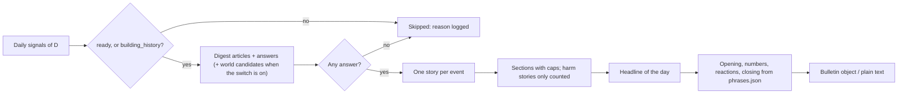

<!-- code-doc
module: src/app/core/bulletin/builder.py
covers:
  - src/app/core/bulletin/builder*.py
  - src/app/core/bulletin/phrases*
  - src/app/core/bulletin/render.py
  - src/app/storage/bulletin_input.py
-->
# Bulletin builder (bulletin, item 2)

Builds the Daily Inference bulletin of one day from the day's digest articles and their
`world_change_assessments` answers (`world_change.md`), with the fixed phrases of the phrase library.
Story text is the article title with outlet and link: the model writer is item 3. Item 2 has only a
dry run (`ai-news bulletin build --date D --dry-run`): nothing is stored, no job, no page, no model
call. Rules of voice and structure: `specs/018-daily-inference/voice.md`; editorial rules ER-* and
FR-003/FR-004/FR-006 in `specs/018-daily-inference/spec.md`.

## Behavior

**Day status**
- Signals of D with status `partial` or `unavailable`, or none stored, give no bulletin: the result
  is `skipped` with a reason (signals_partial, signals_unavailable, `no_signals`) and the CLI logs
  it. A digest of D that has no answers at all is also skipped (`no_assessments`): that is a gap in
  the pipeline, not a quiet day. Tests: `test_partial_and_unavailable_days_are_skipped`,
  `test_day_without_answers_is_skipped`, `test_cli_skipped_day_logs_reason`.
- Day type: quiet (`quiet` of the signals), else busy (items at or above `BUSY_FACTOR` times the
  median items of the previous `BUSY_WINDOW_DAYS` stored days; no busy day without `BUSY_MIN_DAYS`
  stored days), else ordinary. Quiet leaves empty sections out like every day. Tests:
  `test_day_type_openings`, `test_quiet_day_leaves_out_empty_sections`.

**Stories**
- Candidates are the day's digest articles with an answer for `WORLD_CHANGE_VERSION`, plus assessed
  world candidates only when the setting `world_stream_in_bulletin` is on (env `AINEWS_WORLD_STREAM_IN_BULLETIN`,
  default off; FR-016/FR-018). Tests: `test_world_candidates_only_with_the_switch`,
  `test_world_stream_setting_defaults_off`.
- One story per event: candidates with the same event key (a top story of the daily signals, else
  the title key of `cluster_key`) make one story; the best-confidence member leads, all outlets are
  linked. Tests: `test_one_story_per_event_with_all_outlets`.
- A story is shown only at `world_change` confidence of at least `MIN_CONFIDENCE`. Stories are
  ranked by confidence, then outlet count. Tests: `test_below_threshold_is_not_shown`,
  `test_ranking_by_confidence_then_outlets`.
- Sections (FR-003): `added`/`changed` to Key results (at most `KEY_RESULTS_MAX`, model releases at
  most `MODEL_LAUNCHES_MAX`); `issue` with actor `ai_system` to the one positive rubric story
  (`RUBRIC_MAX`); `limit` to Cooperation (at most `COOPERATION_MAX`); other `issue` stories and every
  other `issue` beyond the rubric one only count in "Isolated incidents: N". The top counted issue
  caused by people or an organisation may get a plain line "Among them". Tests:
  `test_caps_per_section`, `test_model_launches_are_capped`, `test_incidents_are_counted_with_a_plain_line`.
- Harm (ER-11): a story whose `harm_to_people` is at least `HARM_MIN` (any member of the event) is
  counted in incidents only: never headline, rubric, section story, plain line or reaction. Tests:
  `test_harm_story_is_only_counted`.

**Headline**
- Of the shown stories, the highest confidence times outlet count (ties: section order, then rank)
  whose title can be made a headline: at most `HEADLINE_MAX_WORDS` words in capitals. A longer title
  is cut at a clause boundary (after `:` `,` `;` or a dash, or before "but", "while", "because",
  "although"), at least `HEADLINE_MIN_WORDS` words kept, and carries the cut marker; the footnote
  closes the bulletin (ER-8). A story with no such boundary is skipped; when none fits the bulletin
  has no headline line. Tests: `test_headline_is_the_highest_scored_shown_story`,
  `test_long_headline_is_cut_at_a_clause_boundary`, `test_headline_without_boundary_is_skipped`.

**Fixed text** (no model call)
- Opening by day type, numbers line, rubric name, reactions and closing come from
  `phrases.json`, picked by date (ordinal plus a slot offset) so neighbouring days differ. Tests:
  `test_variants_differ_on_neighbouring_days`.
- Numbers line: the launch line when both model releases and product launches (stories of the
  signals' event counts) are above zero, else the items line. Tests: `test_numbers_line`.
- Reactions: at most one per story; the three slots below give at most three per issue. Order: the rubric story, the
  first Cooperation story, then (only when neither got one) the first Key results story whose area
  has a reaction. Tests: `test_reactions_follow_the_limits`.
- Day number: days since 2022-11-30 (Day 1429 = 2026-10-29). Tests: `test_day_number`.
- Every phrase passes the never-list of `specs/018-daily-inference/voice.md` (ER-4 words, "Administration released"); the
  loader checks the JSON shape. Tests: `test_phrases_load_and_validate`,
  `test_phrases_validation_rejects_bad_data`, `test_phrases_pass_the_never_list`.

**Output**
- The bulletin object (`Bulletin`, `as_dict`) and the plain text of `specs/018-daily-inference/voice.md` (`render_text`,
  lines wrapped at `TEXT_WIDTH`, "Full report (N) →" with the digest item count and the link
  `/daily?date=D` in the object). Outlets are shown as a list only for events with two or more.
  Tests: `test_render_text_matches_the_voice_layout`.
- `ai-news bulletin build --date D --dry-run [--json]` prints the text, or with `--json` the object
  only. Without `--dry-run` it exits 2 (storage comes in item 4); a day without a digest exits 2; a
  skipped day prints nothing on stdout, logs `bulletin_skipped` and exits 0. Tests:
  `test_cli_dry_run_prints_text`, `test_cli_json_prints_the_object`, `test_cli_needs_dry_run`,
  `test_cli_no_digest`, `test_cli_skipped_day_logs_reason`.

## Decisions

- The core takes plain data (`DayInput`) and never reads the database: the loader
  (`storage/bulletin_input.py`) is the edge. A test pins that the core imports no I/O module.
- Thresholds start at item 1's proposal (`MIN_CONFIDENCE` 0.7, `HARM_MIN` 0.7); they move after the
  FR-002 check and the first days.
- Counts of the numbers line are stories of the signals' `event_counts`, not articles, so one launch
  covered by five outlets is one new model (decided 2026-11-01 (agent)).
- `ai_issue_with_fix` ("reminds humans to update their software") is in the library but never
  picked here: it needs a source that says a fix exists, which the writer (item 3) can check
  (decided 2026-11-01 (agent)).
- A top-ranked non-AI incident supplies the "Among them" line when actor is `people` or
  `organisation` (decided 2026-11-01 (agent): the voice file says "caused by people").
- The story key from signals' top stories merges outlets that the title key would not.

## Invariants

- No sentence in the bulletin that is not a fixed phrase or an article title.
- Every story has at least one link of its day or of an assessed world candidate.
- A harm story is never in a section, headline or reaction.
- The same input and date give the same bulletin.

## Code map

| Where | What |
| --- | --- |
| `src/app/core/bulletin/builder.py` | constants, `Candidate`, `DayInput`, `Story`, `Bulletin`, `build_bulletin` |
| `src/app/core/bulletin/phrases.json` | the phrase library (data) |
| `src/app/core/bulletin/phrases.py` | `load_phrases`, validation and the never-list |
| `src/app/core/bulletin/render.py` | `render_text` |
| `src/app/storage/bulletin_input.py` | `load_day_input`: digest, answers, signals, median, world candidates |
| `src/app/config/settings.py` | `world_stream_in_bulletin` |
| `src/app/cli/main.py` | `bulletin build` |

## Tests

`tests/unit/test_bulletin_builder.py`: phrases, caps, dedup, harm, headline, reactions, day status,
switch, render, command.
