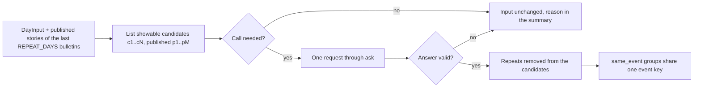

<!-- code-doc
module: src/app/core/bulletin/repeats.py
covers:
  - src/app/core/bulletin/repeats.py
-->
# Bulletin repeats (018, event-level repeats)

Keeps an event out of the bulletin when a bulletin of the last `REPEAT_DAYS` days already told it,
and merges today's candidates that report one event. The free URL and title-key check lives in
`day_input.py` (`builder.md`); this model check catches what it cannot: the same event under another
outlet and another title. One extra model call a day (owner approved 2026-11-15). Pure: the call is
the `ask` argument; the wiring is in `usecases/bulletin/daily.md`.

## Behavior

- Listed candidates are those that can be shown (`showable` of `builder.py`: `world_change` is not
  `none`, the confidence is at least `MIN_CONFIDENCE` and the `kind` is in `SHOWN_KINDS`); at most `REPEATS_MAX_CANDIDATES` by confidence (stable on ties), ids
  `c1..cN`, each with title and outlet. Published stories get ids `p1..pM`, each with day and the
  title shown (the headline when the writer made one, else the title). Titles are cut to
  `TITLE_MAX` characters. No article text is sent. Tests: `test_unshowable_candidates_are_not_listed`,
  `test_repeat_check_lists_only_showable_kinds`,
  `test_listing_is_capped_by_confidence`, `test_request_holds_titles_but_no_article_text`.
- No call without a listed candidate, and none when there is no published story and fewer than two
  candidates; the summary says why (`no_candidates`, `nothing_to_compare`). Tests:
  `test_no_listed_candidate_no_call`, `test_one_candidate_and_no_published_story_no_call`.
- One request, built like the writer's (`request_body`, `WRITER_MODEL`, `REPEATS_PROMPT`, at most
  `REPEATS_MAX_OUTPUT` tokens); the prompt names `REPEATS_VERSION` and asks for JSON only:
  `{"repeats": [{"candidate": "c3", "published": "p2"}], "same_event": [["c1", "c4"]]}`. A repeat
  is a candidate that reports the same event as a published story and whose title shows no new
  development (a decision, ruling, number or step the published story did not have). `same_event`
  groups today's candidates that report one event. When unsure the model lists nothing. Tests:
  `test_request_holds_titles_but_no_article_text`.
- The answer check is strict: a JSON object with exactly the keys `repeats` and `same_event`, known
  ids only, a candidate at most once in `repeats` and in at most one group, groups of two or more.
  Anything else, or a truncated or foreign-model answer, gives reason `invalid_answer` and nothing is
  dropped or merged. A provider reason from `ask` (cap, outage, failure) is recorded the same way.
  Tests: `test_invalid_answer_changes_nothing`, `test_provider_reason_keeps_everything`.
- A repeat pair from the model is applied only when the candidate title shares at least one word
  with the published story's shown title or its original title. A word is a run of `\w`
  characters, compared casefolded, of at least `REPEAT_MIN_WORD` characters. A pair without a
  shared word is not applied: the candidate stays (`same_event` can still merge it) and is listed
  in `kept`. True repeats across languages with no common word are kept too. Tests:
  `test_repeat_without_a_shared_word_is_kept`, `test_repeat_with_a_shared_word_is_dropped`,
  `test_shared_word_may_come_from_the_original_title`, `test_short_words_do_not_count_as_shared`.
- `repeats` is only for a candidate that tells the same event as a story in `published`; two of
  today's candidates about one event go only in `same_event`. `REPEATS_PROMPT` says so
  (`REPEATS_VERSION` `bulletin-repeats-2`). Code guard: a repeat pair is not applied when its
  candidate is in a `same_event` group that has a member not listed in `repeats` (the model
  contradicts itself: had the event been published, every member would be a repeat). Such a pair
  is kept (`kept` reason `same_event_conflict`) and the group is merged as usual. When every
  member of the group is listed in `repeats`, the pairs are applied. The shared-word check comes
  first. Tests: `test_prompt_says_duplicates_of_today_are_not_repeats`,
  `test_repeat_inside_a_partly_repeated_group_is_kept`, `test_fully_repeated_group_is_dropped`.
- A candidate in `repeats` that passes the checks above is removed from `DayInput.candidates`; a removed digest candidate adds to
  `DayInput.digest_left_out`, so the assessed share still counts it. Tests: `test_repeat_is_dropped`.
- Candidates of one group (those not removed) get the `event_key` of the best member (confidence,
  then listing order), so `build_bulletin` makes one story with all outlets. A group left with one
  member after removals is not merged. Candidates not listed are untouched. Tests:
  `test_same_event_sets_one_event_key`, `test_same_event_builds_one_story_with_both_outlets`,
  `test_dropped_member_is_not_merged`.
- The summary (stored in `numbers["repeats"]`): `version`, `model`, `reason` (None when applied),
  `candidates` and `published` (counts listed), `dropped` (`title`, `published_day`,
  `published_title`), `merged` (lists of titles), `kept` (repeat pairs not applied: `title`,
  `published_day`, `published_title`, `reason` `no_shared_word` or `same_event_conflict`; `[]` when none). Tests: `test_repeat_is_dropped`,
  `test_same_event_sets_one_event_key`, `test_repeat_without_a_shared_word_is_kept`.

## Decisions

- decided 2026-11-15 (agent): any malformed answer is one reason, `invalid_answer`; the bulletin
  must go out, so a bad answer costs only the check.
- decided 2026-11-15 (agent): when unsure the model lists nothing; a missed repeat is cheaper than
  a lost story.
- decided 2026-11-16 (agent): a cheap shared-word guard (night of 2026-11-15: the model paired a
  Korean exam story with a smartglasses story and the story was lost); a true repeat with no
  common word is kept, consistent with "a missed repeat is cheaper than a lost story".
- decided 2026-11-15 (agent): the model sees titles only; an event is recognised from titles, and
  article text would raise the cost for little gain.
- decided 2026-11-15 (agent): the published side shows the headline the readers saw, since that
  is what a repeat has to be recognised against.
- decided 2026-11-17 (agent): night of 2026-11-16 the model listed four of five same-story
  candidates as repeats of an unrelated published story (same shape on 2026-11-15); the prompt
  now separates the two lists and the code refuses a repeat inside a partly repeated group, since
  a missed repeat is cheaper than a lost story. It also keeps a true repeat when the model forgets
  one member of the group.

## Invariants

- No I/O in this module; the model call is `ask`.
- `check_repeats` never raises for any model answer (ids of any JSON type included) or for a
  reason returned by `ask`, and never drops a candidate on a fault. A journal that cannot be
  opened is caught by the caller (`daily.md`).
- The input `DayInput` is not changed; a new one is returned.

## Code map

| Where | What |
| --- | --- |
| `src/app/core/bulletin/repeats.py` | constants, `PublishedStory`, `check_repeats`, `repeats_body`, `REPEATS_PROMPT` |
| `src/app/usecases/bulletin/day_input.py` | `published_stories`: the stories of the last `REPEAT_DAYS` ready bulletins |
| `src/app/usecases/bulletin/daily.py` | `run_daily` runs the check between load and build |

## Tests

`tests/unit/test_bulletin_repeats.py`: listing, no-call cases, answer check, drop, merge, request.
