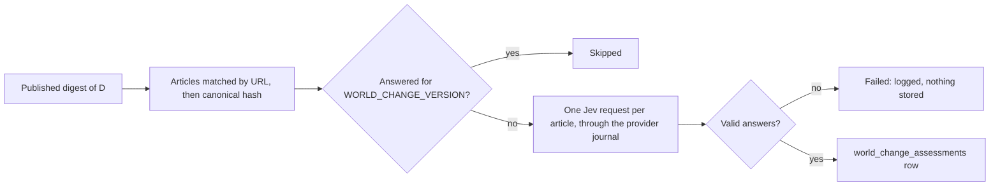

<!-- code-doc
module: src/app/core/bulletin/world_change.py
covers:
  - src/app/core/bulletin/world_change*.py
  - src/app/storage/world_change.py
  - src/app/storage/migrations/versions/*world_change*.py
-->
# World change questions (bulletin, item 1)

For one article, four Jev questions say what AI changed in the world: `world_change`, `area`,
`actor` and `harm_to_people`. The bulletin of spec 018 (`specs/018-daily-inference/spec.md`, FR-001)
will pick its stories from these answers; this feature only asks, validates and stores them. No
daily job runs it yet (spec item 4); the operator command is `ai-news bulletin assess`.

## Behavior

**Questions**
- Four questions, one separate request per article: `world_change` (choice: `added`, `changed`,
  `issue`, `limit`, `none`), `area` (choice: the 13 areas of `specs/018-daily-inference/voice.md`), `actor` (choice:
  `ai_system`, `people`, `organisation`) and `harm_to_people` (noul: probability of real harm to
  people). The shape is the one of `QUESTIONS` in `rubric.py`; the admission rubric and
  `RUBRIC_VERSION` are not touched. Tests: `test_questions_shape_and_version`,
  `test_request_has_only_the_four_questions`.
- The criteria carry the same definitions as the reference labelling prompt
  (`specs/018-daily-inference/records/prompt-item1-labels-2026-10-31.md`), so labels and Jev answer
  one question. Changing any question text changes `WORLD_CHANGE_VERSION`. Tests:
  `test_questions_shape_and_version`.

**Request**
- The state is the text the daily enrichment sends: title and content, or title, summary and content
  when the article has no content. Tests: `test_state_matches_daily_enrichment`.
- The request goes through the provider journal (`PilotJournal`, provider `jev`) when one is given:
  a reserved, capped, replayable call. Tests: `test_assess_uses_the_provider_journal`.
- Probabilities are validated like `_probability`; an unknown choice, a missing answer or a bad
  probability makes the whole assessment invalid. Tests: `test_invalid_answers_return_none`.
- A transport, HTTP or parse failure returns `None` and is logged; `assess` never raises into
  callers. A journal stop (cap reached, unreviewed failed call), exhausted transport attempts
  (an outage) or a `sqlite3.Error` of the journal also returns `None` and sets `stopped`, so a
  loop can end. Tests: `test_transport_failure_returns_none`, `test_journal_stop_sets_stopped`,
  `test_journal_errors_stop_without_raising`.

**Storage**
- One row per article hash and question version (`world_change_assessments`); a second save of the
  same pair changes nothing. `article_id` is nullable: articles are pruned, the hash stays. Tests:
  `test_storage_is_idempotent_per_version`.
- A newer `WORLD_CHANGE_VERSION` starts a new set of rows; old rows stay. Tests:
  `test_storage_is_idempotent_per_version`.

**Command** `ai-news bulletin assess --date D [--max-usd X] [--dry-run]`
- Scope: the articles of the published digest of D (the scope of daily signals). A day without a
  digest is an error (exit 2). Articles already answered for the current version are skipped.
  Tests: `test_cli_assess_skips_answered_and_summarizes`, `test_cli_assess_needs_a_digest`,
  `test_run_assessment_counts`.
- A failed article counts in `failed` and stores nothing; after a stop the rest is
  `not_attempted`. Tests: `test_run_assessment_failures_store_nothing`,
  `test_run_assessment_stops_after_journal_stop`.
- A real run needs `JEV_API_KEY`; without it the command exits 2. Tests: `test_cli_assess_needs_a_key`.
- Prints one JSON summary: `assessed`, `skipped`, `failed`, `unmatched` (digest URLs without a
  stored article), `not_attempted` (after a journal stop), `by_choice`, `cost_usd`. Tests:
  `test_cli_assess_skips_answered_and_summarizes`.
- `--dry-run` sends nothing, writes nothing (no table creation, no journal), needs no key. Tests:
  `test_cli_dry_run_makes_no_request`, `test_cli_dry_run_does_not_create_tables`.
- The cap `--max-usd` (default `ASSESS_DEFAULT_MAX_USD`) is a journal cap; the journal lives in
  `data/bulletin/<D>/` per cap. `--max-usd` above `WORLD_CHANGE_MAX_USD_PER_DAY` is rejected.
  Known limit: another cap value opens another journal, so spend of one day can add up to a few
  caps; the ceiling bounds each run, not the day. Tests: `test_cli_assess_skips_answered_and_summarizes`,
  `test_cli_rejects_max_usd_above_ceiling`; the per-cap journal itself has no test.
- When a rerun stops with `unknown_or_failed_previous_call_requires_review`, an earlier call of
  that journal is unresolved (it may have been billed). The operator checks the log line
  `bulletin_assess_usage` and the journal file `data/bulletin/<D>/journal-*.sqlite3`, then either
  runs with a different `--max-usd` (new journal) or deletes that file after accepting the risk
  of paying that call twice. No test.

**Reuse by the world stream**
- `WorldChangeAssessor.ask(body, parse, event)` is the one place that sends a request through the
  journal and turns journal stops and failures into `None` / `stopped`; `assess` is `ask` with the
  four questions. `open_assessor` takes a `root`, a journal `version` and a `usage_event`, so the
  world stream (`core/world/world.md`, step W5) opens its own journal and its step B asks these
  same questions. The defaults keep `bulletin assess` as described above. Tests:
  `test_request_has_only_the_four_questions`, `test_world_journal_is_separate_from_digest_cap`.

## Decisions

- Separate request, own question set: keeps the validated admission rubric and its version
  untouched (spec FR-001).
- `harm_to_people` stores the probability, not yes/no: the bulletin decides the threshold (FR-003).
- A bad answer in one of four questions drops the whole assessment: a half-answered row would let
  the bulletin treat a missing `harm_to_people` as "no" (decided 2026-10-31 (agent)).
- The state function repeats the daily rule instead of importing `JevRelevanceScorer.state`, which
  needs a scorer object; a test pins that both give the same text.
- Journal per day and cap: the journal identity includes the caps, so a different `--max-usd`
  needs its own file (decided 2026-10-31 (agent)).

## Invariants

- `rubric.py` and `RUBRIC_VERSION` are unchanged by this feature.
- No row without four valid answers; no request without a journal in the command.
- `assess` does not raise for provider or parse errors.
- Unique (`url_canonical_hash`, `question_version`).

## Code map

| Where | What |
| --- | --- |
| `src/app/core/bulletin/world_change.py` | questions, `WORLD_CHANGE_VERSION`, `WorldChange`, `WorldChangeAssessor`, `world_change_state`, `run_assessment` |
| `src/app/storage/world_change.py` | `WorldChangeRepo` |
| `src/app/storage/models_sql.py` | `WorldChangeAssessment` |
| `src/app/storage/migrations/versions/b8e2d4f61a07_add_world_change_assessments.py` | creates the table only when missing; downgrade drops it |
| `src/app/cli/main.py` | `bulletin assess` |
| `specs/018-daily-inference/records/eval_world_change.py` | offline check against labels (FR-002); not product code |

## Tests

`tests/unit/test_world_change.py`: questions, state, request body, parsing, failures, storage,
command, migration round trip.
