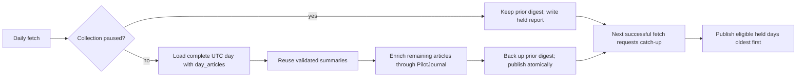

<!-- code-doc
module: src/app/core/daily/enrichment.py
covers:
  - src/app/core/daily/enrichment.py
  - scripts/run_daily_digest_job.sh
  - scripts/run_daily_fetch_job.sh
-->
# Daily digest enrichment

## Behavior

- `day_articles` selects the complete stored UTC day; previously validated summaries are reused.
  Tests: `test_complete_day_more_than_200_and_preserves_history`,
  `test_new_summary_review_then_resume_without_provider_calls`.
- Remaining articles use `PilotJournal`, bounded by `CAPS`; uncertain transport failures retain
  their reservation and retry under `TRANSPORT_REVIEW_REASON` and `TRANSPORT_RETRY_DELAYS`.
  Tests: `test_dropped_connection_is_retried_after_one_then_five_minutes`,
  `test_transport_retries_exhausted_fails_day_without_more_dispatch`.
- A collection pause is checked before provider setup. It writes `held_collection_paused`, makes no
  provider call and leaves the previous digest unchanged. Tests:
  `test_paused_collection_holds_day_without_paid_calls`,
  `test_daily_publish_exits_two_for_held_collection`.
- Publication backs up an existing digest, commits the new groups, and records the report with
  `private_write`. Failed work keeps the prior digest. Tests:
  `test_new_summary_review_then_resume_without_provider_calls`,
  `test_failure_retains_good_digest_and_records_reason`.
- `--catch-up` considers the last `DAILY_CATCH_UP_DAYS` completed UTC days, oldest first: days with
  a latest `held_collection_paused` report and yesterday when no report exists. The digest job runs
  signals for days it publishes; the fetch job requests catch-up after a successful fetch when a
  recent held report exists. After the daily signals the job runs `ai-news period-signals` (017) under
  the same lock with its own bounded timeout; its failure never changes the job result. Tests:
  `test_daily_job_period_signals_failure_keeps_success_and_removes_container`,
  `test_catch_up_publishes_held_days_oldest_first`,
  `test_catch_up_keeps_days_held_while_paused`, `test_catch_up_ignores_days_older_than_limit`,
  `test_daily_publish_catch_up_exits_two_when_a_day_is_held`,
  `test_digest_job_held_skips_signals_and_exits_zero`,
  `test_digest_job_catch_up_runs_signals_for_each_published_day`,
  `test_fetch_job_runs_catch_up_only_after_success_with_recent_hold`,
  `test_fetch_job_preserves_success_status_when_catch_up_fails`,
  `test_nightly_health_workflow_is_read_only`.
- Nightly health (`.github/workflows/nightly-health.yml`, 03:00 UTC, read-only) fails, and GitHub
  e-mails the failure, when collection is paused, today's fetch did not finish, yesterday's digest
  is not published with a scope of at least 5, or yesterday's daily-signals report in
  `logs/daily-digest.log` is missing, has a state other than `ok` (`cap_reached`,
  `deadline_reached`, ...) or a skipped brief. Tests: `test_nightly_health_workflow_is_read_only`,
  `test_nightly_health_flags_signals_stopped_by_a_limit`.
- The first summary request (`grounded_summary`, attempt 0) carries the rule tagged
  `SUMMARY_PROMPT_VERSION`: every name, number, role, product and attribution in a sentence appears
  in its own quote, and a claim is attributed only to a speaker its quote names. The repair requests
  and the review are unchanged. `enrichment_provenance` records the version as `summary_prompt`.
  Tests: `test_first_summary_request_keeps_details_in_quote`,
  `test_provenance_records_summary_prompt_version`.

## Decisions

- 2026-10-22 (owner): during a collection pause, publish the digest later when complete rather than
  on time with an incomplete one.
- 2026-10-22 (agent): nightly health requires a digest scope of at least 5,
  based on the observed scope of 11-100 on 2026-10-10..20 and 1 on the broken night.
- 2026-10-30 (owner): a paid cap or deadline that leaves a day unprocessed is reported by the
  nightly health failure e-mail from GitHub, not by a separate alert channel.
- 2026-10-24 (owner): the first summary request keeps every detail inside its quote (pilots 1-3,
  `docs/archive/2026-10/report-summary-grounding-pilot-2026-10-24.md`); a stricter review gate was rejected because
  it held ~20% of the digest.

## Invariants

- A held or failed publication never replaces an existing digest.
- Only completed UTC days are eligible for publication or catch-up.
- Daily fetch and digest share the host lock; catch-up stays inside the existing job budget.
- Summaries already published are reused as before: `reusable` does not depend on the summary
  prompt version. Tests: `test_reuse_ignores_summary_prompt_version`.

## Code map

- `enrichment.py`: day scope, validation/reuse, provider journal, publication and catch-up selection.
- `cli/main.py`: `daily-publish` options and exit codes.
- `run_daily_fetch_job.sh`: fetch lock and post-fetch catch-up dispatch.
- `run_daily_digest_job.sh`: publication, held result handling, signals and shared budget.
- `.github/workflows/nightly-health.yml`: read-only checks for collection, fetch, digest and signals health.

## Tests

- `tests/unit/test_daily_enrichment.py`: publication, reuse, holds and catch-up selection;
  `test_source_row_*` pin source selection (admitted stored content, extracted page, date checks,
  stored fallback).
- `tests/unit/test_deepseek_digest.py`: digest/fetch job shells and nightly workflow safety checks.
