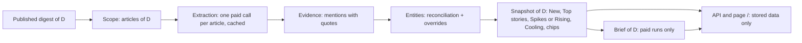

<!-- code-doc
module: src/app/core/daily/signals.py
covers:
  - src/app/core/daily/signals*.py
  - src/app/storage/daily_signals*.py
  - src/app/storage/migrations/versions/*daily_signal*.py
  - src/app/web/signals_view.py
-->
# Daily AI Signals

The block at the top of `/` for one published digest day D: a short brief, what is new, which stories
several publishers covered, what is spiking or rising, what is cooling, and how many events of each
type happened. Everything is computed from stored data; page loads never call a provider.

This file is the intended current behavior of 006 (signals) and 007 (brief): change it first, then the
code and tests. `specs/006-daily-ai-signals/` and `specs/007-daily-signals-brief/` are the history of
how it got here. Operator commands, cost, rollback: `docs/daily-signals.md`.

## Behavior



Rules name their limits; the numbers live in the code: fields of `Thresholds` in
`signals_compute.py`, constants of the extract and brief modules. Each rule lists the tests
that check it.

**Scope and days**
- Only articles of the published digest of D count, matched by URL, then by canonical URL hash.
  Tests: `test_membership_exact_canonical_and_unmatched`.
- A day with a digest row is published even with 0 items; a missing day never counts as zero
  attention. A day is complete when at least `complete_ratio` of its items are extracted.
  Tests: `test_missing_and_empty_days`, `test_observed_empty_days_count_as_zero_but_zero_volume_is_unusable`.
- Days before `AINEWS_DAILY_SIGNALS_COMPARABLE_FROM` are history only: they feed "first seen", get
  no snapshot. Tests: `test_kind_by_comparable_from`.
- Day status: `unavailable`, `partial`, `building_history`, `ready`. Tests: `test_status_precedence`.

**Extraction and entities**
- One provider call per in-scope article, cached by content hash and `EXTRACTION_VERSION`.
  Tests: `test_one_call_per_article_then_cached`, `test_cache_by_content_hash_and_failures`.
- Names and quotes must occur in the article text; a quote that dates the release before the
  article clears "new" (`is_retrospective`). Tests: `test_entity_shape_and_grounding`,
  `test_retrospective_quote_clears_is_new`.
- Short content falls back to title and RSS summary (`input_kind`); a title-only article still
  counts as processed. Tests: `test_short_content_falls_back_to_title_and_summary`,
  `test_history_article_without_body_uses_summary_and_records_input_kind`.
- Mentions are evidence that survives article retention; entities are a pure function of evidence
  and operator overrides (`reconcile`). Tests: `test_reconcile_is_permutation_invariant`,
  `test_prune_keeps_evidence_and_first_seen_then_purge`, `test_first_seen_independent_of_insertion_order`.
- Entities with conflicting vendors (`needs_review`) never enter New, Rising or spikes.
  Tests: `test_person_other_and_question_entities_never_new`, `test_question_entities_excluded_from_trends`.

**New**
- New: first seen in our corpus on D and presented as newly announced by an article of D (primary
  mention with `is_new` and a quote). Tests: `test_new_needs_primary_and_is_new_in_one_article`.
- Confirmed items (`confirmed_publishers`) first, then single-source ones in `EARLY_TYPE_ORDER`; at
  most `new_max`; a history note while fewer than `history_note_days` complete days precede D.
  Tests: `test_us1_confirmed_early_alias_and_history_note`, `test_cp1_new_ordering_early_models_before_products`.
- Not New: people and "other"; packaging variants of a known model (`PACKAGING`); names that do not
  look like names (`proper_name`); names already in an earlier published digest item
  (`LexicalHistory`). An earlier text that frames the name as not yet released (`NOT_RELEASED`)
  does not count, so a GA after a preview stays New. A single common-word name is refused this way
  only when its vendor appears in the same item. Refused items stay in the snapshot as
  `new_suppressed`. Tests: `test_packaging_variant_of_known_model_not_new`,
  `test_generic_lowercase_feature_names_are_not_new`, `test_new_suppressed_by_title_or_summary_history`,
  `test_lexical_hit_in_not_yet_released_text_is_ignored`, `test_parenthetical_prerelease_does_not_suppress_ga`,
  `test_single_token_needs_the_vendor_name_in_the_same_item`.
- Each item has one line without a provider call (`one_liner`): a digest-summary sentence that names
  it with a launch or "is a" verb, else the novelty quote; at most `one_liner_max` characters.
  Tests: `test_one_liner_rules`, `test_one_liners_of_the_40_dry_run_items`.
- `variant of X` only for a specific earlier entity (`specific_variant`), never a family word
  (`FAMILY_STOPWORDS`). Tests: `test_variant_of_only_for_a_specific_earlier_entity`.

**Other sections**
- Top stories: clusters of one event with at least `top_min_publishers`, at most `top_max`.
  Tests: `test_us2_one_story_per_event_and_ordering`, `test_fixture_stories`.
- Rising and Cooling: last 7 days against the previous 7 with a volume-adjusted expectation; both
  windows need `window_min_complete` complete days. Cooling only then, collapsed by default.
  Tests: `test_rising_and_cooling_with_usable_windows`, `test_windows_need_six_complete_days_and_comparable_range`.
- Spikes, until Rising is usable: D against the mean of complete trailing days. A spike that
  duplicates a shown item folds into it; a company spike without a story is dropped; kept spikes
  show the label of D's main story. Folded and dropped ones stay in the snapshot as `spikes_folded`.
  Tests: `test_spikes_from_complete_trailing_days`, `test_spikes_fold_into_story_by_entity_label_and_vendor`,
  `test_spike_reason_line`,
  `test_org_spike_folds_into_new_item_or_earlier_spike_by_vendor`,
  `test_diffuse_company_spike_dropped_and_reason_is_largest_story`.
- Event chips: stories per hard event type (`HARD_EVENTS`), the rest as "+N more"; display only.
  Tests: `test_top_stories_events_and_status`, `test_d3_one_liners_spike_tags_chips_and_hidden_spikes`.
- Quiet day (fewer than `quiet_items` items or no multi-publisher story): a template opening line
  with the counts, then only the cards that have items. Tests: `test_quiet_flag_thresholds_and_methodology`,
  `test_quiet_day_render`.

**Brief**
- A paid run writes one brief per target day from the snapshot and the digest summaries of D
  (`brief_packet`, bounded by `PACKET_MAX_BYTES`; on a quiet day the digest items, at most
  `QUIET_ARTICLES_MAX`). Tests: `test_packet_shrinks_summaries_to_the_byte_cap`,
  `test_quiet_packet_takes_at_most_30_digest_items_and_digest_publisher`.
- The answer is checked mechanically (`parse_brief`): known article ids, an exact quote, numbers and
  names present in the cited text, one sentence per story, 3-5 sentences (1-2 on a quiet day).
  Shown with numbered source links and an AI note. Tests: `test_sentence_codes`,
  `test_answer_level_codes`, `test_grounding_allowances`, `test_brief_rendered_escaped_with_http_links_and_ai_note`.
- An invalid answer gets one recovery attempt, then the day is stored `invalid` and shows no brief.
  Tests: `test_invalid_answer_recovers_or_is_stored_invalid`, `test_invalid_or_unreadable_brief_is_null`.
- A brief is keyed by `input_hash`: the same input is never paid twice, a changed snapshot is
  regenerated on the next paid run. Tests: `test_one_day_brief_then_cached_then_regenerated`,
  `test_input_hash_changes_with_packet_version_and_model`.
- Target days: the run's days with a usable snapshot, plus D-1 in a one-day run when D-1 has no
  current `ok` brief. Tests: `test_backfill_range_and_one_day_catch_up`.

## Decisions

| Decision | Why |
| --- | --- |
| Scope = published digest of D, not all ingested articles | non-AI and non-admitted items never enter analytics (same scope as the digest) |
| One extraction call per article, separate from the digest summary call | digest prompts and replays stay pinned; one bad answer loses one article, not a batch |
| Entities derived from stored evidence by a pure function + overrides | same evidence gives same entities in any arrival or backfill order; fixes are replayable |
| Evidence survives retention and cleanup | "first seen" must not move forward when old articles are pruned |
| New = first seen in our corpus and presented as new by the article (model judgment, with quote) | New means newly announced, not merely new to our corpus (OD1) |
| Lexical safety nets after the model (name shape, earlier digest text, not-yet-released words) | prompt revisions stopped at `daily-signals-extract-5`; remaining errors are fixed in code at $0 |
| Thresholds are code constants recorded in every snapshot, no runtime override | a snapshot is reproducible; a change is a release with a `METHODOLOGY_VERSION` bump |
| Rising waits for two usable 7-day windows; spikes until then | a comparison needs enough complete days on both sides (OD3) |
| Brief in its own table keyed by input hash, not in the snapshot | snapshot hash stays pure; a recompute never drops a paid brief; same input never paid twice |
| Brief validated mechanically, meaning not checked | catches invented names, numbers and quotes without a second model call |
| Quiet-day opening line is a template, not model output | counts are our facts |
| Chips are display only | filtering the digest was deferred (OD4) |
| Signals run only after a successful publication; failure never changes the job result | the digest job must not depend on the signals block |

## Invariants

- Page loads and the API never call a provider; a missing or unreadable snapshot or brief gives
  `brief: null` or an unavailable state, never a 500. Tests: `test_missing_snapshot_is_unavailable`,
  `test_corrupt_payload_is_unavailable_with_note`, `test_signals_read_error_keeps_page`,
  `test_page_200_with_a_corrupt_brief_row`, `test_trend_without_expected_value_and_any_render_error_keep_page`.
- Signals write only their own tables; the digest, articles, weekly and every other table stay
  unchanged by a paid run with briefs and a full recompute. Tests: `test_signals_write_only_their_own_tables`.
- `--max-usd` is the total for a run: extraction first, briefs get the remainder, at most
  `BRIEF_MAX_USD_PER_DAY` per target day. Tests: `test_max_usd_is_the_run_total`.
- A brief failure never changes the extraction `state`, its results or the snapshots.
  Tests: `test_brief_failure_never_breaks_the_run`, `test_ledger_stop_skips_briefs_and_keeps_extraction`.
- Server and client renderers produce the same markup; change both together.
  Tests: `test_client_renderer_matches_server_classes` (shared classes, texts and `HARD_EVENTS`;
  the full markup is not compared).
- Brief text is validated mechanically; meaning is not checked.

# Code map

## Flow

```text
scripts/run_daily_digest_job.sh (02:00 UTC, after the digest)
  -> ai-news daily-signals                       src/app/cli/main.py: daily_signals
  -> run_signals                                 core/daily/signals.py
       _gate                    flag AINEWS_DAILY_SIGNALS_ENABLED + DS key; else state disabled/missing_provider_key
       repo.replace_membership  digest items of D -> articles (exact URL, then canonical hash)
       _extract_days            one DeepSeek call per in-scope article, via SignalsLedger
       repo.recompute_reports   reconcile entities, compute_snapshot per day, store if payload changed
       _briefs                  one brief call per target day (paid runs only), via a second ledger run
  -> JSON run report (stdout + data/daily-signals/runs/<run_id>.json)

GET /api/news/daily-signals?date=D               web/app.py: _read_daily_signals (DB reads only)
GET /?date=D                                     web/signals_view.py: render_signals (server)
                                                 web/digest.html: renderSignals (client, same markup)
```

## Modules

| File | Role | Pure |
| --- | --- | --- |
| `core/daily/signals.py` | Run orchestration, brief step, operator entity commands (`merge_entities`, `alias_entity`) | no |
| `core/daily/signals_extract.py` | Extraction prompt, request body, answer validation (`EXTRACTION_VERSION`) | yes |
| `core/daily/signals_entities.py` | Deterministic entity identity: keys, vendor classes, reconciliation, overrides | yes |
| `core/daily/signals_compute.py` | Snapshot of one day (`compute_snapshot`, `Thresholds`, `one_liner`, folding, quiet flag) | yes |
| `core/daily/signals_brief.py` | Brief packet, prompt, request body, validation rules 1-9, O1 review marker | yes |
| `storage/daily_signals.py` | `DailySignalRepo`: membership, extractions, evidence, entities, overrides, snapshots, briefs | no |
| `storage/daily_signals_ledger.py` | `SignalsLedger`: private SQLite of physical POSTs, replay, per-run caps, per-model prices | no |
| `web/signals_view.py` | Server HTML of the block; `quiet_line`, chips, D3 New list | yes |
| `web/models.py` | `DailySignalsResponse` and nested API models (only optional fields added after 006) | - |
| `web/digest.html` | `renderSignals`: client re-render on date change; must match `signals_view.py` | - |

## Tables

| Table | Holds | FK to `articles` |
| --- | --- | --- |
| `daily_signal_scope` | digest item -> article membership per day | cascade |
| `article_signals` | extraction per article, content hash, version | cascade |
| `signal_mentions` | evidence (mentions with quotes); survives retention | none |
| `ai_entities` | derived entities (rebuilt by reconciliation) | none |
| `ai_entity_overrides` | operator merges/aliases by stable selector keys | none |
| `daily_signal_reports` | one snapshot payload (JSON) per day, methodology version | none |
| `daily_signal_briefs` | one brief per day: status `ok`/`invalid`, input hash, model, payload | none |

Migrations: `b6d1f0a7c3e5` (006), `c3a8e5d27f14` (007); both skip objects that `create_all()` made.
Ledger and run reports live in `data/daily-signals/` (not in the database).

## Versions

| Constant | File | Bump when | After deploy |
| --- | --- | --- | --- |
| `EXTRACTION_VERSION` | `signals_extract.py` | prompt or validation of extraction changes | paid re-extraction (backfill) |
| `METHODOLOGY_VERSION` | `signals_compute.py` | thresholds or snapshot rules change | `--recompute-only --recompute-all` ($0) |
| `BRIEF_VERSION` | `signals_brief.py` | brief prompt, packet or validation changes | brief backfill (paid) |

The brief `input_hash` covers packet, `BRIEF_VERSION` and model: an unchanged input is never paid
twice; a row with the same hash is reused even when `invalid`.

## Where to change what

| Change | Place | Also |
| --- | --- | --- |
| New/Top/Spike/Rising thresholds | `Thresholds` in `signals_compute.py` | bump `METHODOLOGY_VERSION` |
| Family words for `variant of` | `FAMILY_STOPWORDS` in `signals_compute.py` | methodology bump |
| Hard event types (chips, brief order) | `HARD_EVENTS` in `signals_brief.py` | view uses the same tuple |
| Review marker (O1) | `REVIEW_TITLE`, `REVIEW_SHARE` in `signals_brief.py` | `BRIEF_VERSION` bump |
| Brief prompt / rules | `BRIEF_PROMPT`, `parse_brief` in `signals_brief.py` | `BRIEF_VERSION` bump, fixtures |
| Brief model / prices | setting `daily_signals_brief_model`; `BRIEF_PRICES` | unknown model -> `brief_model_unpriced`, no call |
| Extraction prompt | `signals_extract.py` | `EXTRACTION_VERSION` bump (paid) |
| Entity merge rules | `signals_entities.py` | operator overrides for single cases |
| Block markup | `signals_view.py` and `renderSignals` in `digest.html` | both |
| API fields | `web/models.py` | optional fields only |

## Tests

Per rule: see Behavior and Invariants. Files: `tests/unit/test_daily_signals_*.py`,
`test_cli_daily_signals.py`, `test_web_daily_signals_api.py`, `test_web_public_digest.py`; brief
fixtures in `tests/fixtures/daily_signals/brief/`. Tests never call a provider
(`httpx.MockTransport`). PostgreSQL integration runs only with `AINEWS_TEST_POSTGRES_URL` (see
`docs/troubleshooting.md`).
