<!-- code-doc
module: src/app/core/ingestion/pipeline/cycle.py
covers:
  - src/app/core/ingestion/pipeline/*.py
  - src/app/core/ingestion/admission.py
  - src/app/core/ingestion/scoring.py
  - src/app/core/canonicalize.py
  - src/app/core/jev.py
  - src/app/storage/provider_journal.py
  - src/app/storage/admission.py
  - src/app/ingest/*.py
-->
# Fetch pipeline (news ingestion)

One fetch cycle (`run_fetch_cycle`): read the configured and DB-managed sources, fetch RSS feeds
and HTML list pages, drop non-news pages, optionally screen each new candidate with Jev (semantic
admission), score it and store it as an article. A source failure never stops the cycle. Every
`ai-news fetch --once`, scheduled job and web "update" runs this function.

This file is the intended current behavior of 001 (collector), 002 (fetch optimization), the
non-news page filter and semantic admission. Change it first, then the code and tests.
`specs/001-ai-news-collector/`, `specs/002-fetch-pipeline-optimization/` and the October 2026
records in `docs/archive/2026-10/` are the history. Settings and operator notes:
`docs/configuration.md`, `docs/cli.md`.

## Behavior

```mermaid
flowchart LR
  sources["Sources: sources.yaml + enabled DB sources"] --> fetch["Fetch: RSS feed / HTML list page, conditional"]
  fetch --> filter["Page filter: URL, list anchors, page schema"]
  filter --> known["Known canonical hash? skip, streak stop"]
  known --> body["HTML only: download article page"]
  body --> screen["Admission (opt-in): Jev decision, cache, pending ledger"]
  known --> screen
  screen --> score["Score: relevance, freshness, rank; dates from evidence"]
  score --> store["Articles: insert or batch upsert, per-source savepoint"]
  store --> summary["FetchSummary + logs; weekly hooks"]
```



Rules name their limits; the numbers live in `Settings` (`config/settings.py`) or in the named
function. Each rule lists the tests that check it.

**Sources and the run**
- Every source of `sources.yaml` is upserted into `sources` (a source disabled in YAML is disabled
  in the DB too); enabled ones are fetched. Enabled DB sources whose key is not in YAML are fetched
  as well (`_managed_source_to_config`): HTML ones get the selector from `MANAGED_LINK_SELECTORS`,
  else empty HTML options. Tests: `test_run_fetch_cycle_counts_new_duplicates_and_errors`,
  `test_run_fetch_cycle_handles_no_enabled_sources`,
  `test_run_fetch_cycle_includes_db_enabled_sources_without_sources_yaml_edits`,
  `test_managed_source_to_config_adds_empty_html_payload_for_html_sources`,
  `test_managed_source_selector_is_targeted`.
- Every enabled source is fetched on every run; `fetch_interval_minutes` does not skip a source (it
  only sets the expected attempts of weekly coverage). Tests:
  `test_run_fetch_cycle_fetches_every_enabled_source_regardless_of_interval`.
- Admission off: all sources are fetched first, in a thread pool of at most `concurrency_limit`
  workers, grouped by `fetch_execution_profile` (`balanced`: one group; `rss_fast`: RSS group
  first; `html_heavy`: HTML group first; unknown value: `balanced`) with per-type caps
  `fetch_rss_concurrency_limit` / `fetch_html_concurrency_limit`; results are then processed one
  source at a time in source order. Tests: `test_run_fetch_cycle_rss_fast_profile_fetches_rss_before_html`,
  `test_run_fetch_cycle_execution_profile_applies_per_type_concurrency_caps`,
  `test_profile_helpers_and_misc_pipeline_helpers`,
  `test_run_fetch_cycle_html_heavy_profile_fetches_html_before_rss`.
- Admission on: sources are fetched one at a time, each after its pending replay, so a pause stops
  before the next source is fetched. Tests: `test_outage_preserves_verified_and_replays_after_list_rotation`.
- A source that fails to fetch is logged (`source_fetch_failed`), counted in `errors` and skipped.
  A source that fails while being processed rolls back to its own savepoint (articles, admission
  rows and validators of that source), is logged (`source_persist_failed`) and counted; the run
  continues. Tests: `test_run_fetch_cycle_counts_new_duplicates_and_errors`,
  `test_source_savepoint_recovers_after_database_error`, `test_source_rollback_does_not_clear_prior_notice`,
  `test_replay_and_fresh_fetch_share_source_savepoint`.

**Conditional fetch**
- RSS: when `fetch_conditional_rss_enabled`, the stored `etag` / `last_modified` are sent as
  `If-None-Match` / `If-Modified-Since`. A 304 is a successful
  no-op: no items are processed, the source counts in `not_modified_sources`. The response
  validators and status are stored after each response (200 or 304), also when
  `fetch_conditional_rss_enabled` is off (then they are stored but not sent). Tests:
  `test_run_fetch_cycle_rss_304_uses_stored_validators_and_persists_fetch_state`,
  `test_run_fetch_cycle_rss_200_persists_validators_and_processes_items`,
  `test_run_fetch_cycle_uses_rss_validators_and_handles_not_modified`,
  `test_run_fetch_cycle_default_rss_path_persists_304_metadata_from_wrapper`,
  `test_run_fetch_cycle_persists_rss_fetch_state_metadata_for_200`,
  `test_fetch_rss_with_metadata_304_skips_parse_and_reports_not_modified`,
  `test_request_returns_304_not_modified_response_distinctly`,
  `test_run_fetch_cycle_rss_conditional_disabled_sends_no_validators`.
- HTML list pages: the same, only when `fetch_conditional_html_list_enabled` (off by default); with
  it off, no validators are sent or stored. Tests: `test_run_fetch_cycle_html_304_uses_validators_and_skips_processing`,
  `test_run_fetch_cycle_html_conditional_disabled_uses_normal_two_stage_path`,
  `test_fetch_source_items_html_conditional_default_path`,
  `test_fetch_html_links_with_metadata_httpx_not_modified_and_success`.
- Validators of a source are cleared when admission pauses on it, and are not stored when the
  source rolls back, so the next run fetches it in full. Tests:
  `test_outage_preserves_verified_and_replays_after_list_rotation`,
  `test_source_savepoint_recovers_after_database_error`.

**HTTP**
- One `Fetcher` per source fetch (and one per HTML article stage) reuses one pooled client
  (`fetch_http_max_connections`, `fetch_http_max_keepalive_connections`), waits
  `per_source_min_interval_seconds` between requests to one source, retries request errors and
  HTTP errors up to `max_retries` with exponential backoff, and raises a `fetch_failed` error after
  the last attempt. The `Fetcher` is closed when the source fetch ends and when the HTML article
  stage ends, on success and on error. Tests: `test_request_retries_and_returns_response`,
  `test_request_retries_5xx_and_preserves_conditional_headers`,
  `test_request_raises_runtime_error_with_json_payload`, `test_respect_rate_limit_sleeps_until_allowed`,
  `test_request_reuses_single_client_across_multiple_calls`, `test_request_builds_client_with_limits_when_configured`,
  `test_fetch_source_items_closes_fetcher_after_success_and_error`,
  `test_process_html_links_two_stage_closes_fetcher_when_placeholder_loop_raises`.

**Page eligibility (non-news filter)**
- Pages are excluded by exact path rules, never by substrings of a slug (`url_exclusion_reason`):
  non-HTTP links, site home, corporate pages, directory and taxonomy pages, audited product
  landings. Tests: `test_known_non_news_never_downloads_or_extracts`, `test_url_words_are_not_substring_bans`.
- On a list page, anchors inside navigation or footer are dropped, excluded URLs are dropped,
  duplicates are removed. Tests: `test_list_stage_skips_navigation_but_keeps_editorial_links`,
  `test_extract_links_from_html_uses_selectors_and_deduplicates`.
- A downloaded page is excluded by page schema or commerce cues before text extraction
  (`html_exclusion_reason`); article schema or `og:type` article wins over commerce cues, and an
  editorial path or title protects the page from the commerce check (`text_exclusion_reason`).
  Tests: `test_landing_classification_uses_body_and_preserves_article_evidence`,
  `test_positive_html_evidence_survives_pipeline_commerce_check`.
- The filter runs before any article download, text extraction, model call and weekly observation,
  on every path: RSS entries, linked RSS pages, two-stage HTML, and again in the pipeline
  (`_item_exclusion_reason`: URL rules for pages already checked, text rules otherwise).
  Tests: `test_rss_filters_before_fulltext_and_keeps_undated_news`,
  `test_all_pipeline_item_paths_filter_before_models_and_preserve_dedupe`,
  `test_two_stage_filters_before_limit_and_model_call`, `test_html_fetch_cycle_filters_before_download`,
  `test_rss_linked_landing_is_removed_before_text_extraction`.
- A missing date is never a reason to exclude. Tests: `test_rss_filters_before_fulltext_and_keeps_undated_news`,
  `test_admission_and_cache_all_ingestion_paths`.

**RSS**
- Entries without link or title are skipped; `published_at` comes only from the entry's published
  date; an updated date goes to `modified_at` and leaves the publication unknown. Tests:
  `test_parse_rss_skips_invalid_and_separates_updated_parsed`, `test_atom_updated_only_does_not_become_publication`,
  `test_parse_rss_maps_entries_to_article_model`.
- A skipped entry or a malformed feed marks the source coverage incomplete (weekly). Tests:
  `test_rss_skipped_entry_or_malformed_feed_marks_coverage_incomplete`.
- Full text (`rss_extract_full_text`): only the first `rss_full_text_max_items_per_source` items,
  at most `rss_full_text_concurrency_limit` at once across sources. A linked page identified as
  non-news removes the item; any other failure keeps the item without content. Tests:
  `test_fetch_rss_extract_full_text_enriches_only_first_n`, `test_fetch_rss_extract_full_text_fail_soft_logs_and_continues`,
  `test_fetch_rss_extract_full_text_disabled`, `test_fetch_rss_extract_full_text_uses_semaphore_acquire_and_release`,
  `test_rss_linked_landing_is_removed_before_text_extraction`.
- Items whose canonical hash is stored are skipped as duplicates when `rss_known_streak_stop` > 0
  or admission is on; otherwise they go through scoring and persistence again. With
  `rss_known_streak_stop` > 0 processing of the feed stops after that many known items in a row; a
  new item resets the streak; repeats inside one batch do not count as known. Tests:
  `test_run_fetch_cycle_stops_rss_processing_after_known_streak`, `test_run_fetch_cycle_resets_rss_known_streak_on_new_item`,
  `test_run_fetch_cycle_rss_known_streak_stop_does_not_apply_to_html`,
  `test_run_fetch_cycle_batch_upsert_does_not_advance_rss_known_streak_for_in_run_duplicates`.

**HTML (two-stage)**
- Stage 1, list page: links by the source's list/link selectors (`html_link_parser`: selectolax
  when installed, else lxml), excluded URLs removed, then capped at `html_max_links_per_source`
  (the cap marks coverage incomplete), then checked against stored canonical hashes in one batch
  query (`existing_canonical_hashes`). Tests:
  `test_run_fetch_cycle_html_two_stage_skips_known_links_and_respects_max_links`,
  `test_run_fetch_cycle_html_two_stage_checks_known_links_in_one_query`,
  `test_two_stage_filters_before_limit_and_model_call`,
  `test_extract_links_from_html_prefers_selectolax_in_auto_mode_when_available`,
  `test_extract_links_from_html_falls_back_to_lxml_when_selectolax_unavailable`,
  `test_html_link_cap_marks_coverage_incomplete`.
- Stage 2: only unknown links are downloaded; processing stops after `html_known_streak_stop`
  known links in a row. Known links count as duplicates and in `skipped_known_html_links`. Tests:
  `test_run_fetch_cycle_html_two_stage_skips_known_links_before_article_fetch_future`,
  `test_run_fetch_cycle_html_two_stage_stops_after_known_streak`.
- A failed or unparsable article page skips that link only and marks coverage incomplete. Tests:
  `test_process_html_links_two_stage_covers_non_batch_edge_paths`, `test_html_article_failure_retains_retry_and_continues`,
  `test_html_fetch_cycle_skips_failed_article_only`,
  `test_failed_or_unparsable_html_article_marks_coverage_incomplete`.
- Article page: title is the first `h1` text without script, style and template text, else the
  URL; content by the source `extraction_strategy` (default: trafilatura, then readability).
  Tests: `test_html_title_excludes_embedded_styles_scripts_and_templates`, `test_html_empty_heading_uses_url`,
  `test_extract_article_text_uses_readability_when_trafilatura_empty`,
  `test_extract_article_text_handles_trafilatura_and_unknown_strategy`,
  `test_extract_article_text_returns_none_when_extractors_fail`.

**Publication dates**
- A publication date comes only from evidence: the RSS published date, or HTML page metadata
  (`extract_date_evidence`: JSON-LD article objects of this page, meta tags, microdata outside
  navigation and footer). Candidates that disagree give `conflict`, none give `unknown`; visible
  date labels are stored but never parsed; the modified date is kept apart and never used as the
  publication. Discovery time is never substituted. Tests: `test_jsonld_publication_and_modification_remain_separate`,
  `test_equivalent_timezones_and_date_only_are_not_conflicts`,
  `test_conflicting_publication_is_not_resolved_by_modified_date`,
  `test_unknown_ignores_footer_navigation_event_and_unrelated_jsonld`,
  `test_visible_label_retained_without_guessing_date_or_timezone`.
- On the row (`_build_article_row`): unknown or conflicting evidence stores `published_at` empty,
  `publication_status` `unknown` / `conflict` and a zero freshness; the evidence goes to
  `date_provenance`. Tests: `test_unknown_or_conflicting_publication_has_zero_freshness`.
- A publication time more than `FUTURE_DATE_TOLERANCE` ahead of the collection time is replaced by
  the collection time (`_clamp_future` in `_candidate_payload` for admission and the pending ledger,
  and in `_build_article_row` for the stored row), for RSS and HTML alike. The kind and status stay
  `published` / `confirmed`; the original goes to `date_provenance` as `future_date_replaced`.
  Smaller skews are kept. Tests: `test_future_publication_becomes_collection_time`,
  `test_future_date_within_tolerance_is_kept`, `test_candidate_payload_replaces_future_date`.
- Day-precision evidence without a time sets `publication_day` instead of `published_at`. Tests:
  `test_day_precision_evidence_sets_publication_day_not_published_at`.

**Identity and duplicates**
- An article is identified by its canonical URL hash (`canonicalize_url`: lowercase scheme and
  host, default port and fragment dropped, trailing slash removed, `utm_*` and `TRACKING_PARAMS`
  removed, query sorted). An item replayed after a redirect keeps its original identity
  (`ingestion_canonical_url`). Tests: `test_canonicalize_removes_tracking_params_and_fragment`,
  `test_canonicalize_normalizes_trailing_slash_and_query_order`, `test_canonicalize_normalizes_default_ports`,
  `test_canonical_hash_is_stable_for_equivalent_urls`, `test_canonical_aliases_share_decision`,
  `test_redirect_identity_survives_pending_body_replay`.
- Ingestion has no similarity dedup and records no aliases: two URLs of one story are two articles.
  Tests: `test_two_urls_of_one_story_become_two_articles`.
- A duplicate that reaches persistence updates the stored scores and (when given) category; title,
  URL, text and dates stay. Tests: `test_upsert_articles_batch_counts_new_and_duplicates_and_updates_existing`,
  `test_per_row_duplicate_updates_scores_and_category_only`.
- `article_batch_upsert_enabled`: rows of one source are upserted in one statement; otherwise one
  insert per row. Counters are the same in both modes. Tests: `test_run_fetch_cycle_uses_batch_article_upsert_when_enabled`,
  `test_process_html_links_two_stage_batch_mode`, `test_source_savepoint_recovers_after_database_error`,
  `test_article_storage_bounds_long_titles_in_both_insert_modes`.

**Scoring (admission off)**
- Relevance: the Jev relevance probability when Jev is enabled and answers, else the keyword
  heuristic (`ai_relevance_score`: whole words only, `AI_KEYWORDS`, `STOP_WORDS`). After a Jev
  failure the cycle makes no more Jev calls and falls back to keywords. Tests:
  `test_ingestion_persists_jev_score_or_heuristic_on_failure`, `test_jev_failure_stops_requests_and_does_not_log_secrets`,
  `test_ai_relevance_higher_for_ai_keywords`, `test_ai_keyword_uses_word_boundary`.
- Category is stored only when Jev returns a known category other than Other with confidence at
  least `jev_category_min_confidence`; a bad category never discards a valid relevance. Tests:
  `test_jev_category_confidence_gate_keeps_valid_relevance`, `test_jev_category_threshold_is_configurable`.
- Freshness decays exponentially from `published_at` (`freshness_score`, `half_life_hours`), zero
  without a date; rank is the bounded weighted sum of freshness, relevance and source weight
  (`rank_score`). Both are computed at ingestion only. Tests: `test_freshness_decay_uses_half_life`,
  `test_rank_score_combines_signal_weights`, `test_freshness_and_rank_edge_cases`,
  `test_ingestion_persists_jev_score_or_heuristic_on_failure`.
- Daily enrichment rubric (`daily_enrichment_enabled` with admission): the assessment is recorded
  in `enrichment_provenance` (`RUBRIC_VERSION`); a Comparison answer with confidence at least
  `COMPARISON_MIN_CONFIDENCE` sets `material_type`.
  Tests: `test_ordinary_ingestion_uses_rubric_journal_and_reusable_admission`,
  `test_confident_comparison_answer_sets_material_type`.

**Semantic admission** (`semantic_admission_enabled`, requires Jev)
- Without a Jev scorer (disabled or no key) the run fetches nothing, sets the pause notice and
  returns `screening_paused`. Tests: `test_missing_provider_pauses_with_exact_notice`.
- Each eligible candidate not yet stored gets one Jev assessment with an admission question,
  mapped by `decision_from_assessment`: `accepted_ai_editorial` is stored; `non_ai` and
  `non_editorial` are rejected; `insufficient_evidence` is unresolved. Only accepted candidates
  become articles; no keyword fallback runs. Category is independent of admission. Tests:
  `test_admission_choice_mapping`, `test_admission_request_only_when_enabled`,
  `test_admission_and_cache_all_ingestion_paths`, `test_ambiguity_cached_category_independent_and_policy_invalidates`.
- With daily enrichment the assessment text is title and content; a candidate without content (an
  RSS item whose page could not be extracted) is assessed on title, feed description and content.
  The cache key and the enrichment provenance hash do not change. Tests:
  `test_bounded_jev_text_is_pinned_per_mode`, `test_daily_feed_only_candidate_sends_feed_description`,
  `test_feed_only_admission_is_reused_by_enrichment`.
- Decisions are cached in `admission_decisions` by `admission_cache_key` (canonical hash,
  `evidence_hash` of `bounded_evidence`, model, policy version, prompt version). Rejected and
  unresolved candidates are not sent again while the key is unchanged; a cached accept is reused
  only when its stored assessment is valid (`_assessment_from_cached`), otherwise it is assessed
  again. Tests: `test_admission_and_cache_all_ingestion_paths`, `test_cache_key_changes_with_prompt_version`,
  `test_ambiguity_cached_category_independent_and_policy_invalidates`,
  `test_corrupt_accept_cache_requires_new_assessment`, `test_canonical_aliases_share_decision`.
- With the daily admission journal (`daily_enrichment_enabled`), a transport failure of a Jev call
  (timeout or dropped connection: the error types accepted by
  `PilotJournal.review_transport_failure`; per-request timeout `jev_timeout_seconds`) keeps its
  reservation, is reviewed with `ADMISSION_TRANSPORT_REVIEW_REASON` and retried once after
  `ADMISSION_TRANSPORT_RETRY_DELAYS`. The path without a journal is unchanged. Tests:
  `test_admission_timeout_is_retried_once_without_pausing`.
- If the retry also fails, that candidate is unresolved: it stays `pending` (replayed by the next
  run like any pending candidate), no decision is cached, the run goes on with the next candidate.
  Only `ADMISSION_CONSECUTIVE_TRANSPORT_LIMIT` such candidates in a row (no successful Jev answer
  between them) pause the run. A successful answer resets the count. Tests:
  `test_admission_timeout_twice_holds_only_that_candidate`,
  `test_admission_consecutive_timeouts_pause_run`, `test_admission_success_resets_timeout_count`.
- A candidate whose retries were already exhausted by an earlier run of the same UTC day is held
  the same way without sending a request and does not count toward the limit. Tests:
  `test_exhausted_candidate_from_earlier_run_is_held_without_request`.
- A failed row left by an older version (no review) is reviewed when the scorer opens the journal
  (`PilotJournal.review_failed_transports`, so it cannot block other candidates) and retried the
  same way. Tests:
  `test_failed_admission_row_from_older_version_is_retried`.
- Screening unavailable (provider error: HTTP error answer such as 5xx after the journal's overload
  retries, auth error; invalid admission answer; or `ADMISSION_CONSECUTIVE_TRANSPORT_LIMIT`
  transport failures in a row): no more Jev calls, the run pauses. Accepted articles of the current source are kept, the rest of its candidates
  stay `pending`, its validators are cleared, later sources are not fetched, the notice is set.
  Tests: `test_provider_failure_stops_all_further_requests`, `test_malformed_admission_pauses_even_with_valid_category`,
  `test_outage_preserves_verified_and_replays_after_list_rotation`.
- An input above the journal bound (`JevInputTooLarge`) is unresolved and stays pending; it does not
  pause the run. Tests: `test_oversized_journal_input_stays_pending_without_pausing_other_articles`.
- Before a source is fetched, its pending candidates (at most `PENDING_REPLAY_LIMIT`) are
  replayed in the same savepoint as the fresh fetch: stored bodies are screened again, HTML link
  placeholders are downloaded again. This works after a 304 or a list rotation. Tests:
  `test_outage_preserves_verified_and_replays_after_list_rotation`, `test_replay_and_fresh_fetch_share_source_savepoint`,
  `test_redirect_identity_survives_pending_body_replay`,
  `test_pending_replay_is_bounded_by_list_pending_limit`.
- A pending body candidate whose stored `published_at` is older than `PENDING_REPLAY_MAX_AGE_DAYS`
  is archive material: it is settled (`stale_pending`) without a Jev call and is not stored as an
  article. Stale rows are settled before the replay batch is taken, so they do not use
  `PENDING_REPLAY_LIMIT`. Candidates without a parsable `published_at` and HTML link placeholders are
  replayed as above. Tests: `test_stale_pending_candidate_is_settled_without_screening`,
  `test_recent_and_undated_pending_candidates_are_still_replayed`,
  `test_stale_pending_does_not_use_the_replay_limit`.
- A row settled as `stale_pending` is not reopened by the same feed listing the item again
  (`upsert_pending` leaves it settled); an item that is still screened gets its decision as usual.
  Without this a feed with a long archive (OpenAI) reopened its old rows every night. Tests:
  `test_settled_stale_pending_is_not_reopened_by_the_feed`.
- HTML: each unknown link gets a pending placeholder before download; an exclusion, a decision or a
  known hash settles it; a temporary download or parse failure keeps it pending. Tests:
  `test_html_article_failure_retains_retry_and_continues`, `test_confirmed_html_exclusion_settles_before_304`.
- The notice (`collection_status`, `PAUSED_MESSAGE`) is durable. It is cleared only by a run that
  ends unpaused after at least one fresh (not cached) successful assessment; empty, 304, cache-only
  and rolled-back runs keep it. An answer reused from the in-cycle cache of `JevRelevanceScorer` is
  not fresh, in every mode. Tests: `test_cache_only_retry_does_not_claim_provider_recovery`,
  `test_source_rollback_does_not_clear_prior_notice`, `test_outage_preserves_verified_and_replays_after_list_rotation`,
  `test_public_collection_status_exposes_persisted_pause`,
  `test_cycle_cache_hit_after_rolled_back_assessment_keeps_notice`.

**Weekly hooks**
- Every eligible item is recorded as a raw weekly observation before admission
  (`record_observation`), rejected ones included; HTML records only downloaded articles. Tests:
  `test_admission_and_cache_all_ingestion_paths`, `test_outage_preserves_verified_and_replays_after_list_rotation`.
  RSS records known items too (before the known-hash check). Tests:
  `test_rss_records_known_items_as_weekly_observations`.
- One coverage attempt per source per run (`record_attempt`): `fetch_failure`, `persist_failure`,
  `parser_failure` (the source coverage is incomplete), `not_modified`, `success` or `empty`;
  complete only when coverage is complete, acquisition did not stop and HTML did not stop early. A
  `fetch_failure` is recorded as complete (open owner question, see Decisions). An admission rejection does not change it. Tests: `test_outage_preserves_verified_and_replays_after_list_rotation`,
  `test_ambiguity_cached_category_independent_and_policy_invalidates`,
  `test_confirmed_html_exclusion_settles_before_304`,
  `test_coverage_attempt_records_fetch_persist_and_parser_failures`,
  `test_admission_coverage_attempt_records_fetch_and_persist_failures`.
- An undated item marks the source coverage incomplete: RSS when a feed item has no published date
  (an updated-only date counts as none), HTML when a downloaded article page gives no publication
  evidence. Tests: `test_undated_item_marks_coverage_incomplete`.
- On a Monday (UTC) the run publishes the weekly report of the previous Monday-Sunday week: enqueue
  in v2 (`weekly_v2_enabled`), else the legacy report; a failure is only logged. Tests:
  `test_run_fetch_cycle_publishes_previous_monday_sunday_weekly_report_on_monday`,
  `test_monday_v2_trigger_only_enqueues`.

**Counters**
- `fetched` / `fetched_items` is what the source returned, not what was looked at: RSS the feed
  items after parsing (the whole feed, even when the known streak stops the loop early), HTML the
  articles downloaded, plus replayed pending candidates. `examined_items` (per source) and
  `examined` (run) count the items the loop actually looked at: RSS up to and including the item
  that triggered the early stop, HTML equal to `fetched_items`. Tests:
  `test_examined_items_stop_at_rss_early_stop`.
- Every source that is fetched gets one `source_fetch_finished` line when
  `fetch_emit_source_metrics`, also when its fetch failed (`errors` 1, with admission on or off).
  Tests: `test_failed_fetch_logs_source_fetch_finished_with_admission_off`.
- `FetchSummary.source_count` is the number of enabled sources of the run (also after a pause or
  when screening is unavailable); `sources_fetched` counts the sources whose fetch was started
  (stops growing at a pause). Tests: `test_source_count_stays_enabled_count_and_sources_fetched_stops_at_pause`.
- `FetchSummary`: `fetched`, `new`, `duplicates`, `errors`, `not_modified_sources`,
  `skipped_known_html_links`, `early_stop_hits`, `semantic_rejected`, `semantic_unresolved`,
  `semantic_cache_hits`, `screening_paused`, `examined`, `sources_fetched`; the same in the `fetch_run_finished` log, and per
  source in `source_fetch_finished` when `fetch_emit_source_metrics`. Tests:
  `test_run_fetch_cycle_counts_new_duplicates_and_errors`, `test_run_fetch_cycle_html_two_stage_stops_after_known_streak`,
  `test_admission_and_cache_all_ingestion_paths`.

## Decisions

| Decision | Why |
| --- | --- |
| `fetched_items` keeps its meaning; `examined_items` / `sources_fetched` are added | operators and logs read the old names; a new field is safer than a changed meaning (decided 2026-10-27, agent) |
| A `fetch_failure` attempt stays `complete` | open owner question: a failed fetch is not coverage, but `complete=False` would mark that publisher/day incomplete in weekly coverage (`WeeklyStore._coverage`), which can change weekly input quality; not changed in F1 (decided 2026-10-27, agent: stop and ask) |
| Conditional requests; 304 is a successful no-op | repeated polling of unchanged sources was the largest avoidable cost (002 US2) |
| Conditional HTML list fetch off by default | optional last rollout slice; risky optimizations stay behind flags with conservative defaults (002 plan); decided 2026-10-20 (agent): keep off, two-stage dedup already skips known links, a 304 saves only one list request |
| A transport failure holds one candidate, not the day | one timeout paused collection for the whole UTC day (incident 2026-10-22); a timeout says nothing about the article, the candidate stays pending and is replayed. A provider error (5xx, auth) or 5 timeouts in a row mean the service is down, so the run pauses (owner, 2026-10-22). One retry after 10 s, timeout 5 s: 3 s was too tight; 3938 journal calls 2026-10-12..22 all took 2 s or less |
| Two-stage HTML: dedup before article download | article download and extraction dominated run time on HTML sources (002 US3) |
| Known-streak early stop for RSS and HTML | skip reprocessing of known items; risk of missing a late new link accepted (002 risks) |
| Batch upsert behind a flag, off by default | fewer DB round trips; enabled only after the network changes proved stable (002 rollout) |
| One pooled HTTP client per `Fetcher` | a client per request lost keep-alive (002 FR-002) |
| Execution profiles and per-type caps | no concurrency spikes on a small VPS (002 constraints) |
| selectolax first when installed | faster link extraction on the benchmark fixture (002 plan) |
| One source failure never aborts the run; savepoint per source | fail-soft per source (002 FR-010); a DB error must not lose other sources' rows |
| Deterministic page filter before download, models and observations | DB-managed HTML sources had no selectors; menus, footers and landings became articles (non-news cleanup record) |
| Exact path segments, not substrings; dates never decide eligibility | article slugs contain words like "about"; undated news must stay (same record) |
| `MANAGED_LINK_SELECTORS` in code | DB-managed sources do not persist CSS options (same record) |
| Publication date only from evidence; unknown stays unknown | the fallback to discovery time created fake publication bursts (same record) |
| A future publication date becomes the collection time | owner 2026-10-27: two Turing Institute feed items carried a date 8 days ahead on 2026-10-23; `FUTURE_DATE_TOLERANCE` is 24 h so timezone skew is not "future" (decided 2026-10-27, agent); kind stays `published` so freshness, digest day and archive see one consistent date, the original is kept in provenance |
| Canonical URL hash is the only identity; no similarity dedup or aliases | decided 2026-10-20 (agent): stories are grouped at read time (006 FR-005, `simhash64`), which needs one row per publisher; admission and its cache are keyed by the canonical hash |
| Weights of `rank_score`, half-life of `freshness_score` | values from 001 FR-5, no reason stated; decided 2026-10-20 (agent): keep, recency first for a news list, no labeled data to tune them |
| Scores computed once at ingestion | decided 2026-10-20 (agent): one stored, indexed sort key (`ix_articles_rank_score_desc`), old rows never rewritten; stored freshness reflects ingestion delay, not current age |
| `rank_score` is a legacy sort key, not a selection signal; no read-time freshness | decided 2026-10-20 (agent): with admission on, stored rows are Jev-accepted and fetched fresh, so rank barely separates them; the public digest and signals do not read it (selection is Jev and the digest model), only the "Rank" option of the admin list (which defaults to publication date), the API default sort, API/CLI/MCP top and legacy weekly do; kept for backward compatibility |
| Admission is opt-in; local default off, production on | legacy behavior stays when off (admission spec); production enabled by owner decision (activation record) |
| Screening outage pauses collection, no keyword fallback | an outage is "screening unavailable", not an article decision (admission spec); a keyword score must not pass for a semantic check, the ledger replays instead (admission prompt 2026-10-10, `docs/archive/`) |
| Durable pending ledger, replayed before the fresh fetch | unchecked candidates must not be lost; after a 304 or list rotation the feed no longer shows them (`docs/configuration.md`) |
| Stale pending candidates are settled without screening | a feed such as OpenAI lists its archive since 2015; replaying 50 old pending rows per run was a paid Jev call each for articles no digest (built by publication day) will show, and delayed fresh ones; decided 2026-10-23 (agent) |
| `upsert_pending` does not reopen a `stale_pending` row | the fresh feed pass upserts every unknown listed item before screening, so the archive rows were reopened nightly (attempts 17 by 2026-10-27); smallest guard, no age check in the fresh path; decided 2026-10-27 (agent) |
| Feed description is admission evidence only when there is no content | decided 2026-10-23 (agent): without it Jev decides on the title alone (openai.com answers 403; 23 of 29 OpenAI candidates unresolved); the summary is dropped elsewhere because a stored summary may be generated, but at ingestion it is the publisher's feed text. Cached decisions are kept so the feed archive is not re-screened |
| Cache rejects and unresolved by evidence, model, policy, prompt | the same candidate is not paid for again while nothing changed (admission spec) |
| Notice clears only after a fresh successful assessment | a cache-only or empty run does not prove the provider works (admission spec) |
| Oversized input held as unresolved, no pause | one oversized article must not stop collection (commit 01bc4c2) |
| Weekly observations before the admission gate | weekly coverage describes raw acquisition, independent of admission (admission spec) |
| Jev failure without admission: keyword fallback, no more calls in the cycle | Jev only scores and never discards, keyword scoring stays the default (PR #5); decided 2026-10-20 (agent): stopping avoids a `jev_timeout_seconds` wait per item while the provider is down |
| RSS full text off in `scripts/auto_update_once.sh`, on in `scripts/run_daily_fetch_job.sh` | the 30-minute cron helper cuts load (commit 07dd008); the daily job feeds grounded daily summaries checked against the full RSS source text (PR #17) |
| Weekly report trigger inside the fetch run | decided 2026-10-20 (agent): the fetch runs daily, so the Monday report needs no scheduler of its own; v2 only enqueues, ingestion must not wait for providers (010 trend-spec FR-18); a failure is only logged |

## Invariants

- One source's failure never aborts the run; its writes roll back to its savepoint; the run commits
  once at the end. Tests: `test_source_savepoint_recovers_after_database_error`,
  `test_replay_and_fresh_fetch_share_source_savepoint`. An error outside the source loop (sources
  file, schema) aborts the run without a commit. Tests: `test_error_outside_source_loop_aborts_without_commit`.
- At most one article per canonical URL hash; repeated runs add no rows. Tests:
  `test_ingest_persist_query_pipeline_is_deterministic`, `test_source_savepoint_recovers_after_database_error`,
  `test_all_pipeline_item_paths_filter_before_models_and_preserve_dedupe`.
- With admission on, nothing is stored without an accept decision and the keyword heuristic never
  runs. Tests: `test_admission_and_cache_all_ingestion_paths` (the keyword scorer fails the test if called).
- An already stored article triggers no Jev call whenever the known-hash check runs: always for
  HTML and with admission; for RSS without admission only when `rss_known_streak_stop` > 0.
  Tests: `test_ingestion_persists_jev_score_or_heuristic_on_failure`,
  `test_admission_and_cache_all_ingestion_paths`.
- Discovery time never becomes a publication date. Tests: `test_unknown_or_conflicting_publication_has_zero_freshness`,
  `test_atom_updated_only_does_not_become_publication`.
- Provider keys never appear in logs. Tests: `test_jev_failure_stops_requests_and_does_not_log_secrets`.

# Code map

## Flow

```text
ai-news fetch --once                         cli/main.py: fetch
  scripts/run_daily_fetch_job.sh (01:00 UTC timer), scripts/auto_update_once.sh (cron helper)
web update (thread or process)               web/service.py: UpdateRunService
  -> run_fetch_cycle                         core/ingestion/pipeline/cycle.py
       load_sources + upsert_source          sources.yaml -> sources; + list_enabled_sources (DB only)
       register_source                       weekly source version per source
       jev_relevance_scorer                  core/jev.py; None + admission -> pause, return
       admission off: _collect_fetched_items thread pool over all sources (_fetch_source_items)
       per source, in a savepoint:
         admission on: _replay_pending_for_source (replay.py), then _collect_fetched_items (fetch.py)
         _process_source_result              source_result.py
           _persist_fetch_state_if_present   validators; 304 -> not_modified, stop
           HTML links -> _process_html_links_two_stage   html_links.py (filter, cap, known check, download)
           items      -> _process_fetched_source_items   rss.py (filter, known/streak check)
             _screen_candidate (admission)   screening.py: cache key, pending row, Jev, record_decision
             _build_article_row              rows.py: dates, relevance, freshness, rank, provenance
             insert_article / upsert_articles_batch
         record_attempt                      weekly coverage outcome
       clear_collection_paused if a fresh success; _publish_weekly_analytics_if_due; commit
  -> FetchSummary; logs source_fetch_finished, fetch_run_finished
```

## Modules

| File | Role | Pure |
| --- | --- | --- |
| `core/ingestion/pipeline/__init__.py` | Re-exports `run_fetch_cycle` only; everything else is imported from its module | no |
| `core/ingestion/pipeline/cycle.py` | `run_fetch_cycle`: run loop, savepoint per source, weekly attempts, `FetchSummary` | no |
| `core/ingestion/pipeline/models.py` | `FetchSummary`, `SourceMetrics`, `AdmissionState`, `EnabledSource`, `FetchResult`, replay and comparison constants | yes |
| `core/ingestion/pipeline/sources.py` | `_managed_source_to_config`, fetch-state persist and validator clear | no |
| `core/ingestion/pipeline/fetch.py` | Network fetch of enabled sources: validators, execution groups, thread pool | no |
| `core/ingestion/pipeline/source_result.py` | `_process_source_result` (HTML or items path), `_log_source_metrics` | no |
| `core/ingestion/pipeline/html_links.py` | `_process_html_links_two_stage`: list page links to stored articles | no |
| `core/ingestion/pipeline/rss.py` | `_process_fetched_source_items`: feed items to stored articles | no |
| `core/ingestion/pipeline/screening.py` | `_screen_candidate`, cached-decision reuse, admission counters snapshot and restore | no |
| `core/ingestion/pipeline/replay.py` | Pending admission candidates replayed before a source's fresh fetch | no |
| `core/ingestion/pipeline/rows.py` | Candidate payloads, `_build_article_row`, exclusion reason, batch upsert | no |
| `core/ingestion/pipeline/weekly_hooks.py` | Weekly observation and Monday publish hooks (weekly v2, deferred; moved as is) | no |
| `core/ingestion/admission.py` | Admission choice mapping, `bounded_evidence`, `evidence_hash`, `admission_cache_key` | yes |
| `core/ingestion/scoring.py` | `ai_relevance_score`, `freshness_score`, `rank_score` | yes |
| `core/canonicalize.py` | `canonicalize_url`, `canonical_url_hash` (also used by signals, weekly, cleanup) | yes |
| `storage/admission.py` | `admission_decisions` ledger (pending, settle, decision) and `collection_status` notice | no |
| `ingest/fetcher.py` | `Fetcher`: pooled client, per-source interval, retries, conditional headers | no |
| `ingest/rss.py` | Feed parsing, `fetch_rss_with_metadata`, optional linked full text | no |
| `ingest/html.py` | List links (lxml or selectolax), `HtmlListPageResult`, article page build | no |
| `ingest/page_filter.py` | Non-news rules: URL, text, page schema; `MANAGED_LINK_SELECTORS` | yes |
| `ingest/date_evidence.py` | Date candidates and resolution (`DATE_EVIDENCE_VERSION`) | yes |
| `core/jev.py` (not covered) | `jev_state` (bounded text sent to Jev); `JevRelevanceScorer`: one Jev request per text, in-cycle cache, stop after failure | no |
| `storage/source_repo.py` (not covered) | `SourceRepo` (fetch state) | no |
| `storage/article_repo.py` (not covered) | `ArticleRepo` (known hashes, insert, batch upsert) | no |
| `storage/weekly.py` (not covered) | `register_source`, `record_observation`, `record_attempt` | no |

## Tables

| Table | Written here |
| --- | --- |
| `sources` | upsert from YAML; validators `etag`, `last_modified`, `last_status_code`, `last_checked_at` |
| `articles` | new articles; scores and category of duplicates |
| `admission_decisions` | admission ledger: pending candidates, placeholders, cached decisions |
| `collection_status` | the single pause-notice row |
| `weekly_source_versions`, `weekly_input_observations`, `weekly_coverage_attempts` | weekly hooks |

## Versions and flags

| Name | Effect | Change when |
| --- | --- | --- |
| `semantic_admission_policy_version`, `semantic_admission_prompt_version` | part of the admission cache key | admission policy or Jev admission prompt changes; old decisions stop applying |
| `jev_model` | part of the admission cache key | model change re-screens candidates |
| `DATE_EVIDENCE_VERSION` | stored in date provenance | date evidence rules change |
| `RUBRIC_VERSION` | stored in enrichment provenance | daily rubric changes (`core/daily/rubric.py`) |
| `semantic_admission_enabled`, `jev_enabled` | admission gate; Jev scoring | production enables both (deploy policy) |
| `rss_known_streak_stop`, `html_known_streak_stop`, `html_max_links_per_source` | early stop (0: off) and link cap (unset or negative: no cap) | rollback levers (002) |
| `fetch_conditional_rss_enabled`, `fetch_conditional_html_list_enabled` | conditional fetch | rollback levers (002) |
| `article_batch_upsert_enabled` | batch persistence | rollback lever (002) |

## Where to change what

| Change | Place | Also |
| --- | --- | --- |
| Non-news URL/page rules | `ingest/page_filter.py` | tests in `test_non_news_filter.py` |
| Selector of a DB-managed HTML source | `MANAGED_LINK_SELECTORS` in `ingest/page_filter.py` | YAML sources use `sources.yaml` |
| Tracking parameters | `TRACKING_PARAMS` in `core/canonicalize.py` | changes identity of new URLs only |
| Keyword relevance | `AI_KEYWORDS`, `STOP_WORDS` in `core/ingestion/scoring.py` | only used with admission off |
| Rank weights, half-life | `rank_score`, `freshness_score` in `core/ingestion/scoring.py` | no rescoring of stored rows |
| Admission choices | `decision_from_assessment` in `core/ingestion/admission.py` and the admission question in `core/jev.py` | bump policy or prompt version |
| Evidence bound sent to Jev | `jev_state` and `TITLE_LIMIT` / `SUMMARY_LIMIT` / `CONTENT_LIMIT` in `core/jev.py` (used by `bounded_evidence`, `JevRelevanceScorer.state`, the daily provenance hash) | changes cache keys: bump the prompt version; `provider_requests.source_state`, `core/weekly/input.py`, `core/weekly/frozen.py` repeat the daily text; in daily mode `JevRelevanceScorer.state` adds the summary for content-less candidates; test `test_bounded_jev_text_is_pinned_per_mode` |
| Pause notice text | `PAUSED_MESSAGE` in `storage/admission.py` | public API and admin status show it |
| Date evidence | `ingest/date_evidence.py` | bump `DATE_EVIDENCE_VERSION` |

## Tests

Per rule: see Behavior and Invariants. Files: `tests/unit/test_pipeline_runtime.py`,
`test_pipeline_helpers_extra.py`, `test_pipeline_persistence_isolation.py`,
`test_semantic_admission.py`, `test_semantic_admission_pipeline.py`, `test_screening_notice.py`,
`test_non_news_filter.py`, `test_publication_semantics.py`, `test_ingest_rss_additional.py`,
`test_ingest_html_additional.py`, `test_fetcher.py`, `test_canonicalize.py`, `test_scoring.py`,
`test_jev.py`, `test_article_evidence_cache.py` (date evidence), `tests/integration/test_pipeline.py`.
Tests never call a network or provider (`httpx.MockTransport`, fake `Fetcher.request`, fake fetch
functions). Runtime tests replace module attributes of the pipeline modules (fetch functions, repos,
`SessionLocal`) with fakes of the real interfaces and run with real `Settings`; a fake must offer
every method and field the real object offers (fetch fakes return `RssItemList` or
`HtmlListPageResult`). Weekly hooks run only with a real SQLAlchemy `Session`
(`isinstance` checks in `run_fetch_cycle` and `_record_weekly_observation`), so runtime tests with a
fake session do not record weekly rows; SQLite tests do.
A patch must name the module that reads the name (`cycle.py` reads `SessionLocal`, `load_sources`,
`SourceRepo`, `ArticleRepo`; `fetch.py` the fetch functions and `Fetcher`; `html_links.py`
`fetch_html_article`; `rows.py` the scoring functions; `rss.py` and `html_links.py` the
canonicalizers): `test_every_monkeypatch_hits_a_module_that_reads_the_name` fails otherwise.
