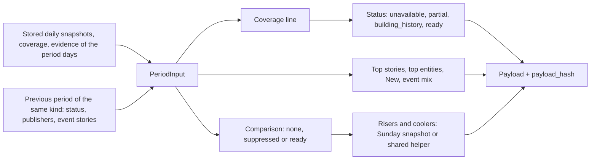

<!-- code-doc
module: src/app/core/periodic/signals_period.py
covers:
  - src/app/core/periodic/*.py
-->
# Period AI Signals

Weekly (and later monthly) view of the AI signals: sums and comparisons of the stored daily data
(`core/daily/signals.md`) over a completed period. Everything is deterministic and costs $0; no
provider is involved. This PR ships only the pure rules: bounds, thresholds, status and the compute
function. Storage, the command, the nightly step and the API come in the next PR; the page and the
paid brief come in later releases. Nothing here is reachable from the app at runtime yet.

This file is the intended current behavior of 017. `specs/017-weekly-monthly-signals/` is the process
and history.

## Behavior

The numbers live in the code: fields of `PeriodThresholds` (by kind) in `period_model.py`; the daily
`Thresholds` still decide what a complete day is and what Rising means.

**Periods**
- Week: Monday to Sunday of digest days D (UTC); key is the Monday. Month: calendar month UTC; key is
  the first day. Only completed periods are computed. Tests: `test_week_runs_monday_to_sunday`,
  `test_week_across_a_year_change`, `test_month_lengths`, `test_previous_month_crosses_the_year`.
- Thresholds per kind (`PeriodThresholds.for_kind`): `min_complete_days`, `min_items`,
  `breadth_ratio`, `quiet_items`, and the caps and minimums of the lists below. Tests:
  `test_thresholds_by_kind`.

**Status** (first rule that holds wins)
- `unavailable`: no day of the period has a usable snapshot.
- `partial`: fewer than `min_complete_days` complete days, or fewer than `min_items` items.
- `building_history`: numbers are fine but there is no usable previous period (its status is
  `ready` or `building_history`), so nothing is compared.
- `ready`.
- A day is complete by the daily rule (`DayCoverage.complete` at the daily `complete_ratio`) and
  belongs to the comparable range. A day without a coverage row is missing: it is listed in
  `missing_days` and counted neither as complete nor as a zero day. Tests:
  `test_period_status_precedence`, `test_a_missing_day_is_not_zero`,
  `test_status_unavailable_partial_building_history_ready`,
  `test_coverage_missing_day_is_listed_not_zero`.

**Coverage line**
- Days complete of days in the period, items, extracted share, distinct publishers, and `quiet`
  when items are below `quiet_items` (sections still show; the opening line says "quiet"). Tests:
  `test_coverage_line_counts_days_items_and_publishers`,
  `test_coverage_incomplete_day_is_not_complete_and_quiet_flag`.

**Sections**
- Top stories: the daily `top_stories` of all days, merged by event type plus entity set (a story
  without entities merges by label); ranked by distinct publishers, then days, then articles; at
  most `top_max`. Publishers are the larger of the best daily count and the distinct publishers
  among the stored links (a lower bound: the snapshot keeps at most a few links per story).
  Tests: `test_top_stories_merge_across_days_by_event_type_and_entities`,
  `test_top_stories_rank_by_publishers_then_days_and_cap`.
- Top entities: for models, products, companies and technologies, ranked by distinct articles, then
  publishers, from the mentions of the period articles; entities that need review are skipped; at
  least `top_entity_min_articles` articles and `top_entity_min_publishers` publishers; at most
  `top_entity_max` per group; each with its days and links. Tests: `test_top_entities_by_group_with_minimums`.
- New this period: the union of the daily `new` lists, confirmed first, then by first-seen day,
  then publishers; an entity seen first as early and later as confirmed is shown confirmed with its
  first day; at most `new_period_max`. Tests: `test_new_union_confirmed_first_with_first_seen_day`,
  `test_new_union_is_capped`.
- Event mix: stories and articles per hard event type, summed from the daily chips; other types as
  "+N more"; the delta in stories against the previous period only when the comparison is `ready`.
  Tests: `test_event_mix_sums_chips_with_delta_and_more`.
- Risers and coolers (week): the daily computation with D = the Sunday. The Sunday snapshot is used
  when its `methodology_version` is the current daily one and its Rising was usable; otherwise the
  shared helper runs over the week bounds (`trend_windows`, `trend_delta`). Shown only when the
  comparison is `ready`. Month: not built here (`not_built`). Tests:
  `test_rising_equals_the_sunday_snapshot`,
  `test_rising_from_the_helper_matches_the_sunday_snapshot_when_methodology_is_old`,
  `test_rising_snapshot_without_usable_windows_falls_back_to_the_helper`, `test_month_has_no_risers_yet`.

**Comparison and publisher breadth**
- `none` without a usable previous period; `suppressed` with reason `low_publisher_coverage` when
  the publishers of this period divided by those of the previous one are below `breadth_ratio`
  (a source outage looks like a drop in topics, not a trend); otherwise `ready`. Suppression hides
  the event deltas and the risers and coolers; the status stays `ready`. Tests:
  `test_low_publisher_coverage_suppresses_the_comparison`,
  `test_no_comparison_without_a_usable_previous_period`.

**Payload and hash**
- The payload carries `PERIOD_METHODOLOGY_VERSION`, the daily methodology version, the extraction
  version and the thresholds. `payload_hash` is the daily one (ignores `generated_at`); the same
  input gives the same hash and the order of days, articles and coverage rows does not matter.
  Tests: `test_payload_hash_is_stable_and_ignores_day_order`,
  `test_payload_is_json_and_records_versions_and_thresholds`.

## Decisions

| Decision | Why |
| --- | --- |
| Weeks are Monday-Sunday UTC of digest days; months are calendar UTC (decided 2026-10-28, planner) | the unit of the daily signals is the digest day; matches the old Monday report |
| Completed periods only (owner answer Q3) | "week so far" invites noisy partial numbers; the daily block covers current days |
| Built from daily snapshots and evidence, not raw articles (decided 2026-10-28, planner) | snapshots and evidence survive article retention; event types come from the chips |
| One definition of "rising": the daily one at the Sunday (decided 2026-10-28, planner) | no second method on the site |
| Coverage = digest-day completeness plus publisher breadth, no per-source slot table (decided 2026-10-28, planner) | judged on what the reader sees; breadth is the proxy for source outages |
| New package `core/periodic/` and `period_` names (decided 2026-10-28, planner) | the feature reads daily data and is not daily |
| Deterministic numbers ship before the brief (decided 2026-10-28, planner) | the paid step has its own flag and release |
| The daily Rising window ending on D includes D (verified 2026-10-28, agent): `trend_windows` in `core/daily/signals_trend.py` takes `day - i` for `i` in `range(w)` (line 61, the same line was in `signals_compute.py` before the move), and the previous window is `range(w, 2 * w)` (line 62) | the Sunday snapshot is exactly the week against the week before, so the weekly risers reuse it |
| The shared Rising/Cooling rule lives in `core/daily/signals_trend.py`, not in `core/periodic/` (decided 2026-10-28, agent) | 006 code imports it without importing the period package; payload hashes of the 006 fixtures are unchanged, so no `METHODOLOGY_VERSION` bump |
| The helper path does not exclude the Sunday's New entities from risers (decided 2026-10-28, agent) | the New list of D is not an input of the period; the fixture week shows the same list as the snapshot |
| A previous period counts as usable when `ready` or `building_history` (decided 2026-10-28, agent) | otherwise the second week would also wait: the first week is never `ready` (it has no previous) |
| Comparison is hidden (event deltas, risers, coolers) when breadth is low, status stays `ready` (decided 2026-10-28, agent) | the numbers of the period are fine; only the comparison is unreliable |
| Distinct publishers of a merged story are a lower bound from stored links (decided 2026-10-28, agent) | the snapshot stores a few links per story, not all publishers; re-clustering days is not worth the risk |
| Values of the list caps and minimums, not given in the plan (decided 2026-10-28, agent): week top 8, entities 5 per group with 3 articles and 2 publishers, New 10; month 12, 8, 6 and 3, 16 | first guess near the daily scale; changing them is a methodology bump |
| Month risers and month-only rules are not built here (R6) | bounds and thresholds for months exist; the monthly view ships last |

## Invariants

- Pure: no database, no clock, no provider import, $0. `generated_at` is an input. Tests:
  `test_payload_hash_is_stable_and_ignores_day_order`.
- A missing day is never a zero day. Tests: `test_a_missing_day_is_not_zero`,
  `test_coverage_missing_day_is_listed_not_zero`.
- The daily snapshot payload hashes do not change by the extraction of the shared helper. Checked
  once when it moved (before and after table in the PR); the daily tests remain the guard
  (`test_rising_and_cooling_with_usable_windows`, `test_windows_need_six_complete_days_and_comparable_range`).

# Code map

| File | Role | Pure |
| --- | --- | --- |
| `signals_period.py` | Public entry: re-exports `compute_period`, `PeriodInput`, `PeriodThresholds`, `payload_hash` | yes |
| `period_model.py` | Bounds (`period_bounds`, `period_days`, `previous_start`), `PeriodThresholds`, `PeriodInput`, `PreviousPeriod`, `period_status` | yes |
| `period_compute.py` | `compute_period` and one function per section; `PERIOD_METHODOLOGY_VERSION` | yes |
| `core/daily/signals_trend.py` | Shared Rising/Cooling rule: `trend_windows`, `trend_delta`, `TrendRow` | yes |

Flow: `compute_period` -> `coverage_line`, `period_status`, `comparison`, then `top_stories`,
`top_entities`, `new_this_period`, `risers_and_coolers`, `event_mix`.

| Change | Place | Also |
| --- | --- | --- |
| Thresholds, caps, minimums | `PeriodThresholds.for_kind` | bump `PERIOD_METHODOLOGY_VERSION` |
| A section rule | `period_compute.py` | bump `PERIOD_METHODOLOGY_VERSION` |
| What Rising means | `signals_trend.py` and daily `Thresholds` | bump the daily `METHODOLOGY_VERSION` and the period one |

Next PR (not in the code yet): the two tables and their repository, the migration, the command and
its flag, the nightly step, the read API. The version table gets its brief row with the brief.

## Tests

Per rule: see Behavior. Files: `tests/unit/test_period_model.py`, `tests/unit/test_period_compute.py`;
fixture weeks are built by `tests/unit/period_fixtures.py` from `tests/fixtures/daily_signals/`
(the previous week is the same days shifted back, thinned). No test calls a provider.
