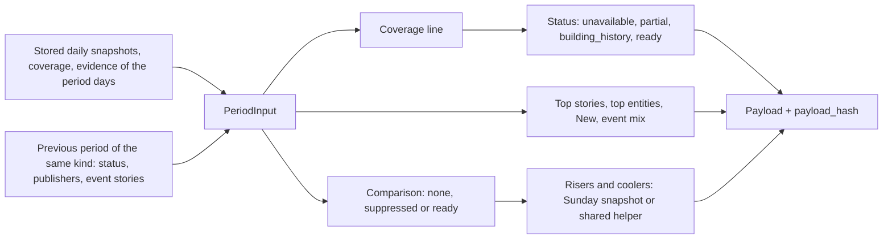

<!-- code-doc
module: src/app/core/periodic/signals_period.py
covers:
  - src/app/core/periodic/*.py
  - src/app/storage/period_signals*.py
  - src/app/storage/migrations/versions/*period_signal*.py
  - src/app/web/routes/period.py
  - src/app/web/period_view.py
-->
# Period AI Signals

Weekly and monthly view of the AI signals: sums and comparisons of the stored daily data
(`core/daily/signals.md`) over a completed period, plus one short AI-written brief per period. The
numbers are deterministic and cost $0; no provider is involved. The brief is the only paid step,
off by default behind its own flag. Shipped: the pure rules (bounds, thresholds, status, compute),
storage, the command `ai-news period-signals`, the nightly step, the read API, the `/weekly` and
`/monthly` pages, the month numbers and the brief step (week and month). The
numbers are computed behind `AINEWS_PERIOD_SIGNALS_ENABLED` (default off), the brief behind
`AINEWS_PERIOD_SIGNALS_BRIEF_ENABLED` (default off); pages and API only read stored rows.

This file is the intended current behavior of 017. `specs/017-weekly-monthly-signals/` is the process
and history.

## Behavior



The numbers live in the code: fields of `PeriodThresholds` (by kind) in `period_model.py`; the daily
`Thresholds` still decide what a complete day is and what Rising means.

**Periods**
- Week: Monday to Sunday of digest days D (UTC); key is the Monday. Month: calendar month UTC; key is
  the first day. Only completed periods are computed. Tests: `test_week_runs_monday_to_sunday`,
  `test_week_across_a_year_change`, `test_month_lengths`, `test_previous_month_crosses_the_year`,
  `test_latest_completed_month_is_the_one_before_the_current`.
- Thresholds per kind (`PeriodThresholds.for_kind`): `min_complete_days`, `min_items`,
  `breadth_ratio`, `quiet_items`, and the caps and minimums of the lists below. Tests:
  `test_thresholds_by_kind`. The month risers have their own `month_*` minimums in the same
  class (see "Risers and coolers (month)"); a week payload does not carry them. Tests:
  `test_a_week_payload_does_not_change_with_the_month_thresholds`.

**Status** (first rule that holds wins)
- `unavailable`: no day of the period has a usable snapshot.
- `partial`: fewer than `min_complete_days` complete days, or fewer than `min_items` items.
- `building_history`: numbers are fine but there is no usable previous period (its status is
  `ready` or `building_history`), so nothing is compared.
- `ready`.
- A day is complete by the daily rule (`DayCoverage.complete` at the daily `complete_ratio`) and
  belongs to the comparable range. A day without a coverage row is missing: it is listed in
  `missing_days` and counted neither as complete nor as a zero day. Tests:
  `test_period_status_precedence`, `test_a_missing_day_is_not_zero`,
  `test_status_unavailable_partial_building_history_ready`,
  `test_coverage_missing_day_is_listed_not_zero`.
- Month: the same rules with the month column of `PeriodThresholds`: `min_complete_days` 24 (of
  28-31), `min_items` 400, `quiet_items` 600. The first month (November 2026) has no stored
  previous month, so it is `building_history`, never `ready`. Tests: `test_month_status_thresholds`,
  `test_no_comparison_without_a_usable_previous_month`.

**Coverage line**
- Days complete of days in the period, items, extracted share, distinct publishers, and `quiet`
  when items are below `quiet_items` (sections still show; the opening line says "quiet"). Tests:
  `test_coverage_line_counts_days_items_and_publishers`,
  `test_coverage_incomplete_day_is_not_complete_and_quiet_flag`.

**Sections**
- Top stories: the daily `top_stories` of all days, merged by event type plus entity set (a story
  without entities merges by label); ranked by distinct publishers, then days, then articles; at
  most `top_max`. Publishers are the larger of the best daily count and the distinct publishers
  among the stored links (a lower bound: the snapshot keeps at most a few links per story).
  Tests: `test_top_stories_merge_across_days_by_event_type_and_entities`,
  `test_top_stories_rank_by_publishers_then_days_and_cap`.
- Top entities: for models, products, companies and technologies, ranked by distinct articles, then
  publishers, from the mentions of the period articles; entities that need review are skipped; at
  least `top_entity_min_articles` articles and `top_entity_min_publishers` publishers; at most
  `top_entity_max` per group; each with its days and links. Tests: `test_top_entities_by_group_with_minimums`.
- New this period: the union of the daily `new` lists, confirmed first, then by first-seen day,
  then publishers; an entity seen first as early and later as confirmed is shown confirmed with its
  first day; at most `new_period_max`. Tests: `test_new_union_confirmed_first_with_first_seen_day`,
  `test_new_union_is_capped`.
- Event mix: stories and articles per hard event type, summed from the daily chips; other types as
  "+N more"; the delta in stories against the previous period only when the comparison is `ready`.
  Tests: `test_event_mix_sums_chips_with_delta_and_more`.
- Risers and coolers (week): the daily computation with D = the Sunday. The Sunday snapshot is used
  when its `methodology_version` is the current daily one and its Rising was usable; otherwise the
  shared helper runs over the week bounds (`trend_windows`, `trend_delta`). Shown only when the
  comparison is `ready`. Tests: `test_rising_equals_the_sunday_snapshot`,
  `test_rising_from_the_helper_matches_the_sunday_snapshot_when_methodology_is_old`,
  `test_rising_snapshot_without_usable_windows_falls_back_to_the_helper`.
- Risers and coolers (month): `trend_delta` (the shared rule) over month totals: the complete days of
  the month against the complete days of the previous month, the expectation scaled by the
  extracted items of both, with the `month_*` minimums of `PeriodThresholds` (see Decisions for the
  values). Shown only when the comparison is `ready` and the previous month is usable for it: it
  starts on or after the comparable-from day and both months have at least `min_complete_days`
  complete days and an extracted item; otherwise the section is `unavailable`. Items carry
  `current`, `previous` and `expected` (month totals) instead of the 7-day fields; `trend_source` is
  `month_helper`. Tests: `test_month_risers_and_coolers_compare_month_totals`,
  `test_month_risers_respect_the_month_minimums`, `test_month_risers_need_a_complete_previous_month`,
  `test_month_risers_need_the_previous_month_inside_the_comparable_range`.

**Comparison and publisher breadth**
- `none` without a usable previous period; `suppressed` with reason `low_publisher_coverage` when
  the publishers of this period divided by those of the previous one are below `breadth_ratio`
  (a source outage looks like a drop in topics, not a trend); otherwise `ready`. Suppression hides
  the event deltas and the risers and coolers; the status stays `ready`. Tests:
  `test_low_publisher_coverage_suppresses_the_comparison`,
  `test_no_comparison_without_a_usable_previous_period`. Month: the same rule and the same
  event-mix delta against the previous month. Tests: `test_month_breadth_suppresses_the_comparison`,
  `test_month_event_mix_has_a_delta_against_the_previous_month`.

**Payload and hash**
- The payload carries `PERIOD_METHODOLOGY_VERSION`, the daily methodology version, the extraction
  version and the thresholds. `payload_hash` is the daily one (ignores `generated_at`); the same
  input gives the same hash and the order of days, articles and coverage rows does not matter.
  Tests: `test_payload_hash_is_stable_and_ignores_day_order`,
  `test_payload_is_json_and_records_versions_and_thresholds`. The week payload is not changed by
  month support: its hash on the fixture week is pinned (`test_a_week_payload_does_not_change_with_the_month_thresholds`).

**Storage**
- Two tables, no foreign keys: `period_signal_reports` (one row per `period_kind` and `period_start`:
  end, status, versions, `payload_hash`, thresholds, payload, coverage JSON) and
  `period_signal_briefs` (one row per `period_kind` and `period_start`: `brief_version`, model,
  `input_hash`, status `ok` or `invalid`, reason, payload). Tests:
  `test_upgrade_matches_models_and_downgrade_drops_only_period_tables`,
  `test_upgrade_after_create_all_keeps_existing_tables`, `test_single_head_and_chain`.
- A period is stored only when its `payload_hash` differs from the stored one; the second run
  writes nothing. Tests: `test_second_run_writes_nothing`, `test_changed_input_rewrites_only_that_period`.
- The input of a period is its days plus the days before it (a week: 7, the helper path needs 14
  days; a month: the whole previous month for the month risers), the
  stored daily snapshots, per-day coverage, the evidence (reconciled in memory, nothing persisted)
  and the stored previous period (status, publishers, event stories). An unreadable previous row
  counts as no previous period; an unreadable daily snapshot counts as no snapshot. Tests:
  `test_run_round_trip_stores_oldest_first_and_links_the_previous_week`,
  `test_unreadable_stored_previous_period_counts_as_none`, `test_a_database_run_stores_november_then_compares_december`.

**Run** (`ai-news period-signals [--kind week|month] [--period YYYY-MM-DD] [--backfill N] [--recompute-all]`)
- With `AINEWS_PERIOD_SIGNALS_ENABLED` off the command prints `{"state": "disabled"}`, exits 0 and
  writes nothing. Tests: `test_flag_off_says_so_and_writes_nothing`,
  `test_month_before_the_first_month_and_flag_off_do_nothing`.
- Default: the latest completed week (the week whose Sunday is before today, UTC). `--backfill N`
  takes N weeks ending at the target, `--period` names any day of the target week, and
  `--recompute-all` takes every week from the first one; periods run oldest first so each reads the
  stored previous one. `--kind month` does the same for calendar months (`--period` is any day of a
  completed month). Tests: `test_targets_default_backfill_and_clipping_before_the_first_week`,
  `test_backfill_period_and_recompute_all`, `test_default_run_computes_the_latest_completed_week`.
- The first computable week is the first full Monday-Sunday week inside the comparable range
  (`first_week`); earlier weeks are dropped from a backfill and reported as `skipped_before_first`;
  an uncompleted or earlier `--period` is refused (exit 2). Tests: `test_first_and_latest_week_bounds`,
  `test_uncompleted_or_early_period_is_refused`, `test_bad_arguments_exit_2`.
- The first computable month is the first full calendar month inside the comparable range
  (`first_month`: November 2026); October 2026 is partial and is never computed, like the weeks
  before 2026-10-12. Earlier months are dropped from a backfill (`skipped_before_first`) and an
  uncompleted or earlier `--period` is refused (exit 2). Tests:
  `test_the_first_month_is_the_first_full_month_in_the_comparable_range`,
  `test_backfill_recompute_all_and_period_of_months`, `test_october_and_uncompleted_months_are_refused`.
- The plain command (no `--kind`, `--period`, `--recompute-all`, and `--backfill` 1: the nightly
  step) runs the week as before and then the month: the latest completed month, every night,
  idempotent by hash, so a failed 1st heals the next night. Before 2026-12-01 there is no completed
  month inside the range and the month run does nothing and writes nothing; on 2026-12-01 it stores
  November. Its report is the `month` key of the output; a month failure never changes the week
  report. `--kind week` or `--kind month` runs that kind alone. Tests:
  `test_the_nightly_default_does_nothing_before_the_first_month_is_complete`,
  `test_the_nightly_default_before_december_writes_nothing`,
  `test_plain_run_adds_the_month_report_and_a_kind_does_not`,
  `test_month_before_the_first_month_writes_nothing`.
- The nightly step in `scripts/run_daily_digest_job.sh` runs the default command after the daily
  signals with a time-budget guard; its failure never changes the job result. Tests: none (shell;
  checked by `bash -n`).
- Command options of the brief: `--with-brief`, `--max-usd X` (total of the run, default
  `AINEWS_PERIOD_SIGNALS_MAX_USD`, 0.10), `--cache-dir` (the ledger file). A zero or malformed
  `--max-usd` exits 2. Tests: `test_command_options_pass_to_the_run`,
  `test_command_rejects_a_bad_max_usd_and_flag_off_stays_disabled`.

**Brief** (paid; `core/periodic/period_brief.py`, `period_brief_run.py`)

```mermaid
flowchart LR
  row["Stored period row: ready or building_history, not quiet"] --> packet["Packet: top stories, New, risers + digest titles and summaries"]
  packet --> hash{"Same input hash stored?"}
  hash -->|yes, ok or invalid| cached["cached: no call"]
  hash -->|no| ledger["Ledger: own run id, per-brief cap, reservation at the byte cap"]
  ledger --> call["One call"]
  call --> check{"Validation (daily rules, period sentence counts)"}
  check -->|ok| ok["Store ok"]
  check -->|rejected| recovery["One recovery call with the reason"]
  recovery --> check2{"Validation"}
  check2 -->|ok| ok
  check2 -->|rejected| invalid["Store invalid, no brief"]
```

- The step runs only when `AINEWS_PERIOD_SIGNALS_BRIEF_ENABLED` is on and a DeepSeek key is set. Flag
  off, or no key: no ledger and no provider object exists and nothing is written. An unpriced model
  (`BRIEF_PRICES`, model `daily_signals_brief_model`) makes no call. Tests:
  `test_flag_off_creates_no_provider_and_no_brief`,
  `test_unpriced_model_flag_off_and_no_key_make_no_call`.
- Targets: a period row whose status is `ready` or `building_history` and whose payload is not
  quiet; any other status, a missing row or an unreadable payload is skipped with a reason. A
  default run (the nightly step) briefs only the latest completed period of its kind (the week; the
  month once a month row exists), and only when the run computed it; `--with-brief` briefs every
  period of the run (a paid backfill). A month brief is never attempted while no month row exists:
  before 2026-12-01 the month run has no target. A `building_history` month (November) is briefed.
  A changed month payload is a new input hash and is briefed (paid) again. Tests:
  `test_only_ready_or_building_history_periods_without_a_brief_are_attempted`,
  `test_targets_nightly_default_and_with_brief`, `test_nightly_default_briefs_the_latest_week_once`,
  `test_with_brief_covers_every_week_of_the_run_within_the_cap`,
  `test_a_month_brief_needs_a_month_row_and_uses_month_values`,
  `test_month_brief_targets_are_the_latest_completed_month_when_computed`,
  `test_the_month_brief_is_attempted_only_on_a_month_row`, `test_a_partial_month_gets_no_brief`.
- Packet: stories, New items and risers (when the comparison is shown) of the stored payload with
  the digest title and summary of up to `PERIOD_LINKS_PER_ITEM` linked articles each; ids `a1..aN`
  by first reference; hard-event counts. It is cut to `PERIOD_PACKET_MAX_BYTES` (week 16,000, month
  24,000): summaries shrink first, then New and risers lose their tail (`_TRIMS`); stories that
  alone do not fit skip the period (`packet_too_large`). A link without a digest item is not cited.
  Tests: `test_period_packet_has_stories_new_risers_and_digest_articles`,
  `test_risers_are_left_out_when_the_comparison_is_hidden`,
  `test_a_link_without_a_digest_item_is_not_cited`,
  `test_packet_is_cut_to_the_cap_of_its_kind_and_loses_its_tail_before_failing`.
- Request and validation: the daily rules of `signals.md` (ids, exact quote, numbers and names
  grounded in the cited text, no URLs or markup, one sentence per story) with the sentence counts
  of the kind (`PERIOD_SENTENCES`: week 4-6, month 5-8) and the output bound of the kind
  (`PERIOD_MAX_OUTPUT`). One recovery attempt with the rejection reason, then `invalid` and no
  brief. Tests: `test_request_body_by_kind`, `test_validation_uses_the_sentence_counts_of_the_kind`,
  `test_validation_keeps_the_daily_rules`, `test_recovery_attempt_then_ok`.
- Cache: the `input_hash` covers the packet, `PERIOD_BRIEF_VERSION` and the model. A stored row with
  the same hash (`ok` or `invalid`) is never paid again; a changed payload, a version bump or a
  model change makes a new hash. Tests: `test_ok_brief_is_stored_then_cached_by_input_hash`,
  `test_invalid_after_one_recovery_is_never_paid_twice`,
  `test_period_input_hash_changes_with_packet_version_and_model`.
- Money: each brief has its own ledger and run id (`<run>-brief-<kind>:<start>`) and a cap of its
  kind, `PERIOD_BRIEF_MAX_USD` (week 0.05, month 0.08), also limited by what is left of the run
  total (`--max-usd`, default 0.10). The reservation of an attempt is the encoded request bytes
  priced as input tokens plus the output bound priced as output tokens, so it is the worst case at
  the byte cap: about $0.028 (week) and $0.040 (month) per attempt. A stop (cap, deadline, provider
  failure) is a terminal reason in the report; the remaining periods are skipped and nothing is
  stored for the stopped one. Tests: `test_per_brief_cap_stops_before_the_call`,
  `test_the_reservation_of_a_full_packet_fits_the_default_caps`,
  `test_run_cap_limits_the_second_brief`, `test_run_budget_exhausted_skips_without_a_call`,
  `test_run_cap_max_usd_stops_the_step`, `test_a_stop_is_a_terminal_reason_and_stores_nothing`,
  `test_the_ledger_has_its_own_run_id`.
- A brief failure of any kind never changes the stored numbers or the run result; the step writes
  only `period_signal_briefs`. Tests: `test_a_brief_failure_keeps_the_numbers`,
  `test_no_table_but_the_brief_row_is_written`.

**API** (stored data only)
- `GET /api/news/period-signals?kind=week|month&start=YYYY-MM-DD`; without `start` the newest `ready` or
  `building_history` period, else the newest stored one. A missing row or an unreadable payload gives
  200 with status `unavailable`, never 500. `brief` is the stored `ok` brief of that period (sentences
  with their source links, model, version, time) or null for a missing, `invalid` or unreadable row.
  Tests: `test_ready_week`,
  `test_partial_week_is_served_with_its_status`, `test_default_is_the_latest_ready_or_building_period`,
  `test_default_falls_back_to_a_partial_week`, `test_missing_row_is_unavailable_200`,
  `test_corrupt_row_is_unavailable_200`, `test_invalid_query_is_422`,
  `test_page_and_api_without_a_brief`, `test_page_and_api_with_a_brief_on_top`,
  `test_an_invalid_or_unreadable_brief_shows_nothing`, `test_the_brief_belongs_to_its_week`,
  `test_month_rows_are_served_by_kind_and_listed_in_the_index`.
- `GET /api/news/period-signals/index[?kind=]`: stored periods newest first (kind, start, end,
  status, computed time); no payload is read. Both routes are public like the daily one. Tests:
  `test_index_lists_newest_first_without_payloads`, `test_empty_index`,
  `test_auth_middleware_coverage_is_pinned`.
- No provider code is imported on the request path. Tests: `test_request_path_does_not_import_provider_code`.

**Page** (`GET /weekly`, `GET /weekly?week=YYYY-MM-DD`; stored data only, no provider, no compute)
- Without `week` the page shows the week the API picks by default; with `week` that Monday. Sections
  in order: the brief ("In brief", only when a stored `ok` brief exists), coverage line (days
  complete, items, publishers, extracted share, missing days, the "Partial week" line when `partial`, the "Quiet week" line when `quiet`), top stories, top entities
  by group, New this week, Rising and Cooling, event types with the delta. Tests:
  `test_ready_week_shows_sections_in_order`, `test_partial_and_quiet_lines`.
- A section that has nothing, or whose comparison is hidden, shows one plain reason line instead of a
  list: "First week, no comparison with a previous week." (comparison `none`, status
  `building_history`) and the low publisher coverage line (comparison `suppressed`). Event deltas
  are shown only when stored. Tests: `test_building_history_says_first_week`,
  `test_suppressed_comparison_gives_a_reason_not_a_chart`.
- No stored week, a missing week or an unreadable or odd payload gives a 200 page with a plain
  "not available" line, never 500; the week picker (previous, next, list) is plain links built from
  the index. A `week` that is not a Monday redirects (303) to its Monday. Tests: `test_no_rows_is_unavailable_200`,
  `test_corrupt_row_is_200`, `test_week_param`, `test_default_skips_a_newer_partial_week`.
- Stored text is escaped; only `http(s)` links are rendered; days link to `/?date=YYYY-MM-DD`.
  The brief shows its sentences with numbered source links and the same AI note as the daily brief
  (`AI_NOTE`). Tests: `test_text_is_escaped_and_only_http_links`, `test_week_label_across_months`,
  `test_page_and_api_with_a_brief_on_top`, `test_brief_text_is_escaped_and_only_http_links_are_rendered`.
- The header link "Weekly" and the line under the daily block on `/` show only when a stored week
  exists. Tests: `test_nav_link_and_home_line_follow_stored_weeks`,
  `test_home_page_survives_a_period_read_failure`.

**Month page** (`GET /monthly`, `GET /monthly?month=YYYY-MM`; same rules as the week page)
- Same sections, states and reason lines as `/weekly`, in month words ("First month, no comparison
  with a previous month.", "Partial month", "Quiet month", "New this month", "vs previous month");
  the heading is the month name ("November 2026"); riser and cooler items show month totals
  ("month: 5 -> 30 (expected 5)"). Without `month` the page shows the month the API picks by
  default; the picker (previous, next, list) links `?month=YYYY-MM`. Tests:
  `test_ready_month_shows_its_sections_and_month_words`, `test_month_states_use_month_words`,
  `test_month_label`.
- `?month=` is `YYYY-MM`; a full date `YYYY-MM-DD` redirects (303) to its `YYYY-MM`; text that is
  neither (or a month that is not stored) gives the 200 "not available" page, a corrupt row a 200
  page. Tests: `test_month_param_and_picker`, `test_corrupt_month_row_is_200`.
- The header link "Monthly" shows on `/` and on `/weekly` only when a month row is stored (any
  status); `/monthly` always links back to `/weekly`. A failed read hides the link. Tests:
  `test_monthly_nav_link_needs_a_month_row`, `test_monthly_nav_link_is_hidden_when_the_read_fails`.

## Decisions

| Decision | Why |
| --- | --- |
| Weeks are Monday-Sunday UTC of digest days; months are calendar UTC (decided 2026-10-28, planner) | the unit of the daily signals is the digest day; matches the old Monday report |
| Completed periods only (owner answer Q3) | "week so far" invites noisy partial numbers; the daily block covers current days |
| Built from daily snapshots and evidence, not raw articles (decided 2026-10-28, planner) | snapshots and evidence survive article retention; event types come from the chips |
| One definition of "rising": the daily one at the Sunday (decided 2026-10-28, planner) | no second method on the site |
| Coverage = digest-day completeness plus publisher breadth, no per-source slot table (decided 2026-10-28, planner) | judged on what the reader sees; breadth is the proxy for source outages |
| New package `core/periodic/` and `period_` names (decided 2026-10-28, planner) | the feature reads daily data and is not daily |
| Deterministic numbers ship before the brief (decided 2026-10-28, planner) | the paid step has its own flag and release |
| The daily Rising window ending on D includes D (verified 2026-10-28, agent): `trend_windows` in `core/daily/signals_trend.py` takes `day - i` for `i` in `range(w)` (line 61, the same line was in `signals_compute.py` before the move), and the previous window is `range(w, 2 * w)` (line 62) | the Sunday snapshot is exactly the week against the week before, so the weekly risers reuse it |
| The shared Rising/Cooling rule lives in `core/daily/signals_trend.py`, not in `core/periodic/` (decided 2026-10-28, agent) | 006 code imports it without importing the period package; payload hashes of the 006 fixtures are unchanged, so no `METHODOLOGY_VERSION` bump |
| The helper path does not exclude the Sunday's New entities from risers (decided 2026-10-28, agent) | the New list of D is not an input of the period; the fixture week shows the same list as the snapshot |
| A previous period counts as usable when `ready` or `building_history` (decided 2026-10-28, agent) | otherwise the second week would also wait: the first week is never `ready` (it has no previous) |
| Comparison is hidden (event deltas, risers, coolers) when breadth is low, status stays `ready` (decided 2026-10-28, agent) | the numbers of the period are fine; only the comparison is unreliable |
| Distinct publishers of a merged story are a lower bound from stored links (decided 2026-10-28, agent) | the snapshot stores a few links per story, not all publishers; re-clustering days is not worth the risk |
| Values of the list caps and minimums, not given in the plan (decided 2026-10-28, agent): week top 8, entities 5 per group with 3 articles and 2 publishers, New 10; month 12, 8, 6 and 3, 16 | first guess near the daily scale; changing them is a methodology bump |
| The first computable week is the first full week inside the comparable range, not the week that contains the comparable-from date (decided 2026-10-28, agent) | the plan says weeks before 2026-10-12 are never computed; a partial first week would be `partial` anyway |
| The default API read prefers the newest `ready` or `building_history` period over a newer `partial` one (decided 2026-10-28, agent) | a reader should see numbers that can be trusted; a partial week is still served by `start` or when nothing else exists |
| The run reconciles evidence in memory and reads entity ids from `ai_entities`; it does not persist reconciliation (decided 2026-10-28, agent) | the period run writes only its own tables; an entity not yet stored has id 0 until the daily run stores it |
| A period run is a function in `period_run.py`, the command only parses options (decided 2026-10-28, agent) | testable without the CLI, same split as the daily run |
| `?week=` that is not a Monday redirects (303) to its Monday; text that is not a date gives the unavailable page (decided 2026-10-28 (agent)) | a shared link with any day of the week still lands on the week; garbage never gives a 422 or 500 page |
| The nav link and the line on `/` follow the default week of the page (newest `ready` or `building_history`, else newest stored) (decided 2026-10-28 (agent)) | the link text and the page it opens always agree |
| The page uses `digest.css` plus a small `period.css` and no script (decided 2026-10-28 (agent)) | no client re-render is needed (plan "Web"); the daily classes are reused |
| The legacy weekly pages, the preview on `/` and the Monday legacy report are retired (owner answer 2026-10-28, 017 R5) | they mostly said "Insufficient comparable source coverage"; the legacy read API, `POST` and tables stay for compatibility, the weekly v2 tables go in a later release |
| The brief reuses the daily brief code, parameterised for sentence counts, prompt, output bound and version (decided 2026-10-28, agent) | one validation for both briefs; the daily prompt, packet, input hash and request key are unchanged (checked once against the daily fixtures: five days, packet, id map, input hash, request body and key identical before and after) |
| Both briefs are built in one release, week values live and month values defined now; the weekly brief is switched on when it ships, the monthly one runs from 2026-12-01 (owner answer Q2, 2026-10-28) | the month numbers arrive in R6; a month brief is never attempted while no month row exists |
| A default (nightly) run briefs only the latest completed week; `--with-brief` is the paid backfill (decided 2026-10-28, agent) | the plan calls brief backfill a separate paid flag; the nightly cost stays one brief a week |
| The nightly command needs no new argument: the flag decides (decided 2026-10-28, agent) | the shell script stays unchanged; flag off means no provider object |
| One ledger per brief, with its own run id and the cap of its kind (decided 2026-10-28, agent) | the ledger caps a run, so one ledger per brief makes the per-brief cap exact; the run total is the sum, limited by `--max-usd` |
| The model is `daily_signals_brief_model`, prices come from `BRIEF_PRICES` (decided 2026-10-28, agent) | one model and one price table for both briefs; the plan names `deepseek-v4-pro`; an unknown model never calls |
| Output bound by kind, week 1,100 tokens and month 1,500, against 900 for the daily brief (decided 2026-10-28, agent) | 4-6 and 5-8 sentences with a quote each do not fit 900; the bound is part of the reservation, so the per-attempt reservations above stay under the caps |
| A quiet period (below `quiet_items`) gets no brief (decided 2026-10-28, agent) | the daily quiet rule (1-2 sentences, digest in the packet) has no period meaning; a quiet ready week is rare and its sections still show |
| The packet loses the tail of New and risers before it gives up (decided 2026-10-28, agent) | a week with ten New items and linked articles can exceed 16,000 bytes at the summary floor; stories are the part worth keeping |
| The prompt tells the model not to name days (decided 2026-10-28, agent) | day numbers would be rejected as unsupported numbers; the packet carries no day list |
| Month risers: the minimums `month_*` are about three times the daily ones, not four (decided 2026-10-28 (agent)): rising current 12, delta 8, ratio 1.5, 3 publishers, at most 8; cooling previous 15, delta 8, ratio 0.5, 3 publishers, at most 6 | a month has about 4.3 windows of a week, but counts of one entity grow slower than volume and the lists should stay short; changing them is a methodology bump |
| Month trend items use `current`, `previous`, `expected`, not the `_7d` fields (decided 2026-10-28 (agent)) | the fields say what they count; the daily trend markup speaks of 7 days |
| The `month_*` thresholds are left out of a week payload (decided 2026-10-28 (agent)) | week payload hashes must not change with R6 (pinned on the fixture week); no methodology bump |
| The month windows are the complete days of each month, needing `min_complete_days` in both (decided 2026-10-28 (agent)) | the same "a missing day is not zero" rule as the daily windows; a month is judged on its usable days, not on a calendar count |
| The plain command runs the month after the week and reports it under `month` (decided 2026-10-28 (agent)) | the nightly shell script stays unchanged (`enrichment.md` covers it); both period flags decide, so no new switch exists; before 2026-12-01 the month run has no target |
| `?month=` is `YYYY-MM`; `YYYY-MM-DD` redirects (303) to it (decided 2026-10-28 (agent)) | mirrors `?week=` (any day lands on its period) and gives one canonical URL |
| "Monthly" nav link follows any stored month row, not the default month (decided 2026-10-28 (agent)) | the plan says "when a month exists"; `/monthly` shows a partial month with its status line anyway |
| No October month view (owner answer Q4; plan "Decided") | October is partial (data from 2026-10-12); the first month is November, shown from 2026-12-01 |

## Invariants

- Pure: no database, no clock, no provider import, $0. `generated_at` is an input. Tests:
  `test_payload_hash_is_stable_and_ignores_day_order`.
- A missing day is never a zero day. Tests: `test_a_missing_day_is_not_zero`,
  `test_coverage_missing_day_is_listed_not_zero`.
- A period run writes only `period_signal_*` tables; digest, articles, signals and weekly tables stay
  untouched. Tests: `test_a_period_run_writes_only_period_signal_tables`.
- Only `period_brief_run.py` can reach a provider (through the signals ledger) and only in the brief
  step; the request path (routes, storage, views) imports no provider code. Tests:
  `test_request_path_does_not_import_provider_code`, `test_flag_off_creates_no_provider_and_no_brief`.
- The same input hash is never paid twice; a brief step never exceeds `PERIOD_BRIEF_MAX_USD` per
  brief or `--max-usd` per run. Tests: see Brief.
- The daily snapshot payload hashes do not change by the extraction of the shared helper. Checked
  once when it moved (before and after table in the PR); the daily tests remain the guard
  (`test_rising_and_cooling_with_usable_windows`, `test_windows_need_six_complete_days_and_comparable_range`).

# Code map

| File | Role | Pure |
| --- | --- | --- |
| `signals_period.py` | Public entry: re-exports `compute_period`, `PeriodInput`, `PeriodThresholds`, `payload_hash` | yes |
| `period_model.py` | Bounds (`period_bounds`, `period_days`, `previous_start`, `next_start`), `PeriodThresholds`, `PeriodInput`, `PreviousPeriod`, `period_status` | yes |
| `period_compute.py` | `compute_period` and one function per section; `PERIOD_METHODOLOGY_VERSION` | yes |
| `period_run.py` | `run_periods`, `target_periods` (`target_weeks`, `target_months`), `brief_targets`, `first_period`, `latest_completed` (week and month wrappers): pick periods, compute, store, then call the brief step | no |
| `period_brief.py` | `PERIOD_BRIEF_VERSION`, values by kind, `period_packet`, `period_body`, `period_input_hash`, `parse_period_brief` | yes |
| `period_brief_run.py` | `run_briefs`: targets, cache by hash, ledger per brief, attempts, store | no |
| `storage/period_signals.py` | `PeriodSignalRepo`: `context`, `load_input`, `previous`, `save_report`, `get_report`, `latest`, `index`, `digest_items`, `get_brief`, `save_brief` | no |
| `core/daily/signals_brief.py` | Shared brief code: `ArticleRefs`, `fit_packet`, `parse_brief(counts=)`, `request_body(prompt=, max_output=)`, `input_hash(version)`; daily behavior unchanged | yes |
| `storage/migrations/versions/f4a9c1d27b83_add_period_signals.py` | the two tables, skip-if-exists, `down_revision` `e7b4c2a9d150` | no |
| `web/period_view.py`, `web/period.html`, `web/static/css/period.css` | the `/weekly` HTML, template and styles; `latest_week` and `has_month` (in the route file) feed the nav links and the line on `/`; one template serves `/weekly` and `/monthly` | no |
| `web/routes/period.py` | the two read routes and the `/weekly` and `/monthly` page routes; response models `PeriodSignalsResponse`, `PeriodSignalsIndexResponse` in `web/models.py` | no |
| `cli/main.py` `period-signals` | options and flag check; flags `period_signals_enabled`, `period_signals_brief_enabled` and `period_signals_max_usd` in `config/settings.py` | no |
| `core/daily/signals_trend.py` | Shared Rising/Cooling rule: `trend_windows`, `trend_delta`, `TrendRow` | yes |

Flow: `compute_period` -> `coverage_line`, `period_status`, `comparison`, then `top_stories`,
`top_entities`, `new_this_period`, `risers_and_coolers`, `event_mix`.

| Change | Place | Also |
| --- | --- | --- |
| Thresholds, caps, minimums | `PeriodThresholds.for_kind` | bump `PERIOD_METHODOLOGY_VERSION` |
| A section rule | `period_compute.py` | bump `PERIOD_METHODOLOGY_VERSION` |
| What Rising means | `signals_trend.py` and daily `Thresholds` | bump the daily `METHODOLOGY_VERSION` and the period one |
| Brief prompt, packet or validation | `period_brief.py` (or the shared code in `signals_brief.py`) | bump `PERIOD_BRIEF_VERSION` (and `BRIEF_VERSION` if the daily request changes); a backfill is paid and capped |
| Brief caps, sentence counts, output bound | `PERIOD_BRIEF_MAX_USD`, `PERIOD_SENTENCES`, `PERIOD_MAX_OUTPUT` | money changes go to the owner; bump `PERIOD_BRIEF_VERSION` for counts and bound |

**Versions**

| Constant | Bump when | Effect of a bump |
| --- | --- | --- |
| `PERIOD_METHODOLOGY_VERSION` | numbers: thresholds, a section rule | `ai-news period-signals --recompute-all` ($0) |
| `PERIOD_BRIEF_VERSION` | brief prompt, packet or validation | new input hashes: the next run pays for new briefs (nightly: the latest week; `--with-brief`: a capped backfill) |

Everything in this doc is built: weeks since R2-R5, months in R6. The first month shown is November
2026, from 2026-12-01.

Operator commands, enabling and rollback: `docs/period-signals.md`. `docker-compose.prod.yml` passes
`AINEWS_PERIOD_SIGNALS_ENABLED` and `AINEWS_PERIOD_SIGNALS_BRIEF_ENABLED` from the server `.env`
with default `false`, so the nightly step is a no-op and never pays until the operator sets them
(decided 2026-10-28 (coordinator): same path as the daily flag). `AINEWS_PERIOD_SIGNALS_MAX_USD`
(default 0.10) is not in the compose file, so production uses the default; `--max-usd` overrides it
per run.
Tests: `test_production_compose_passes_period_signals_flag_off_by_default`,
`test_production_compose_passes_period_brief_flag_off_by_default`.

## Tests

Per rule: see Behavior. Files: `tests/unit/test_period_model.py`, `tests/unit/test_period_compute.py`,
`tests/unit/test_period_signals_repo.py`, `tests/unit/test_period_signals_migration.py`,
`tests/unit/test_cli_period_signals.py`, `tests/unit/test_web_period_signals_api.py`,
`tests/unit/test_web_period_page.py`, `tests/unit/test_period_brief.py`,
`tests/unit/test_period_brief_flow.py`, `tests/unit/test_period_month.py`, `tests/unit/period_brief_db.py` (hand-made period payload,
digest items and a fake provider); fixture weeks
are built by `tests/unit/period_fixtures.py` from `tests/fixtures/daily_signals/` (the previous week is
the same days shifted back, thinned) and database weeks by `tests/unit/period_db.py`. No test calls
a real provider.
