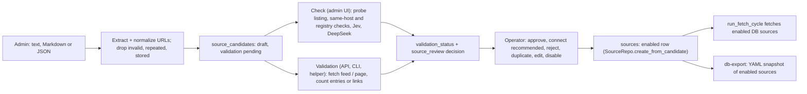

<!-- code-doc
module: src/app/core/sources/onboarding.py
covers:
  - src/app/core/sources/*.py
  - src/app/storage/source_candidate_repo.py
  - src/app/web/routes/sources.py
  - src/app/web/source_intake.py
  - scripts/sources_onboarding_helper.py
-->
# Source onboarding

An admin imports candidate sources (pasted text, Markdown or JSON), the app normalizes them,
drops exact duplicates and stores them as draft candidates of an import batch. A check (in the
background, with a bounded probe and a paid model review) or the older deterministic validation
records whether each candidate is a usable feed or list page. The operator approves, rejects,
disables, marks duplicate or edits candidates; an approved candidate becomes an enabled row of
`sources`, which the next `run_fetch_cycle` fetches. `sources.yaml` is not edited; an export
writes the enabled sources as a YAML snapshot.

This file is the intended current behavior of 003 (source onboarding) and 011 (JSON intake with
automatic review). Change it first, then the code and tests. `specs/003-source-onboarding-management/`,
`specs/011-json-source-intake/` and PR #8 are the history. Operator commands: `docs/configuration.md`
(section "Source list"), `docs/cli.md`.

## Behavior



Rules name their limits; the numbers live in the named function. Each rule lists the tests that
check it.

**Import**
- Text that starts with `{` or `[` (optionally inside a json code fence) is JSON: a `sources`
  array or a top-level array of URL strings or objects. Only each record's `url` is imported; its
  `name`, `description` and `type` are kept (capped) in `raw_input`; other keys (evidence, website,
  replacements) are ignored. Record count, input size and URL length are capped in
  `_json_source_records`; malformed or oversized JSON raises and never falls back to URL scraping.
  Tests: `test_json_intake_imports_only_source_urls_and_preserves_declared_type`,
  `test_json_arrays_and_fences_are_supported`,
  `test_malformed_or_oversized_json_does_not_fall_back_to_url_scraping`. Text that starts with `[`
  but does not look like a JSON array (a Markdown link) is read as text: no test.
- Other text: Markdown link targets and plain http(s) URLs, in order of appearance, trailing
  punctuation stripped (`extract_candidate_urls`). Tests:
  `test_extract_candidate_urls_finds_plain_text_urls_in_prose`,
  `test_extract_candidate_urls_finds_markdown_link_targets`.
- `normalize_candidate_url`: only http/https with a host; scheme and host lowercase; default port
  dropped; repeated slashes collapsed, trailing slash and root path removed; `utm_*` and
  `_TRACKING_PARAM_NAMES` removed (query order kept); fragment dropped. A Google search wrapper
  (`_is_search_wrapper`) is rejected. Tests: `test_normalize_candidate_url_applies_canonical_cleanup`,
  `test_normalize_candidate_url_rejects_search_wrapper_urls`,
  `test_normalize_candidate_url_keeps_non_default_port_and_normalizes_root_path`,
  `test_source_onboarding_path_and_reason_helpers`.
- Type: a declared JSON `type` `rss` or `html` wins (`atom` is `rss`); otherwise
  `_infer_candidate_type` (feed suffix or `/feed` in the URL: `rss`, else `html`). Tests:
  `test_json_arrays_and_fences_are_supported`, `test_json_intake_imports_only_source_urls_and_preserves_declared_type`,
  `test_source_onboarding_review_helper_guards_and_edit_inference`.
- `import_source_candidates` stores the batch (raw text and counts) and one draft per new
  normalized URL. `parsed_count` is the number of extracted URLs; `rejected_count` counts invalid
  URLs, repeats inside the input and URLs already stored in any batch. A stored URL is not created
  again or moved to the new batch; the result lists only new candidates. Tests:
  `test_parse_source_candidates_rejects_invalid_and_duplicate_urls`,
  `test_create_draft_candidate_deduplicates_exact_normalized_canonical_url`,
  `test_create_draft_candidates_returns_only_rows_created_for_current_batch`,
  `test_source_onboarding_import_reports_only_new_candidates_for_current_batch`.
- Entry points: `POST /api/source-onboarding/import` (`raw_text` required: 422; parse error: 422;
  storage error: 503; success: 201), CLI `ai-news import-candidates`, admin page (paste or JSON file;
  the page refuses files over 1 MB before upload). Tests:
  `test_source_onboarding_import_route_rejects_non_mapping_and_blank_text`,
  `test_source_onboarding_import_route_returns_503_when_storage_is_unavailable`,
  `test_upload_api_returns_immediately_health_and_progress_remain_available`,
  `test_import_candidates_command_persists_batch_and_reports_counts`,
  `test_admin_shows_upload_latest_batch_and_bulk_connection` (markup only; the size check in the
  page script has no test).

**Overlap groups** (advisory, nothing is blocked)
- `group_candidate_overlaps` compares candidates of one host pairwise (`_overlap_reason`): one path
  a strict segment prefix of the other: `same_host_path_prefix`; else a topic segment
  (`_TOPIC_SEGMENTS`) in either: `same_host_topic_variant`; else either a root path
  (`_ROOT_SEGMENTS`): `same_host_family`; else no overlap. Connected candidates form one group with
  the strongest reason (`_REVIEW_REASON_PRIORITIES`) and a preferred candidate
  (`_pick_preferred_candidate`: not a topic page, fewest segments, shortest path, RSS, lowest id).
  Tests: `test_group_candidate_overlaps_flags_same_host_path_prefix_variants`,
  `test_group_candidate_overlaps_flags_topic_page_variants_under_same_host`,
  `test_group_candidate_overlaps_keeps_distinct_same_host_families_separate`,
  `test_group_candidate_overlaps_skips_missing_host_and_singletons`,
  `test_group_candidate_overlaps_covers_no_overlap_hosts_and_revisited_pending_nodes`,
  `test_source_onboarding_path_and_reason_helpers`, `test_source_onboarding_picker_and_ingest_helpers`.
- `GET /api/source-onboarding/overlaps` returns the groups of a batch or of given candidate ids
  (`review_candidate_overlaps`). Tests: `test_review_candidate_overlaps_filters_non_group_results`,
  `test_find_overlap_groups_and_summarize_batch_cover_review_helpers`,
  `test_source_onboarding_overlaps_and_listing_return_503_on_storage_errors`.
- `classify_candidate_batch` (no caller in `src/`) lists rejected URLs (`search_wrapper`,
  `invalid_url`, `duplicate_url`), flagged ones (`topic_page`; `broad_media_page` for short InfoQ
  paths, `_is_broad_media_candidate`) and the overlap groups of a pasted batch. Tests:
  `test_classify_candidate_batch_rejects_search_wrappers_and_flags_broad_candidates`,
  `test_classify_candidate_batch_groups_same_vendor_overlaps_for_review`.

**Validation** (deterministic; API, CLI, helper; no model)
- `run_source_validation`: a candidate of type `unknown` gets the inferred type. RSS
  (`validate_rss_candidate`): the feed is fetched with the ingestion `Fetcher` and
  `fetch_rss_with_metadata`; at least one entry: `validated` with `entry_count`, none: `failed`.
  HTML (`validate_html_candidate`): the page is fetched, links are extracted with link selector `a`
  and no list selector; at least one link: `validated` with `link_count` and a few `sample_links`,
  none: `warning`. Another type: `failed`. Tests:
  `test_validate_rss_candidate_marks_candidate_valid_when_feed_has_entries`,
  `test_validate_rss_candidate_fails_when_feed_has_no_entries`,
  `test_validate_html_candidate_marks_candidate_valid_when_article_links_are_extractable`,
  `test_validate_html_candidate_warns_when_page_loads_but_has_no_article_links`,
  `test_run_source_validation_infers_unknown_candidate_type_and_records_result`,
  `test_run_source_validation_returns_failed_result_for_unsupported_candidate_type`,
  `test_run_source_validation_executes_html_path_and_batch_wrapper`,
  `test_source_onboarding_picker_and_ingest_helpers`. A fetch or parse error gives `failed` with
  the error type and message (`_format_validation_error`): no test (both branches are
  `pragma: no cover`).
- The result is stored by `record_validation_result`: status, detected type (also replaces
  `candidate_type` when set), error, details JSON (`_build_validation_details`), `validated_at`.
  Tests: `test_record_validation_result_updates_candidate_and_guards_missing_candidate`,
  `test_record_validation_result_keeps_candidate_type_when_detected_type_missing`,
  `test_run_source_validation_persists_status_and_timestamp_end_to_end`.
- `run_source_validation_batch` needs a batch id or candidate ids and validates in id order; the
  caller commits once. `POST /api/source-onboarding/validate` runs it in a worker thread (health
  stays responsive); bad ids: 422; storage error: 503. CLI `ai-news validate-candidates`, helper
  `db-validate`. Tests: `test_run_source_validation_batch_requires_scope`,
  `test_run_source_validation_rejects_missing_candidate`,
  `test_source_onboarding_validate_route_rejects_invalid_payload_shapes`,
  `test_source_onboarding_validate_rejects_invalid_identifier_payloads`,
  `test_source_onboarding_validate_route_accepts_candidate_ids_only`,
  `test_source_onboarding_validation_keeps_health_endpoint_responsive`,
  `test_source_onboarding_validate_route_returns_503_when_storage_is_unavailable`,
  `test_validate_candidates_command_rejects_missing_scope`,
  `test_validate_candidates_command_runs_batch_or_candidate_validation`. The helper command: no test.

**Check** (admin page "Check"; `SourceIntakeService`, paid model calls)
- One check job per process: `POST .../batches/{batch_id}/check` starts a daemon thread and
  returns 202; the same batch while running returns the running job; another batch while running
  or an unknown batch: 409. `GET .../check-status` shows status, completed and total; a crash sets
  `failed` with the exception type only. The job state is in memory: after a restart the status is
  `idle` and unchecked candidates stay `pending` until the operator starts the check again (no
  test). Only `draft` candidates are checked. Tests:
  `test_upload_api_returns_immediately_health_and_progress_remain_available`,
  `test_worker_failure_does_not_report_success_and_bad_details_are_safe`,
  `test_background_reviews_commit_results_cache_repeats_and_bulk_connect`.
- Registry duplicates: URLs are compared by `_url_key` (normalized, https, no `www.`). A candidate
  whose key matches an earlier candidate of the batch or any `sources` row (enabled or not) gets
  `warning`, decision `duplicate` and status `duplicate`, without network or model calls; so does a
  candidate whose probe redirects to an existing source. Tests:
  `test_existing_urls_and_same_host_families_never_use_models`,
  `test_failures_and_redirect_duplicates_stay_out_of_approval`.
- Probe (`probe_source`): reads only the candidate URL, public addresses only on every hop
  (`_ensure_public_url`: http/https, no credentials, every resolved address global), redirects
  followed by hand up to the loop bound in `_read_source`, body capped by `_MAX_RESPONSE_BYTES`,
  client timeout in `source_http_client`. A feed needs entries with a title and link among the
  first samples; an HTML page needs at least two links in article headings other than itself.
  Probe failure: `failed`, decision `reject`, reason "Technical verification failed". Tests:
  `test_probe_uses_only_source_listing_and_records_bounded_evidence`,
  `test_probe_rejects_pages_without_publication_evidence`, `test_probe_bounds_redirects_and_body_size`,
  `test_private_network_sources_are_blocked`, `test_non_http_and_credential_urls_are_blocked`,
  `test_public_resolution_and_empty_dns`, `test_failures_and_redirect_duplicates_stay_out_of_approval`.
- Same host: when a `sources` row or another candidate of the batch has the same host (requested or
  final), the decision is `review` with up to five overlap URLs and no model call. Tests:
  `test_existing_urls_and_same_host_families_never_use_models`.
- Evidence brief (`SourceProbe.brief`): observed URL, format, title, description, item count, at
  most five samples (title, URL, date) and the declared name and description marked unverified,
  each capped; never article text. Tests:
  `test_evidence_brief_ignores_full_articles_and_cache_depends_on_models`,
  `test_probe_uses_only_source_listing_and_records_bounded_evidence`.
- Cache: a stored review from `jev` or `deepseek` is reused when its `evidence_fingerprint`
  (`_PROMPT_VERSION`, `jev_model`, `source_review_deepseek_model`, brief) matches and it is younger
  than the age bound in `_check_candidate`; a fallback review (no provider) is never reused. Tests:
  `test_background_reviews_commit_results_cache_repeats_and_bulk_connect`,
  `test_stale_cache_rechecks_and_missing_provider_is_not_cached`,
  `test_evidence_brief_ignores_full_articles_and_cache_depends_on_models`.
- Model review (`SourceReviewer.review`, brief cut to a fixed length): Jev answers three questions
  (publication source, AI coverage, sufficient evidence). All confident yes: `ready`; sufficient
  evidence and a confident no on either of the others: `reject`; else `review`, and the same brief
  goes to DeepSeek (`source_review_deepseek_model`, thinking off, output and request count capped in
  `_deepseek`), whose decision counts only above its confidence bound, else `review`. Jev disabled,
  without key or failed earlier in the job counts as `review`. A provider error or invalid answer
  gives `review` and no more calls to that provider in the job. Keys never appear in results. Tests:
  `test_confident_jev_decision_does_not_call_deepseek`, `test_uncertain_jev_routes_same_brief_to_deepseek`,
  `test_provider_failure_remains_manual_and_stops_repeated_provider_calls`,
  `test_missing_keys_jev_failure_and_deepseek_budget_never_approve`.
- Each result is committed on its own (`_save`): `validated` (probe passed, any decision),
  `warning` or `failed`; the review goes to `validation_details` under `source_review`
  (`review_details` reads it). It is dropped when the candidate is no longer a draft or its URL or
  raw input changed since the job read it. Tests:
  `test_candidate_changed_during_probe_does_not_receive_old_evidence`,
  `test_background_reviews_commit_results_cache_repeats_and_bulk_connect`.

**Review actions** (`review_source_candidate`; API returns 400 on a domain error, 503 on storage)
- Approve: only `validated` candidates, whatever the decision or status. `SourceRepo.create_from_candidate`
  reuses the candidate's earlier source, else a source with the same URL, else creates one (key
  from host and path, unique suffix; name from the declared JSON name, else host; type from the
  candidate; default interval and weight); the source is enabled. The candidate becomes `approved`
  with `approved_source_id`; the review note is replaced. Tests:
  `test_review_source_candidate_approve_promotes_validated_draft`,
  `test_review_source_candidate_rejects_approval_when_validation_failed`,
  `test_review_source_candidate_reuses_existing_source_for_reapproval`,
  `test_source_repo_helpers_cover_disable_and_candidate_promotion_paths`,
  `test_create_from_candidate_allocates_unique_source_key_when_base_key_conflicts`,
  `test_source_repo_helper_methods_cover_missing_values_and_unknown_type_fallback`,
  `test_source_onboarding_approve_action_returns_persisted_review_payload`,
  `test_source_onboarding_approve_action_rejects_non_validated_candidates`,
  `test_source_onboarding_approve_action_creates_enabled_managed_source`.
- Connect recommended (`approve_ready`, `POST .../batches/{batch_id}/approve-ready`): refused while
  a check runs (409); approves, in one commit, the batch's `draft` + `validated` candidates with
  decision `ready` whose `_url_key` is not in `sources` (read again now) or approved earlier in
  the same call. Tests: `test_bulk_approval_rechecks_registry_and_skips_manual_failed_and_known`,
  `test_background_reviews_commit_results_cache_repeats_and_bulk_connect`,
  `test_upload_api_returns_immediately_health_and_progress_remain_available`,
  `test_editing_a_candidate_invalidates_its_model_review`.
- Reject: status `rejected`, note = reason; the source of an approved candidate stays enabled.
  Tests: `test_source_onboarding_reject_and_mark_duplicate_actions_capture_review_decisions`,
  `test_review_source_candidate_guard_and_fallback_paths`.
- Disable: only a candidate with `approved_source_id`; that source is disabled, status `disabled`.
  Tests: `test_review_source_candidate_disable_turns_off_previously_approved_managed_source`,
  `test_source_onboarding_disable_action_disables_previously_approved_managed_source`,
  `test_source_onboarding_review_helper_guards_and_edit_inference`,
  `test_source_onboarding_service_disable_requires_approved_source_id`.
- Mark duplicate: the target must exist and differ; status `duplicate`, link to the target, and the
  target's `approved_source_id` is copied. Tests:
  `test_review_source_candidate_mark_duplicate_sets_duplicate_relationship`,
  `test_review_source_candidate_rejects_invalid_duplicate_targets`,
  `test_source_onboarding_review_routes_reject_malformed_inputs_cleanly`.
- Edit (not for `approved`): a new URL is normalized again and must be unique; a type must be
  `rss`, `html` or `unknown`, else it is inferred from a new URL. Any change of URL, raw input or
  type resets validation to `pending` (clears details, error, detected type, time), so an earlier
  model review no longer counts. Tests: `test_source_onboarding_review_helper_guards_and_edit_inference`,
  `test_review_source_candidate_rejects_invalid_edit_payloads`,
  `test_source_onboarding_edit_action_returns_updated_candidate_fields`,
  `test_editing_a_candidate_invalidates_its_model_review`.
- Unknown candidate or action: error. Tests: `test_review_source_candidate_guard_and_fallback_paths`,
  `test_source_onboarding_disable_and_reject_routes_return_400_on_domain_errors`,
  `test_source_onboarding_review_routes_return_503_on_storage_errors`.

**Lists and summaries**
- `GET .../candidates` filters by batch, status and validation status, with the summary of the
  given batch or of the first listed candidate's batch; `GET .../batches/{batch_id}/summary`: 404
  for an unknown batch; `GET .../latest` returns the newest batch id and the check job. Counts come
  from `summarize_batch`. CLI `ai-news review-batch-outcomes`. Tests:
  `test_source_onboarding_candidate_list_filters_return_summary_payload`,
  `test_source_onboarding_batch_summary_route_returns_aggregate_counts`,
  `test_source_onboarding_batch_summary_route_returns_not_found_for_missing_batch`,
  `test_list_candidates_filters_by_ids_status_and_validation_status`,
  `test_find_overlap_groups_and_summarize_batch_cover_review_helpers`,
  `test_source_onboarding_service_first_batch_id_returns_first_candidate_batch_id`,
  `test_review_batch_outcomes_command_reports_deterministic_summary`.

**Into collection**
- An approved candidate is an enabled `sources` row without a YAML entry, so `run_fetch_cycle`
  fetches it from the next run on; an HTML one uses the code selector. That rule and its tests:
  `src/app/core/ingestion/pipeline.md`, Behavior, "Sources and the run". Approval never writes
  `sources.yaml`. Tests: `test_source_onboarding_approve_action_creates_enabled_managed_source`,
  `test_source_onboarding_approve_action_returns_persisted_review_payload`.
- When the approved source is a row that `sources.yaml` also defines (same URL), the YAML upsert of
  the next run sets its `enabled` from YAML again: no test.

**YAML export**
- `export_approved_sources_yaml` dumps every enabled `sources` row (from YAML or approved), sorted
  by key: id, name, type, url, enabled, interval, weight, and empty `parser_options` for HTML; the
  output is deterministic and loads with `load_sources`. Only the helper `db-export` writes it.
  Tests: `test_export_approved_sources_yaml_is_deterministic_and_round_trips_html_sources`,
  `test_export_snapshot_and_html_serialization_helpers`.

**Access**
- Every `/api/source-onboarding/*` route and the admin page need an admin session when auth is on.
  Tests: `test_auth_middleware_coverage_is_pinned`, `test_route_table_order_names_and_models_are_pinned`.

## Decisions

| Decision | Why |
| --- | --- |
| The database is the operational source registry; `sources.yaml` is seed and export | YAML editing did not scale to curated batches (003 problem, FR-001, FR-014..016; `docs/configuration.md`) |
| Drafts stay apart from `sources` until an explicit approval; approval needs `validated` | broken or noisy sources must not reach fetch runs (003 plan "Design choice", FR-009/010); nothing is enabled automatically (011) |
| Search wrappers rejected at import | the 50-source batch contained Google wrapper links (003 plan, domain findings) |
| Exact duplicates by normalized URL, unique column | duplicate sources add fetch cost and noise (003 US2, FR-005) |
| Overlaps are advisory groups, never automatic rejects | heuristic false positives (003 plan, risk 2); one host can hold distinct sections (011) |
| HTML page without links is `warning`, not `failed` | bot protection and unstable sites; manual override kept (003 plan, risk 3) |
| JSON import reads only each record's `url` | research reports carried evidence article links that became candidates (011, PR #8) |
| Check runs in one background job, commits per candidate | health stays responsive and work is not repeated on a small VPS (011) |
| Probe reads only the listing page, size and redirect bounds, public addresses only | no archive crawling; no requests into the private network (011, PR #8) |
| Jev first, DeepSeek second opinion on uncertain cases, high confidence bounds | conservative decisions; model scores are judgments, not guarantees (011, PR #8) |
| Provider failure or missing key leaves manual review; provider stops for the job; DeepSeek calls and output capped | a failure must never approve; paid calls are bounded (011, PR #8) |
| Same-host candidates go to manual review without a model call | DeepSeek may not override unresolved overlap (011) |
| Reviews cached by evidence fingerprint and models, reused for 7 days | repeated imports do not repeat paid work (011, PR #8); decided 2026-10-21 (agent): keep 7 days, a listing changes slowly and a week bounds stale decisions |
| Check results in `validation_details`, no new table | no schema migration (011) |
| An edit resets validation; a running check never overwrites an edited candidate | old evidence must not approve a changed URL (PR #8) |
| Deterministic validation, API, CLI and helper kept beside the check | existing API/CLI behavior preserved (011) |
| Individual approve accepts any `validated` candidate, bulk only `ready` | the operator overrides model decisions; bulk rechecks readiness (011) |
| New source: interval 30 minutes, weight 1.0 | no source states it; decided 2026-10-21 (agent): keep, the interval no longer skips fetches (`pipeline.md`) and 1.0 is the neutral weight of `rank_score` |
| Approved HTML sources carry no selectors; `MANAGED_LINK_SELECTORS` in code | DB rows store no CSS options (non-news record, see `pipeline.md` decisions) |
| InfoQ named as broad media | the provided 50-source batch (003 plan, domain finding 3; fixture `qa_ai_sources.txt`) |

## Invariants

- At most one candidate per normalized URL. Tests:
  `test_create_draft_candidate_deduplicates_exact_normalized_canonical_url`.
- No source is enabled except by an approve or connect-recommended call; a check never approves.
  Tests: `test_background_reviews_commit_results_cache_repeats_and_bulk_connect`,
  `test_existing_urls_and_same_host_families_never_use_models`.
- Only `validated` candidates are approved. Tests:
  `test_review_source_candidate_rejects_approval_when_validation_failed`,
  `test_source_onboarding_approve_action_rejects_non_validated_candidates`.
- A provider failure, missing key or exhausted budget never gives `ready`. Tests:
  `test_missing_keys_jev_failure_and_deepseek_budget_never_approve`,
  `test_provider_failure_remains_manual_and_stops_repeated_provider_calls`.
- The check never requests a private or local address. Tests: `test_private_network_sources_are_blocked`.
- Keys and provider error texts never reach results or job status. Tests:
  `test_provider_failure_remains_manual_and_stops_repeated_provider_calls`,
  `test_worker_failure_does_not_report_success_and_bad_details_are_safe`.
- Onboarding never writes `sources.yaml`. Tests:
  `test_source_onboarding_approve_action_returns_persisted_review_payload`.

## Code map

### Flow

```text
admin page (web/index.html)                          ai-news import-candidates / validate-candidates
  POST /api/source-onboarding/import                 web/routes/sources.py -> import_source_candidates
  POST .../batches/{id}/check -> SourceIntakeService web/source_intake.py: _run, _check_candidate
       probe_source, SourceReviewer, evidence_fingerprint   core/sources/review.py
  POST .../batches/{id}/approve-ready -> approve_ready
  POST .../candidates/{id}/approve|reject|disable|mark-duplicate, PATCH .../candidates/{id}
       SourceOnboardingService (web/service.py) -> review_source_candidate
       approve -> SourceRepo.create_from_candidate   storage/source_repo.py
  POST /api/source-onboarding/validate               run_source_validation_batch
  GET .../candidates, .../summary, .../overlaps, .../latest, .../check-status
next run_fetch_cycle                                 enabled DB sources (core/ingestion/pipeline.md)
scripts/sources_onboarding_helper.py db-bootstrap | db-review | db-validate | db-export
```

### Modules

| File | Role |
| --- | --- |
| `core/sources/onboarding.py` | URL parsing, overlap groups, deterministic validation, import, review actions, YAML export (split planned, below) |
| `core/sources/review.py` | Check probe (`probe_source`), evidence brief, `SourceReviewer` (Jev, DeepSeek), `evidence_fingerprint` |
| `web/source_intake.py` | `SourceIntakeService`: check job, registry and same-host checks, cache, `approve_ready` |
| `web/routes/sources.py` | 13 `/api/source-onboarding/*` routes |
| `web/service.py` (not covered, shared) | `SourceOnboardingService`: list, summary and review actions over `review_source_candidate`; planned to move out |
| `storage/source_candidate_repo.py` | `SourceImportBatchRepo`, `SourceCandidateRepo` (drafts, filters, validation result, review save, summary) |
| `storage/source_repo.py` (not covered) | `SourceRepo.create_from_candidate`, `disable_source` |
| `scripts/sources_onboarding_helper.py` | `db-*` commands over the DB registry; `lint`, `probe`, `suggest-patch`, `apply-suggested`, `fetch-check` for `sources.yaml` selectors |

### Planned split of `core/sources/onboarding.py`

Section 2 of `docs/plan-split-overloaded-modules-2026-10-21.md`.

| Goes to | Today's names |
| --- | --- |
| candidates.py (no DB, no network) | `NormalizedSourceCandidate`, `CandidateOverlapGroup`, `BatchRejectedCandidate`, `BatchFlaggedCandidate`, `BatchCandidateReview`; `extract_candidate_urls`, `_json_source_records`, `normalize_candidate_url`, `parse_source_candidates`, `classify_candidate_batch`, `group_candidate_overlaps`; helpers `_normalize_candidate_type`, `_extract_plain_urls`, `_strip_trailing_punctuation`, `_is_search_wrapper`, `_is_search_wrapper_url`, `_default_port`, `_infer_candidate_type`, `_candidate_value`, `_normalized_path`, `_path_segments`, `_overlap_reason`, `_is_strict_path_prefix`, `_is_topic_path`, `_is_root_family_path`, `_batch_flag_reason`, `_is_broad_media_candidate`, `_batch_output_url`, `_prefer_reason`, `_pick_preferred_candidate`; the regex and reason constants |
| validation.py | `ValidationResult`, `validate_rss_candidate`, `validate_html_candidate`, `run_source_validation`, `run_source_validation_batch`, `_fetch_feed_with_ingest`, `_fetch_html_with_ingest`, `_extract_links_with_ingest`, `_extract_feed_entries`, `_format_validation_error` |
| `onboarding.py` (stays) | `SourceImportResult`, `import_source_candidates`, `review_candidate_overlaps`, `review_source_candidate`, `export_approved_sources_yaml`, `write_approved_sources_yaml_snapshot`, `_approve_candidate`, `_reject_candidate`, `_disable_candidate`, `_mark_duplicate_candidate`, `_edit_candidate`, `_lookup_candidate`, `_serialize_approved_source`, `_find_by_normalized_url`, `_candidate_int_value` |

Patch targets and quoted names that change (checked 2026-10-21; the plan text differs in two places):

| Where | Target | After the split |
| --- | --- | --- |
| `test_source_validation.py` | `source_onboarding.SourceCandidateRepo`, 5x | 4x read by `run_source_validation` -> validation.py; 1x (`test_review_candidate_overlaps_filters_non_group_results`) stays in `onboarding.py` |
| `test_source_validation.py` | `source_onboarding.run_source_validation` | validation.py (read by `run_source_validation_batch`) |
| `test_source_onboarding_edges.py` | `Fetcher`, `fetch_rss_with_metadata`, `extract_links_from_html` | validation.py |
| `test_source_candidate_repo.py` | string `app.core.sources.onboarding.group_candidate_overlaps` | the module that `SourceCandidateRepo.find_overlap_groups` imports lazily (in `storage/source_candidate_repo.py`, not `storage/repos.py`) |
| `test_source_onboarding_dedupe.py`, `test_source_onboarding_batch_rules.py`, `test_source_validation.py`, `tests/integration/test_source_validation_flow.py` | `hasattr(source_onboarding, ...)` and message strings for `group_candidate_overlaps`, `classify_candidate_batch`, `run_source_validation` and others | point at the new module or keep re-exports |
| `test_source_onboarding_service.py` | string `app.web.service.review_source_candidate` | the module `SourceOnboardingService` moves to |
| `test_web_source_onboarding_api.py` | `sources_routes.run_source_validation_batch`, `sources_routes.SourceOnboardingService` | unchanged while the routes import these names directly |

Importers: `src/` 6 (`core/sources/review.py`, `web/service.py`, `web/routes/sources.py`,
`web/source_intake.py`, `cli/main.py`, `storage/source_candidate_repo.py`), scripts 1, tests 10.

### Tables

| Table | Written here |
| --- | --- |
| `source_import_batches` | raw text and counts of each import |
| `source_candidates` | drafts, status, review note, duplicate link, `approved_source_id`, validation fields and `source_review` details |
| `sources` | rows created or re-enabled by approval, disabled by disable |

### Where to change what

| Change | Place | Also |
| --- | --- | --- |
| URL normalization, tracking parameters | `normalize_candidate_url` | `_url_key` in `web/source_intake.py` builds on it; the pipeline uses `canonicalize_url` separately |
| Overlap rules | `_overlap_reason`, `_TOPIC_SEGMENTS`, `_ROOT_SEGMENTS`, `_REVIEW_REASON_PRIORITIES` | tests in `test_source_onboarding_dedupe.py` |
| JSON limits | `_json_source_records` | the size hint and check in `web/index.html` |
| Probe bounds, evidence brief | `_read_source`, `_MAX_RESPONSE_BYTES`, `SourceProbe.brief` | bump `_PROMPT_VERSION` when the brief changes |
| Model questions, thresholds, budget | `SourceReviewer` | bump `_PROMPT_VERSION`; paid calls |
| Defaults of a new source | `SourceRepo.create_from_candidate` | |
| Bulk approval rule | `SourceIntakeService.approve_ready` | |

## Tests

Per rule: see Behavior and Invariants. Files: `tests/unit/test_source_onboarding_parser.py`,
`test_source_onboarding_dedupe.py`, `test_source_onboarding_batch_rules.py`,
`test_source_onboarding_edges.py`, `test_source_validation.py`, `test_source_onboarding_service.py`,
`test_source_candidate_repo.py`, `test_source_candidate_repo_edges.py`, `test_source_repo_edges.py`,
`test_sources_export.py`, `test_source_intake.py`, `test_source_review.py`,
`test_web_source_onboarding_api.py`, `test_web_source_onboarding_view.py`, `test_web_app.py`,
`test_web_route_table.py`, `test_cli_main.py`, `tests/integration/test_source_validation_flow.py`.
Tests never call a network or provider: validation takes fake fetch functions, the probe and
reviewer use `httpx.MockTransport`, the check patches `probe_source` and `SourceReviewer.review`.
Batch fixture: `tests/fixtures/source_batches/qa_ai_sources.txt`.
