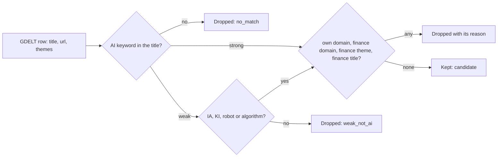

<!-- code-doc
module: src/app/core/world/__init__.py
covers:
  - src/app/core/world/*.py
-->
# World news stream

Candidate stories about AI in human life from outside our own sources, for the Daily Inference
bulletin (spec `specs/018-daily-inference/spec.md`, FR-014..FR-018). Plan:
`specs/018-daily-inference/records/plan-item5-world-sources-2026-10-31.md`. Shipped so far: the
keyword filter (W1). The GDELT reader (W2) and everything after it are not in the code yet.

## Behavior

- The filter reads only the title, the URL and the GDELT themes of a row. It uses no network and
  no database. Tests: `test_filter_has_no_io_imports`.
- A title matches strongly on a phrase list in many languages (`STRONG_PHRASES`) or on the
  capitalised tokens `AI`, `ИИ`, `ШІ`, `GPT` (`STRONG_TOKENS`); phrases ignore case, tokens do not.
  A headline written entirely in capitals (at least `ALL_CAPS_MIN_LETTERS` cased letters) does not
  match on `AI`; a CJK title with a Latin `AI` is not a capitals headline. Tests:
  `test_filter_strong_phrases_in_many_languages`, `test_filter_all_caps_title_is_not_strong`,
  `test_filter_cjk_title_with_ai_is_strong`.
- A weak match (`WEAK_WORDS`, `WEAK_TOKENS`) is kept only when the title also has `IA`, `KI`
  (capitals), "robot" or "algorithm" (`WEAK_KEEP_RE`); other weak matches are dropped. Tests:
  `test_filter_weak_requires_ia_ki_or_robot`.
- Names and stems that gave false hits do not match: Alexa, Siri, Gemini, Claude, "automat...",
  and "Ai" inside a name or a longer word. Tests: `test_filter_ignores_names_alexa_ai_and_automatically`.
- A title is dropped when it has a finance word (`FINANCE_TITLE_RE`), when a GDELT theme is in
  `FINANCE_THEMES`, or when the host is in `FINANCE_DOMAINS` or a subdomain of one. Tests:
  `test_filter_drops_finance_titles_and_themes`, `test_filter_drops_finance_domains`,
  `test_filter_keeps_slguardian_org`.
- A title is dropped when the host is one of our own source domains or a subdomain of one:
  `feeds.arstechnica.com` as a source makes `arstechnica.com` and `www.arstechnica.com` own.
  `load_own_domains` reads the hosts of all sources in `sources.yaml` and cuts the prefixes in
  `FEED_HOST_PREFIXES`. Tests: `test_filter_drops_own_registrable_domains`,
  `test_load_own_domains_cuts_feed_prefixes`, `test_load_own_domains_reads_repo_sources`.
- On 60 real titles of a measured day (30 kept, 30 dropped) the result equals the recorded one.
  Tests: `test_filter_real_title_fixture`.

## Decisions

- Keyword filter on the title, not a GDELT theme filter: GDELT has no AI theme (measured on one
  day, 2026-10-31).
- Weak words need a second signal because `IA`, `KI` and "robot" collide with other words; names
  and "automat..." were removed after false hits on a hand-checked sample.
- Own-domain match is by suffix, not by exact host, so feed and `www` subdomains do not leak our
  own sources into the stream. Only the prefixes in `FEED_HOST_PREFIXES` are cut; a source on a
  shared host (a project page on a hosting provider) makes only that host own, not the provider.
- `slguardian.org` is a general news site; it was listed as finance by mistake and is removed.
- Dedup (same canonical URL, same first 60 normalized title characters) is not part of the filter;
  it belongs to storage (W3).
- The footer credit "News discovery: GDELT Project" with a link is required by the GDELT terms
  and approved by the owner (2026-10-31); the world stream has its own Jev budget of $0.10 per
  day inside the approved $3 per month. Both are used by later steps; neither is in the code yet.

## Invariants

- The filter module imports no network, database or web code and never touches `articles`
  (FR-016). Tests: `test_filter_has_no_io_imports`.
- Production has 3.6 GB of free disk and 2 GB of RAM: the reader (W2) keeps no raw GDELT file and
  holds no whole-day list of raw rows. This is binding for W2 and later steps.

## Code map

- `filter.py`: keyword lists, `classify_title`, `filter_title` (result `FilterResult` with a
  reason), `load_own_domains`, `own_domains_from_hosts`, `host_in_domains`.
- Change a keyword or a drop rule in the constant named above and extend the fixture test.

## Tests

- `tests/unit/test_world_filter.py`: all rules above.
- `tests/fixtures/world/titles.jsonl`: 60 real titles from the measured day, each with the
  recorded decision.
