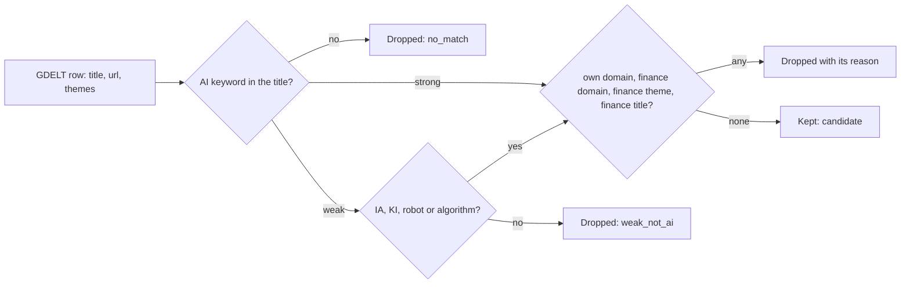
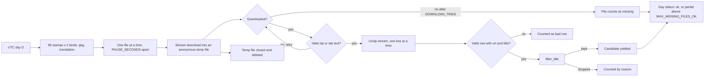
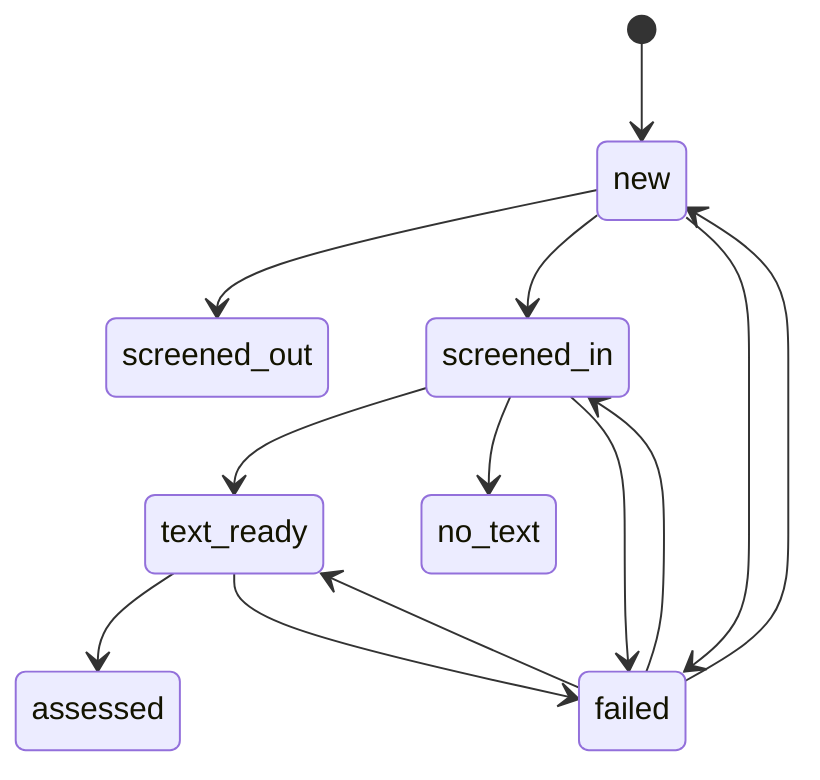
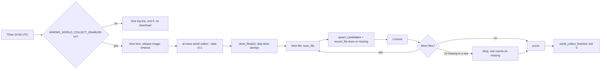
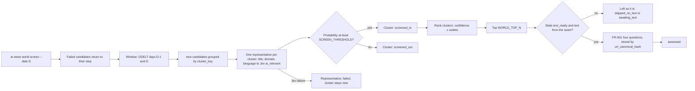
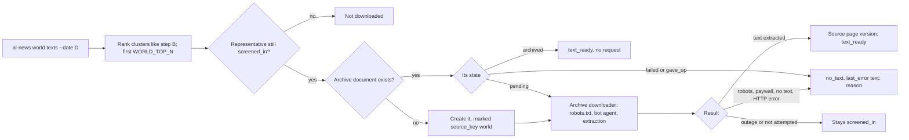

<!-- code-doc
module: src/app/core/world/__init__.py
covers:
  - src/app/core/world/*.py
  - src/app/storage/world.py
  - src/app/core/world_collect.py
  - src/app/core/world_screen.py
  - src/app/core/world_text.py
  - scripts/run_daily_world_job.sh
-->
# World news stream

Candidate stories about AI in human life from outside our own sources, for the Daily Inference
bulletin (spec `specs/018-daily-inference/spec.md`, FR-014..FR-018). Plan:
`specs/018-daily-inference/records/plan-item5-world-sources-2026-10-31.md`. Shipped so far: the
keyword filter (W1), the GDELT reader (W2, no database), the storage tables (W3), the collect
command with its nightly job (W4) and the Jev title screen with the FR-001 questions for the top
candidates (W5, command `ai-news world screen`, not on a timer) and the text download through the
archive (W6, command `ai-news world texts`, not on a timer).

## Behavior

- The filter reads only the title, the URL and the GDELT themes of a row. It uses no network and
  no database. Tests: `test_filter_has_no_io_imports`.
- A title matches strongly on a phrase list in many languages (`STRONG_PHRASES`) or on the
  capitalised tokens `AI`, `ИИ`, `ШІ`, `GPT` (`STRONG_TOKENS`); phrases ignore case, tokens do not.
  `AI` is a token when no letter or digit stands before it and no letter after it: "AI-generated"
  and "AI技术" match; AIDS, AIIB, AIFF, AIRPORT do not. Tests: `test_filter_ai_token_is_a_word`.
  A headline written entirely in capitals (at least `ALL_CAPS_MIN_LETTERS` cased letters) does not
  match on `AI`; a CJK title with a Latin `AI` is not a capitals headline. Tests:
  `test_filter_strong_phrases_in_many_languages`, `test_filter_all_caps_title_is_not_strong`,
  `test_filter_cjk_title_with_ai_is_strong`.
- A weak match (`WEAK_WORDS`, `WEAK_TOKENS`) is kept only with "robot", "algorithm" or `IA` / `KI`
  (capitals) in a context (`WEAK_KEEP_RE`): after an article or preposition ("la IA", "de KI"),
  with a hyphen ("KI-Suche"), before "generativ...", or as the first word. "Des Moines, IA" and
  "Mi KI es tu casa" are dropped. Other weak matches are dropped. Tests:
  `test_filter_weak_requires_ia_ki_or_robot`, `test_filter_ia_ki_need_context`.
- Names and stems that gave false hits do not match: Alexa, Siri, Gemini, Claude, "automat...",
  and "Ai" inside a name or a longer word. Tests: `test_filter_ignores_names_alexa_ai_and_automatically`.
- A title is dropped when it has a finance word (`FINANCE_TITLE_RE`), when a GDELT theme is in
  `FINANCE_THEMES`, or when the host is in `FINANCE_DOMAINS` or a subdomain of one. Words that
  also mean something else (shares, stock photos, actions, акции, 基金, инвест) are not finance
  words alone, so human-life stories stay. Tests: `test_filter_drops_finance_titles_and_themes`,
  `test_filter_drops_finance_domains`, `test_filter_keeps_slguardian_org`,
  `test_filter_keeps_human_life_stories_with_money_words`.
- A title is dropped when the host is one of our own source domains or a subdomain of one:
  `feeds.arstechnica.com` as a source makes `arstechnica.com` and `www.arstechnica.com` own.
  `load_own_domains` reads the hosts of all sources in `sources.yaml` and cuts the prefixes in
  `FEED_HOST_PREFIXES`. Hosts on `SHARED_PLATFORM_DOMAINS` (medium.com, github.com,
  microsoft.com, feedburner.com and similar) are not own: their stories are not ours. Tests:
  `test_filter_own_domains_skip_shared_platforms`, `test_filter_drops_own_registrable_domains`,
  `test_load_own_domains_cuts_feed_prefixes`, `test_load_own_domains_reads_repo_sources`.
- On 60 real titles of a measured day (30 kept, 30 dropped) the result equals the recorded one.
  The expected values were recorded from this filter and read by hand; the fixture pins the
  behavior and is not an independent judgement. Tests: `test_filter_real_title_fixture`.

### GDELT reader

- `day_file_names` gives the 96 file names of a UTC day for a kind (`gkg` or `translation`),
  stamps every 15 minutes (`STAMP_MINUTES`), at `GDELT_BASE_URL` over https. Tests:
  `test_day_file_names_cover_96_stamps`.
- `parse_gkg_line` reads one tab separated GKG 2.1 line: url, source domain, file time, themes,
  language from `srclc:<iso3>` in the translation field (`LANGUAGE_UNKNOWN` when absent, also in
  the primary set: a primary file is not all English), and the title from
  `<PAGE_TITLE>` in the extras with HTML entities decoded. A line without a url or a title, or
  with too few columns, is a bad row: it is counted and skipped, never raised. Tests:
  `test_gkg_row_parse_title_and_lang`, `test_gkg_malformed_row_is_counted_and_skipped`.
  `published_stamp` of a candidate is the GKG record date (the 15 minute file time), not the
  article time; the article time would be `<PAGE_PRECISEPUBTIMESTAMP>` in the extras, which the
  reader does not read yet.
- A file is downloaded as a stream into an anonymous temporary file (zip or plain text, detected
  by the zip signature), read line by line and closed; the file is gone on success, on failure,
  after an error in the consumer and on an early stop; every temporary file handle is closed
  (`GkgFile.close`). Tests: `test_scan_reads_zip_and_plain_files`, `test_scan_leaves_no_file_on_disk`.
- A failed download (HTTP error, 404, transport error) is tried `DOWNLOAD_TRIES` times,
  `RETRY_DELAY_SECONDS` apart; after that the file counts as missing and the scan goes on. A
  download that is not a readable zip (truncated, no central directory) or not tab text (an HTML
  body with status 200) is a failed attempt too. Tests: `test_missing_file_counts_as_missing`,
  `test_download_retries_then_succeeds`, `test_truncated_zip_is_retried_then_missing`,
  `test_html_body_is_missing`.
- A zip that breaks while it is read (CRC, deflate or end of data) counts the file as missing, the
  rows read before the break stay, and the scan goes on. A file whose every row is bad counts as
  missing. Tests: `test_corrupt_zip_mid_stream_counts_as_missing`, `test_all_bad_rows_file_is_missing`.
- After `MAX_CONSECUTIVE_MISSING` missing files in a row the scan stops (`stopped_early`), counts
  the rest as missing and the day is `partial`: a day not yet published would otherwise cost
  3 tries x `RETRY_DELAY_SECONDS` for each of 192 files. Tests: `test_scan_stops_after_consecutive_missing`.
- A day is `ok` with at most `MAX_MISSING_FILES_OK` missing files of its 192, otherwise `partial`.
  Tests: `test_day_status_partial_above_missing_limit`.
- The scan yields candidates (rows kept by the filter) as it reads and fills a `DayStats` with
  files, missing files, rows, bad rows, matched, kept and drops per reason. It stores nothing.
  Tests: `test_scan_counts_rows_and_drop_reasons`.
- Memory does not grow with the day: no list of raw rows is built, only the kept candidates are
  held by the caller. Tests: `test_scan_memory_is_bounded`.
- The command `ai-news world scan --date D [--max-files N]` prints the `DayStats` as one JSON
  line; it needs the network and writes nothing. Tests: `test_cli_world_scan_prints_counts`.

### Storage

- Candidates live in `world_candidates`, files in `world_files`; both are separate from `articles`
  and the digest tables, which the world storage never reads or writes (FR-016). Tests:
  `test_world_tables_not_read_by_digest`, `test_world_storage_never_touches_articles`.
- A candidate is identified by `url_canonical_hash`, made with `canonical_url_hash` (the same
  canonicalization as `articles`). `upsert_candidates` inserts a new hash in state `new`. A repeat
  of a known hash, also in the same batch, changes nothing: `first_seen_at` and the state stay.
  Tests: `test_world_candidate_dedup_by_canonical_hash`,
  `test_world_upsert_repeat_keeps_first_seen_and_state`.
- `cluster_key` is the first `CLUSTER_KEY_CHARS` characters of the title, lower-cased with every
  run of non-letters and non-digits made one space. Candidates of the same story in different
  outlets share it; it is stored, nothing is merged in W3. Tests: `test_world_cluster_key_normalizes_title`.
- `published_at` comes from the 14 digit GDELT record stamp and is null when it does not parse.
  Long titles and URLs (and error texts) are cut to the column size; the hash is made from the
  full URL. An empty batch changes nothing, and a batch over `HASH_CHUNK` hashes is checked in
  chunks. Tests: `test_world_candidate_fields_from_gdelt`,
  `test_world_candidate_cuts_long_url_title_and_error`, `test_world_upsert_batches_over_hash_chunk`,
  `test_world_upsert_empty_batch`.
- `transition` moves a candidate along the arrows of the diagram only (`TRANSITIONS`); any other
  move raises `InvalidTransition` and changes nothing. A move to `failed` adds one to `attempts`
  and stores the error text; a move to `no_text` stores the reason without counting an attempt; a
  move to any other state clears the error. `screened_out`, `no_text` and `assessed` are final. A stored state that is not in the table also raises
  `InvalidTransition`. Tests: `test_world_transitions_follow_allowed_table`,
  `test_world_failed_counts_attempts_and_retries`, `test_world_no_text_keeps_reason`,
  `test_world_transition_unknown_stored_state_is_invalid`.
- `candidates_in_state` lists candidates of a state, oldest first, for the next step to take.
  Tests: `test_world_transitions_follow_allowed_table`.
- `world_files` has one row per GDELT file stamp and kind (`gkg`, `translation`). `record_file`
  stores state `done` or `missing`, rows, matched and the error, and replaces an earlier row of the
  same file. `done_files` gives the `done` files of a UTC day so a rerun skips them; `missing`
  files are tried again. Tests: `test_world_file_states_record_and_skip_done`.
- `prune` deletes candidates whose `first_seen_at` is older than `WORLD_RETENTION_DAYS` and file
  rows last updated before the same limit; a row exactly at the limit stays. Archive documents,
  archive texts, articles and world change answers are not touched. Tests: `test_world_prune_keeps_archive`, `test_world_prune_cutoff_boundary`.
- The migration adds both tables on SQLite and PostgreSQL, is safe after `create_all`, and its
  schema equals the models. Tests: `test_world_migration_round_trip` (SQLite). CI has no
  PostgreSQL test: on 2026-11-01 `upgrade head`, `downgrade -1`, `upgrade head` and a round of
  upsert (1200 rows, 1200 repeats), `record_file`, `done_files`, `prune` and `transition` ran by
  hand on a throwaway PostgreSQL database without errors. Repeat that check by hand when the
  tables change.

### Collect job

- `ai-news world collect [--date D] [--max-files N]` takes one UTC day with `--date`. Without
  it, it collects yesterday and then the day before (catch-up: a night the timer missed, or a day
  cut short, is recovered; a complete day costs no download because every file is `done`). The
  per-day rules below apply to each day. Tests: `test_collect_default_runs_yesterday_and_day_before`,
  `test_collect_catch_up_recovers_missed_night`, `test_collect_complete_day_downloads_nothing`.
  A day goes through the 192 file stamps of the day (`gkg` first, then `translation`), skips every file
  that `done_files` lists, scans the others one at a time with `scan_file` (streamed, no raw file
  kept), stores the kept candidates with `upsert_candidates`, records the file as `done` (or
  `missing`) with `record_file` and commits. A crash loses at most the file being read. Then
  `prune` runs and the summary is logged; the prune counts are in the summary. Tests:
  `test_collect_prunes_old_rows`, `test_collect_resumes_without_reprocessing_files`,
  `test_collect_commits_per_file`, `test_collect_crash_keeps_finished_files`.
- A missing file is recorded `missing` and tried again by the next run of the same day. After
  `MAX_CONSECUTIVE_MISSING` missing files in a row the run stops, the rest is not recorded and
  counts as missing, except files already `done`, which count as `skipped`. Tests: `test_collect_missing_file_is_recorded_and_retried`,
  `test_collect_stops_after_consecutive_missing`,
  `test_collect_stop_counts_done_files_as_skipped`.
- The day is `partial` when the files not done after the run (missing now) are more than
  `MAX_MISSING_FILES_OK`; a rerun that completes the files makes it `ok`. Tests:
  `test_collect_partial_day_flag`. `partial` is not stored: W5 and W6 derive it from `done_files`
  of the day and `MAX_MISSING_FILES_OK` (a day has 192 files).
- One log line `world_collect_finished` carries `day`, `files` (read now), `skipped` (done before),
  `missing`, `partial`, `rows`, `matched`, `kept`, `new`, `repeats`, `pruned_candidates` and
  `pruned_files`; the command prints the same fields as JSON. Tests:
  `test_collect_summary_counts`, `test_cli_world_collect_prints_summary`.
- The command works whatever the switch says. The job script reads `AINEWS_WORLD_COLLECT_ENABLED`
  (environment, else the deploy `.env`), default off. True values: `true`, `1`, `yes`, `on`, in any
  case, optionally in single or double quotes. In `.env` a leading `export `, spaces around the
  value, a trailing `# comment` and CRLF line ends are accepted, the last assignment wins, and a
  value with spaces before `=` is off. When the value is not true the script logs
  `world collect skipped: AINEWS_WORLD_COLLECT_ENABLED is off` and exits 0 before taking the lock,
  starting a container or downloading. Tests: `test_world_job_script_switch_off_does_nothing`,
  `test_world_job_script_switch_on_from_env_file`, `test_world_job_script_env_file_forms`.
- `scripts/run_daily_world_job.sh` is shaped like the archive job: host lock
  (`/tmp/ai-news-auto-update.lock`, 1800 s wait), the release image from `.last_deploy_image`,
  `timeout`, one container name `ai-news-world`, always exit 0, a failure or timeout is one stderr
  line. The timer `ai-news-daily-world` runs it at 04:00 UTC. Tests: `test_world_job_script_is_isolated`,
  `test_install_timers_includes_world`, `test_sudoers_sample_matches_the_sudo_calls_of_the_scripts`.
  `install_daily_timers.sh` has no `disable` path for the world timer; the switch is the way to turn
  the job off (no test).

### Jev screen and assessment (W5)

**Step A, title screen**
- One Jev question `ai_relevant` (type `noul`: probability that the story is about AI in human
  life, the scope of spec 018) per cluster, version `WORLD_SCREEN_VERSION`. The request state is
  the title, the source domain and the language, nothing else: no URL, no text. The title is cut to
  `TITLE_LIMIT`. Jev has no local rule against a request without content: the daily path already
  sends `Content:` empty for feed items without text; whether the live API accepts a title-only
  state is checked by the gate run (see Decisions). `RUBRIC_VERSION` and `WORLD_CHANGE_VERSION`
  are not touched. Tests: `test_screen_questions_shape_and_version`,
  `test_screen_sends_title_and_domain_only`, `test_screen_versions_leave_rubric_alone`.
- The candidates of step A are those in state `new` whose GDELT day (the first 8 characters of
  `gdelt_file`) is `--date` or the day before: a candidate not reached on one day is still
  pending on the next run, and after that it is left alone. Tests: `test_screen_window_is_two_days`.
- Candidates with the same `cluster_key` are one story: the oldest (lowest `first_seen_at`, then
  id) is the representative and is the only one sent. Every other `new` candidate of the cluster in
  the window gets the same state and the same `screen_confidence` without a request. A new
  candidate whose cluster already has a screened member in the window (from an earlier run) also
  follows that member without a request: `screened_out` if it is out, else `screened_in`. The
  oldest screened member of the cluster is the reference. Tests:
  `test_screen_cluster_follows_representative`, `test_late_outlet_follows_screened_cluster`,
  `test_late_outlet_follows_oldest_screened_member`.
- The probability is stored in `screen_confidence`. At or above `SCREEN_THRESHOLD` the state is
  `screened_in`, below it `screened_out` (final). An answer that is not a probability in [0, 1] is
  a failure. Tests: `test_screen_threshold_splits_in_and_out`, `test_screen_bad_answer_is_a_failure`.

**Ranking and step B**
- Clusters of candidates in `screened_in`, `text_ready` or `assessed` are ranked by priority
  (`screen_confidence` x number of distinct source domains in the cluster), then oldest first.
  GDELT themes are not stored by W3, so human-life themes do not take part. The first
  `WORLD_TOP_N` clusters are the top; already assessed clusters come first whatever their
  priority, so a window never asks more than `WORLD_TOP_N` stories in total over any number of
  runs. The representative of a
  cluster is its assessed member, else a `text_ready` one, else the oldest (lowest
  `first_seen_at`, then id). Tests: `test_rank_representative_prefers_assessed_then_text_ready_then_oldest`. The priority is stored
  in `priority` of the representative. Tests: `test_rank_orders_by_confidence_times_outlets`,
  `test_rank_assessed_keep_their_place`.
- Step B asks the four FR-001 questions of `world_change` (the same questions, validation and
  storage as `bulletin assess`: `WorldChangeAssessor`, `WorldChangeRepo`, `WORLD_CHANGE_VERSION`),
  keyed by `url_canonical_hash` and with no `article_id`, only for top candidates in state
  `text_ready` for which the text seam returns text. The state is the title and that text. Tests:
  `test_stage_b_only_for_top_n_with_text`, `test_stage_b_stores_answers_by_hash`.
- The text seam is `TextSource`, a function from a candidate to its text or None. `run_screen`
  defaults to `no_text` (always None); the command passes `archive_text_source` (W6, see the next
  section). A top candidate without text from the seam stays as it is and counts in `skipped_no_text`; a top
  candidate still `screened_in` counts in `awaiting_text`. When nothing could be asked the summary
  says so in `note`. Tests: `test_stage_b_without_text_does_nothing_and_says_so`.
- The assessed candidate moves to `assessed`; the cluster followers get no answer of their own
  (the bulletin reads a story through its representative). Tests: `test_stage_b_stores_answers_by_hash`.

**Cost cap and failures**
- The budget is per real UTC calendar day, not per `--date`. All world requests of a real day
  (steps A and B, any `--date`, any number of runs) go through one provider journal
  `data/world/<UTC today>/journal-<WORLD_JOURNAL_VERSION>.sqlite3` with the fixed cap
  `WORLD_JEV_MAX_USD_PER_DAY` ($0.10, owner 2026-10-31), a file of its own: the digest's Jev cap
  (`data/daily-admission/<today>/`, $0.05) and `bulletin assess` (`data/bulletin/<D>/`) neither
  share nor spend it. The next UTC day opens a new journal and a new budget. Tests:
  `test_world_journal_is_separate_from_digest_cap`,
  `test_world_budget_is_per_real_day_across_dates_and_limits`,
  `test_world_next_real_day_gets_new_budget`.
- `--max-usd` is a run-local lower limit and never opens another journal: before each request the
  run stops when the journal's committed spend of the day has reached it; above
  `WORLD_JEV_MAX_USD_PER_DAY` it is rejected and nothing is opened. Tests:
  `test_world_run_limit_stops_before_request`, `test_world_run_limit_equal_to_spend_stops` (spend equal
  to the limit stops), `test_world_run_limit_also_stops_step_b`,
  `test_cli_world_screen_rejects_max_usd_above_cap`.
- At the cap (or any journal stop or outage) the run stops, logs a stop line with the reason (event
  prefix `world_screen` for step A, `world_change` for step B, suffix `_stopped`), and also
  `world_cost_cap` when the reason is the day cap or the run limit; every unprocessed candidate
  stays in its state and counts in `not_attempted`; the next run takes them. Tests:
  `test_world_cap_stops_requests`, `test_world_run_limit_stops_before_request`.
- A bad answer to a representative (a reply that is not a valid probability or not valid
  FR-001 answers) moves only that representative to `failed` with `attempts` plus one and
  `last_error` `screen: ...` (or `assess: ...` for step B); its cluster stays `new`. There is no
  retry in the same run. With the journal, an HTTP error status, a transport error or an outage is
  not a failure of the candidate but a journal stop: nothing is marked `failed`, `attempts` stays,
  the run ends and the rest counts in `not_attempted`. Tests:
  `test_world_jev_failure_leaves_candidates_pending`,
  `test_world_wedged_journal_marks_nothing_failed`.
- A call that failed in transit may have been billed, so the journal refuses every further request
  (`unknown_or_failed_previous_call_requires_review`), also in later runs of the same real day.
  Operator step: read the `world_screen_usage` log line and the journal file of that day, decide
  whether the call was billed. The simple way is to wait for the next UTC day (a new budget; the
  old file stays). To go on the same day, accepting the risk of paying that call twice, do not
  delete the file: rename it to `journal-world-stream-1.sqlite3.reviewed-<UTC time>` and run again
  with `--max-usd` set to $0.10 minus `total_committed_usd` from the `world_screen_usage` line
  (`cost_usd` of the summary understates it, because unknown calls count 0 there); use that lowered
  value for every further run of that UTC day. Never work around the stop by only changing
  `--max-usd`: it does not open another journal (unlike `bulletin assess`), and a fresh file
  without the lowered limit would open a second $0.10 for the same day. Tests: `test_world_wedged_journal_marks_nothing_failed` (the stop
  itself); the operator steps have no test.
- At the start of a real run, `failed` candidates of the window with fewer than `MAX_ATTEMPTS`
  attempts return to the step named in `last_error`: `screen` to `new`, `assess` to `text_ready`.
  Other failures are not touched. `no_text` is not `failed` and is never requeued (W6 sets it).
  Tests: `test_failed_candidates_return_to_their_step`,
  `test_failed_after_max_attempts_stay_failed`, `test_no_text_is_not_requeued_by_screen`.

**Command** `ai-news world screen --date D [--max-usd X] [--dry-run]`
- Runs step A and then step B for the window. Prints one JSON summary: `screened` (candidates
  that got a state), `in`, `out`, `requests` (step A requests answered or failed), `asked`
  (step B candidates sent), `assessed`, `skipped_no_text`, `awaiting_text`, `failed`,
  `not_attempted`, `cost_usd` (journal total of the day, earlier runs
  included), `tokens` (Jev input tokens of this run, per step: `screen`, `assess`), `note`.
  Tests: `test_cli_world_screen_summary`.
- A real run needs `JEV_API_KEY`; without it the command exits 2. Tests:
  `test_cli_world_screen_needs_a_key`.
- `--dry-run` sends nothing and writes nothing (no table creation, no journal, no requeue), needs no
  key, and prints the counts it would work on: `would_screen` (clusters of `new` candidates),
  `would_follow` (cluster followers and late outlets), `would_assess` (`text_ready` in the top;
  the text seam is not called; the top is cut to `WORLD_TOP_N`),
  `awaiting_text` and `retryable_failed`. Tests: `test_cli_world_screen_dry_run_sends_nothing_writes_nothing`, `test_dry_run_respects_top_n`.
- The command is not on a timer and not in the 04:00 job, which stays collect-only; wiring comes
  with W7. Tests: `test_world_job_script_is_isolated`.
- The command reads text through `archive_text_source`, so step B asks about the candidates whose
  text `world texts` stored. Tests: `test_cli_world_screen_reads_archive_text`.

### Text download (W6)

- The command takes the same top as step B (`rank_clusters`, first `WORLD_TOP_N` clusters of
  `screened_in`, `text_ready` and `assessed`) and downloads only the representative of a cluster
  that is still `screened_in`; followers, `text_ready`, `assessed` and `no_text` candidates are not
  downloaded. One run never downloads more than `WORLD_TOP_N` pages (plus their robots.txt); the
  bound is per run, W7 runs the command once a day and no daily bound is kept in code. Clusters
  that already have text keep their places in the top, so nothing beyond the top is fetched. When
  a representative ends in `no_text`, the next run ranks the cluster by its remaining outlets and
  tries the next outlet. Tests: `test_world_never_downloads_more_than_n`,
  `test_world_text_only_cluster_representative_is_downloaded`,
  `test_world_text_next_run_tries_the_next_outlet`,
  `test_world_text_no_text_cluster_ranks_by_remaining_outlets`.
- The download is the archive's. A hash with no `ArchiveDocument` gets one through
  `archive_articles` with a transient `Article` (never added to the session, as in
  `archive import-db`; `article_id` empty) and `source_key` set to `WORLD_SOURCE_KEY`. A hash that
  already has a document, for example a real article archived by the nightly job, is never
  upserted: its metadata stays and the world stream only reads it. Then `download_documents` runs
  the archive's download step on the pending documents: `SourcePageDownloader` with robots.txt,
  the declared bot user agent, per-host pacing, redirects, body limit, the reuse of a page the
  daily publish already extracted, and the archive's outage rule. No second crawler. Tests:
  `test_world_text_goes_through_archive_robots_and_bot_agent`,
  `test_world_text_reuses_stored_archive_text`,
  `test_world_text_keeps_metadata_of_a_real_archive_document`.
- Documents marked `WORLD_SOURCE_KEY` stay out of the nightly job: `window_states` (coverage)
  skips them and `due()` without ids (the nightly download list, its caps and retries) skips them;
  the world stream makes its own single attempt. If the nightly job later archives a real article
  with the same URL, `archive_articles` upserts the document and the real `source_key`,
  `article_id` and title replace the marker, so it joins the nightly numbers. The size warning
  still counts world texts (the whole table; accepted). Tests:
  `test_archive_coverage_skips_world_documents`, `test_archive_due_skips_world_documents`,
  `test_real_article_takes_over_a_world_document`.
- Extracted text becomes an `archive_texts` version with origin `source_page`; the candidate moves
  to `text_ready`. A document that already has text (for example from the nightly archive) moves
  the candidate to `text_ready` without a request. Tests:
  `test_world_text_goes_through_archive_robots_and_bot_agent`,
  `test_world_text_reuses_stored_archive_text`.
- `no_text` with `last_error` `text: <issue>` follows when the document is `failed` (whatever its
  `next_attempt_at`) or `gave_up`, after the attempt of this run or from an earlier one: robots.txt
  denied (`robots_disallowed_or_unavailable`), a paywall or too short an extraction, a non-article
  page, an HTTP error status (`http_404` and the like) or a per-page timeout. The story then keeps
  its title only (spec User Story 1, scenario 4), and the next run falls back to the next outlet.
  The prefix `text:` differs from `screen:` and `assess:`; `no_text` is final, so W5 never
  requeues it. Tests: `test_world_text_blocked_by_robots_is_no_text`,
  `test_world_text_paywall_and_empty_page_are_no_text`,
  `test_world_text_http_error_is_no_text_with_reason`,
  `test_world_text_existing_failed_or_gave_up_document_is_no_text`.
- When the downloader reports an outage, or a pending page was not attempted (time or per-host
  cap), the candidate stays `screened_in` and no `no_text` is written; the archive keeps its own
  attempts and cache as its outage rule says. The next run takes it. Tests:
  `test_world_text_outage_marks_nothing`.
- Archive storage: the page text lives in `archive_documents` / `archive_texts` (origin
  `source_page`), found by `url_canonical_hash`; the candidate stores no text. Following ER-9 the
  text is read to ask Jev and to write the retelling and is never published; no `articles` row is
  made. Candidate pruning does not touch archive rows. Tests:
  `test_world_text_creates_no_articles_and_keeps_archive_after_prune`.
- `archive_text_source` is the `TextSource` for step B: the newest stored version of the
  candidate's archive document, cut to `CONTENT_LIMIT` of Jev, or None. Tests:
  `test_world_text_seam_feeds_step_b`, `test_world_text_seam_cuts_to_jev_limit`.
- `--dry-run` writes nothing (no table, no archive document, no request) and prints the same
  summary with `would_download` (the representatives it would try). Tests:
  `test_world_text_dry_run_writes_nothing`.
- The command prints one JSON summary: `date`, `dry_run`, `top` (clusters in the top),
  `candidates` (representatives still `screened_in`), `downloads` (pages requested), `cache_reused`,
  `text_ready`, `no_text`, `reasons` (`no_text` by issue), `kept` (left `screened_in`), `outage`.
  Tests: `test_cli_world_texts_summary`.
- The order of a day is `world screen` (step A), `world texts`, `world screen` again (step B reads
  the new text); the second screen asks nothing in step A. Wiring and the timer are W7. Tests: none
  (a rule of use).

## Decisions

- Keyword filter on the title, not a GDELT theme filter: GDELT has no AI theme (measured on one
  day, 2026-10-31).
- Weak words need a second signal because `IA`, `KI` and "robot" collide with other words; names
  and "automat..." were removed after false hits on a hand-checked sample.
- Own-domain match is by suffix, not by exact host, so feed and `www` subdomains do not leak our
  own sources into the stream. Only the prefixes in `FEED_HOST_PREFIXES` are cut; a source on a
  shared host (a project page on a hosting provider) is not own at all
  (`SHARED_PLATFORM_DOMAINS`, decided 2026-10-31 by the coordinator).
- `slguardian.org` is a general news site; it was listed as finance by mistake and is removed.
- Files come one at a time, a second apart, with a bot user agent: the production server has little
  disk and memory (see Invariants), and GDELT files are small enough that parallel download gains
  nothing in a nightly job (decided 2026-10-31 (agent)).
- `world_change_assessments` keys stay as they are (hash and question version); W5 reads a
  candidate's answers by its `url_canonical_hash`, no join column is added (decided 2026-11-01
  (agent)).
- File rows are pruned with the candidates: they are 192 rows a day, and a catch-up older than the
  retention is not expected (decided 2026-11-01 (agent)).
- Check-then-insert without `ON CONFLICT` in `upsert_candidates`: it relies on one writer (see
  Invariants); decided 2026-11-01 by the coordinator.
- A `failed` candidate returns to the step that failed (`new`, `screened_in` or `text_ready`), so
  W5 and W6 need no separate retry state; the run decides how many attempts are enough (decided
  2026-11-01 (agent)).
- Switch off by default and read by the job script, not by the command: the download is about
  820 MB a day; turning it on in production is a separate owner decision (owner, 2026-11-01). A
  manual `world collect` stays possible for smoke runs and catch-up.
- The collect orchestration is `core/world_collect.py`, outside `core/world/`, because
  `storage/world.py` imports `core/world/gdelt.py` and core world code must not import storage
  (decided 2026-11-01 (agent)).
- The job processes only yesterday; a day cut short by the timeout is finished by hand with
  `ai-news world collect --date D`, which skips done files (decided 2026-11-01 (agent)).
- No `--dry-run` for collect: it only writes the world tables (decided 2026-11-01 (agent)).
- The scan has no `--dry-run`: in W2 nothing is written at all; the flag arrives with storage (W4).
- A 404 is retried like any failure because the newest files appear on https with a delay.
- Dedup (same canonical URL, same first 60 normalized title characters) is not part of the filter;
  it belongs to storage (W3).
- The footer credit "News discovery: GDELT Project" with a link is required by the GDELT terms
  and approved by the owner (2026-10-31); the digest Jev cap of FR-012 stays $0.05 per day,
  and the world stream has its own Jev cap of $0.10 per day (owner, 2026-10-31), inside the
  approved $3 per month. The world cap is used by W5 (`WORLD_JEV_MAX_USD_PER_DAY`).
- Screen threshold `SCREEN_THRESHOLD` is 0.5 (decided 2026-11-01 (agent)): no measured Jev
  distribution exists yet; the gate run on a stored day reports the share kept and the threshold
  is retuned from it, with `WORLD_SCREEN_VERSION` raised only when the question text changes.
- The screen asks `ai_relevant` for "AI in human life" and not the digest's "AI is the central
  subject": the stream exists for stories outside the AI industry (decided 2026-11-01 (agent)).
- One request per cluster, followers copy the result: the same story in many outlets costs one
  request, and the outlet count is what ranks it (plan 6.1; the copy rule decided 2026-11-01
  (agent)).
- Outlets are counted as distinct source domains, not cluster size, so one outlet posting the same
  story under many URLs does not rank it up (decided 2026-11-01 (agent)).
- The failing step is written as a prefix of `last_error` (`screen:` or `assess:`) because the
  `failed` state does not say where it came from and W3 has no column for it; W6 uses its own
  prefix (decided 2026-11-01 (agent)).
- Steps A and B share one journal per real UTC day with a fixed cap, so one $0.10 covers the
  stream whatever `--date` or `--max-usd` a run has (coordinator, 2026-11-01, after review: the
  owner's rule is a hard stop per calendar day; `bulletin assess` keys its journal by cap and is
  not a model for this).
- Top N is per window (GDELT days D-1 and D), not exactly per real day across sliding windows; the
  same story can be asked again in the next window. Known for W5, left as is (coordinator,
  2026-11-01).
- Orchestration is `core/world_screen.py` (it imports storage); the question, state and parser are
  pure and live in `core/world/screen.py` (decided 2026-11-01 (agent)).
- Real token sizes of A and B are not measured yet: the plan assumed 300 tokens for A and
  acceptance of a title-only state; the gate run replaces the assumptions.

- `world texts` is a command of its own, not a step of `world screen`: it needs no Jev key and no
  money, and a network failure must not stop the paid step (decided 2026-11-01 (agent)).
- Every non-outage failure of a page is `no_text` at once, with the archive's issue as the reason,
  and the story is not retried by the world stream: the archive keeps its own retry schedule for the
  document, and the next outlet of the cluster is tried instead (decided 2026-11-01 (agent)).
- The archive's own download step is reused through `download_documents` (the same function the
  nightly capture uses, restricted to given document ids) and not copied, so robots, pacing, the
  outage rule and the cache stay one code path (plan section 5).
- World documents are marked (`WORLD_SOURCE_KEY`) and kept out of the nightly capture's coverage,
  download list and retries, so 100 world pages cannot take its caps or lower its coverage target;
  the world stream does one attempt and falls back to the next outlet (coordinator, 2026-11-01,
  after review). An existing document is never rewritten by the world stream, because
  `archive_articles` would blank the `article_id` and `source_key` of a real article.

## Invariants

- The filter module imports no network, database or web code and never touches `articles`
  (FR-016). Tests: `test_filter_has_no_io_imports`.
- Code in `src/app/core/world/` never imports `app.storage`, because `storage/world.py` imports
  `core/world/gdelt.py`; a relative import counts too. Tests: `test_world_core_never_imports_storage`,
  `test_import_scan_resolves_relative_imports`.
- `src/app/storage/world.py` is imported only by the world code and the world CLI, never by web,
  digest, bulletin or daily code. Tests: `test_world_tables_not_read_by_digest`.
- One writer: only the collect job writes the world tables, and only under the host lock.
  `upsert_candidates` is check-then-insert; a second concurrent writer could lose a batch to
  `IntegrityError`, and would need `ON CONFLICT DO NOTHING`. Tests: none (a rule of use).
- The world job never changes the fetch, digest or archive jobs: own timer, own container name,
  own log `logs/daily-world.log`, always exit 0. Tests: `test_world_job_script_is_isolated`.
- Production has 3.6 GB of free disk and 2 GB of RAM: the reader keeps no raw GDELT file and holds
  no whole-day list of raw rows; one file lives on disk at a time and is deleted. Binding for the
  later steps. Tests: `test_scan_leaves_no_file_on_disk`, `test_scan_memory_is_bounded`.

- `core/world/screen.py` imports no storage, network or database code (same rule as the other
  core world modules). Tests: `test_world_core_never_imports_storage`.
- World requests never use the journal file of the digest or of `bulletin assess`. Tests:
  `test_world_journal_is_separate_from_digest_cap`.
- `core/world_text.py` makes no `articles` row and never adds its transient `Article` to a session;
  it writes archive rows only through `archive_articles` and the archive download step. Tests:
  `test_world_text_creates_no_articles_and_keeps_archive_after_prune`.
- Step B writes only `world_change_assessments` (by hash) and `world_candidates`; no world candidate
  becomes an article. Tests: `test_world_storage_never_touches_articles`.

## Code map

- `filter.py`: keyword lists, `classify_title`, `filter_title` (result `FilterResult` with a
  reason), `load_own_domains`, `own_domains_from_hosts`, `host_in_domains`.
- `gdelt.py`: constants, `day_file_names`, `parse_gkg_line`, `GkgRow`, `Candidate`, `DayStats`,
  `GkgFile` (open file, lines, close), `fetch_file` (download, check, retries), `scan_day`.
- `storage/world.py`: `WorldRepo` (`upsert_candidates`, `transition`, `candidates_in_state`,
  `record_file`, `done_files`, `prune`), `cluster_key`, `TRANSITIONS`, `InvalidTransition`, state and
  file constants, `WORLD_RETENTION_DAYS`, `CLUSTER_KEY_CHARS`.
- `storage/models_sql.py`: `WorldCandidate` (`world_candidates`), `WorldFile` (`world_files`);
  migration `c9f3a7e15b28_add_world_candidates_and_files.py`, after `b8e2d4f61a07`.
- `gdelt.py` also has `scan_file` and `FileResult` (one file; `scan_day` is built on them).
- `core/world_collect.py`: `collect_day`, `CollectSummary`, `yesterday_utc`; the only caller of
  `WorldRepo` besides tests.
- `scripts/run_daily_world_job.sh`; `scripts/install_daily_timers.sh` writes the unit and timer
  `ai-news-daily-world` (04:00 UTC) and enables the timer on every deploy.
- `core/world/screen.py`: `WORLD_SCREEN_VERSION`, `SCREEN_QUESTIONS`, `SCREEN_THRESHOLD`,
  `WORLD_TOP_N`, `WORLD_JEV_MAX_USD_PER_DAY`, `MAX_ATTEMPTS`, `screen_state`, `parse_screen`,
  `priority`.
- `core/world_screen.py`: `run_screen`, `open_world_assessor`, `TextSource`, `no_text`; asks
  through `WorldChangeAssessor.ask` and stores through `WorldChangeRepo`
  (`core/bulletin/world_change.py`). `WorldRepo.candidates_in_window` and `set_priority` serve it.
- `core/world_text.py`: `run_texts`, `archive_text_source`; ranks with `rank_clusters`, makes
  documents with `archive_articles` and downloads with `download_documents`
  (`core/archive/capture.py`, see `capture.md`).
- `storage/world.py`: `transition` keeps the reason for `no_text`.
- `cli/main.py`: `world` Typer group with `scan`, `collect`, `screen` and `texts`.
- Change a keyword or a drop rule in the constant named above and extend the fixture test.

## Tests

- `tests/unit/test_world_filter.py`: all rules above.
- `tests/unit/test_world_gdelt.py`: reader rules above, with `httpx.MockTransport` and small zip
  and plain fixtures built in the test.
- `tests/unit/test_world_storage.py`: storage rules above, including the migration round trip.
- `tests/unit/test_world_collect.py`: collect rules above, with fake transports and a SQLite file.
- `tests/unit/test_world_screen.py`: W5 rules above, with `httpx.MockTransport`, a real provider
  journal in a temp directory and a SQLite file.
- `tests/unit/test_world_text.py`: W6 rules above, with `httpx.MockTransport` for the pages and a
  SQLite file; the downloader runs for real on a temp cache.
- `tests/unit/test_deepseek_digest.py`: the job script test; `tests/unit/test_daily_timers.py`: timer.
- `tests/fixtures/world/titles.jsonl`: 60 real titles from the measured day, each with the
  recorded decision.
