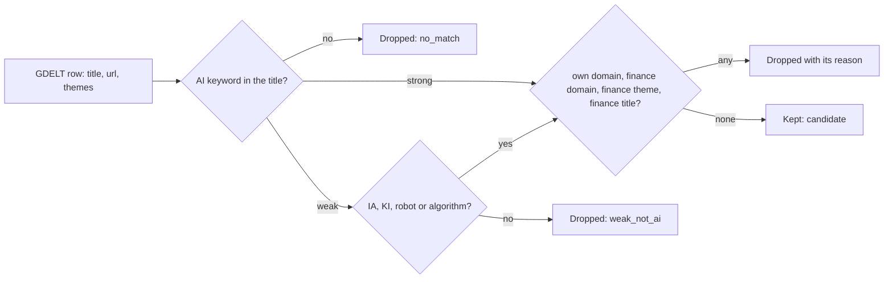
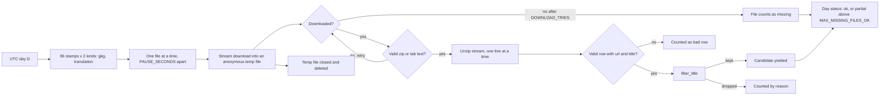
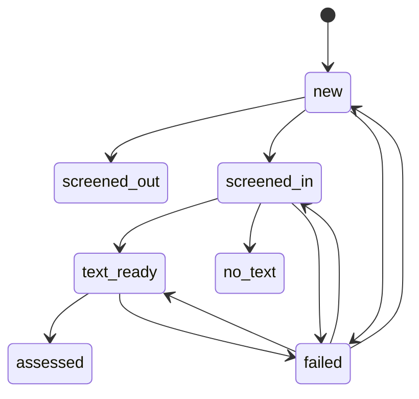

<!-- code-doc
module: src/app/core/world/__init__.py
covers:
  - src/app/core/world/*.py
  - src/app/storage/world.py
-->
# World news stream

Candidate stories about AI in human life from outside our own sources, for the Daily Inference
bulletin (spec `specs/018-daily-inference/spec.md`, FR-014..FR-018). Plan:
`specs/018-daily-inference/records/plan-item5-world-sources-2026-10-31.md`. Shipped so far: the
keyword filter (W1), the GDELT reader (W2, no database) and the storage tables (W3). The collect
command, jobs and Jev steps (W4 and later) are not in the code yet.

## Behavior

- The filter reads only the title, the URL and the GDELT themes of a row. It uses no network and
  no database. Tests: `test_filter_has_no_io_imports`.
- A title matches strongly on a phrase list in many languages (`STRONG_PHRASES`) or on the
  capitalised tokens `AI`, `ИИ`, `ШІ`, `GPT` (`STRONG_TOKENS`); phrases ignore case, tokens do not.
  `AI` is a token when no letter or digit stands before it and no letter after it: "AI-generated"
  and "AI技术" match; AIDS, AIIB, AIFF, AIRPORT do not. Tests: `test_filter_ai_token_is_a_word`.
  A headline written entirely in capitals (at least `ALL_CAPS_MIN_LETTERS` cased letters) does not
  match on `AI`; a CJK title with a Latin `AI` is not a capitals headline. Tests:
  `test_filter_strong_phrases_in_many_languages`, `test_filter_all_caps_title_is_not_strong`,
  `test_filter_cjk_title_with_ai_is_strong`.
- A weak match (`WEAK_WORDS`, `WEAK_TOKENS`) is kept only with "robot", "algorithm" or `IA` / `KI`
  (capitals) in a context (`WEAK_KEEP_RE`): after an article or preposition ("la IA", "de KI"),
  with a hyphen ("KI-Suche"), before "generativ...", or as the first word. "Des Moines, IA" and
  "Mi KI es tu casa" are dropped. Other weak matches are dropped. Tests:
  `test_filter_weak_requires_ia_ki_or_robot`, `test_filter_ia_ki_need_context`.
- Names and stems that gave false hits do not match: Alexa, Siri, Gemini, Claude, "automat...",
  and "Ai" inside a name or a longer word. Tests: `test_filter_ignores_names_alexa_ai_and_automatically`.
- A title is dropped when it has a finance word (`FINANCE_TITLE_RE`), when a GDELT theme is in
  `FINANCE_THEMES`, or when the host is in `FINANCE_DOMAINS` or a subdomain of one. Words that
  also mean something else (shares, stock photos, actions, акции, 基金, инвест) are not finance
  words alone, so human-life stories stay. Tests: `test_filter_drops_finance_titles_and_themes`,
  `test_filter_drops_finance_domains`, `test_filter_keeps_slguardian_org`,
  `test_filter_keeps_human_life_stories_with_money_words`.
- A title is dropped when the host is one of our own source domains or a subdomain of one:
  `feeds.arstechnica.com` as a source makes `arstechnica.com` and `www.arstechnica.com` own.
  `load_own_domains` reads the hosts of all sources in `sources.yaml` and cuts the prefixes in
  `FEED_HOST_PREFIXES`. Hosts on `SHARED_PLATFORM_DOMAINS` (medium.com, github.com,
  microsoft.com, feedburner.com and similar) are not own: their stories are not ours. Tests:
  `test_filter_own_domains_skip_shared_platforms`, `test_filter_drops_own_registrable_domains`,
  `test_load_own_domains_cuts_feed_prefixes`, `test_load_own_domains_reads_repo_sources`.
- On 60 real titles of a measured day (30 kept, 30 dropped) the result equals the recorded one.
  The expected values were recorded from this filter and read by hand; the fixture pins the
  behavior and is not an independent judgement. Tests: `test_filter_real_title_fixture`.

### GDELT reader

- `day_file_names` gives the 96 file names of a UTC day for a kind (`gkg` or `translation`),
  stamps every 15 minutes (`STAMP_MINUTES`), at `GDELT_BASE_URL` over https. Tests:
  `test_day_file_names_cover_96_stamps`.
- `parse_gkg_line` reads one tab separated GKG 2.1 line: url, source domain, file time, themes,
  language from `srclc:<iso3>` in the translation field (`LANGUAGE_UNKNOWN` when absent, also in
  the primary set: a primary file is not all English), and the title from
  `<PAGE_TITLE>` in the extras with HTML entities decoded. A line without a url or a title, or
  with too few columns, is a bad row: it is counted and skipped, never raised. Tests:
  `test_gkg_row_parse_title_and_lang`, `test_gkg_malformed_row_is_counted_and_skipped`.
  `published_stamp` of a candidate is the GKG record date (the 15 minute file time), not the
  article time; the article time would be `<PAGE_PRECISEPUBTIMESTAMP>` in the extras, which the
  reader does not read yet.
- A file is downloaded as a stream into an anonymous temporary file (zip or plain text, detected
  by the zip signature), read line by line and closed; the file is gone on success, on failure,
  after an error in the consumer and on an early stop; every temporary file handle is closed
  (`GkgFile.close`). Tests: `test_scan_reads_zip_and_plain_files`, `test_scan_leaves_no_file_on_disk`.
- A failed download (HTTP error, 404, transport error) is tried `DOWNLOAD_TRIES` times,
  `RETRY_DELAY_SECONDS` apart; after that the file counts as missing and the scan goes on. A
  download that is not a readable zip (truncated, no central directory) or not tab text (an HTML
  body with status 200) is a failed attempt too. Tests: `test_missing_file_counts_as_missing`,
  `test_download_retries_then_succeeds`, `test_truncated_zip_is_retried_then_missing`,
  `test_html_body_is_missing`.
- A zip that breaks while it is read (CRC, deflate or end of data) counts the file as missing, the
  rows read before the break stay, and the scan goes on. A file whose every row is bad counts as
  missing. Tests: `test_corrupt_zip_mid_stream_counts_as_missing`, `test_all_bad_rows_file_is_missing`.
- After `MAX_CONSECUTIVE_MISSING` missing files in a row the scan stops (`stopped_early`), counts
  the rest as missing and the day is `partial`: a day not yet published would otherwise cost
  3 tries x `RETRY_DELAY_SECONDS` for each of 192 files. Tests: `test_scan_stops_after_consecutive_missing`.
- A day is `ok` with at most `MAX_MISSING_FILES_OK` missing files of its 192, otherwise `partial`.
  Tests: `test_day_status_partial_above_missing_limit`.
- The scan yields candidates (rows kept by the filter) as it reads and fills a `DayStats` with
  files, missing files, rows, bad rows, matched, kept and drops per reason. It stores nothing.
  Tests: `test_scan_counts_rows_and_drop_reasons`.
- Memory does not grow with the day: no list of raw rows is built, only the kept candidates are
  held by the caller. Tests: `test_scan_memory_is_bounded`.
- The command `ai-news world scan --date D [--max-files N]` prints the `DayStats` as one JSON
  line; it needs the network and writes nothing. Tests: `test_cli_world_scan_prints_counts`.

### Storage

- Candidates live in `world_candidates`, files in `world_files`; both are separate from `articles`
  and the digest tables, which the world storage never reads or writes (FR-016). Tests:
  `test_world_tables_not_read_by_digest`, `test_world_storage_never_touches_articles`.
- A candidate is identified by `url_canonical_hash`, made with `canonical_url_hash` (the same
  canonicalization as `articles`). `upsert_candidates` inserts a new hash in state `new`. A repeat
  of a known hash, also in the same batch, changes nothing: `first_seen_at` and the state stay.
  Tests: `test_world_candidate_dedup_by_canonical_hash`,
  `test_world_upsert_repeat_keeps_first_seen_and_state`.
- `cluster_key` is the first `CLUSTER_KEY_CHARS` characters of the title, lower-cased with every
  run of non-letters and non-digits made one space. Candidates of the same story in different
  outlets share it; it is stored, nothing is merged in W3. Tests: `test_world_cluster_key_normalizes_title`.
- `published_at` comes from the 14 digit GDELT record stamp and is null when it does not parse.
  Long titles and URLs (and error texts) are cut to the column size; the hash is made from the
  full URL. An empty batch changes nothing, and a batch over `HASH_CHUNK` hashes is checked in
  chunks. Tests: `test_world_candidate_fields_from_gdelt`,
  `test_world_candidate_cuts_long_url_title_and_error`, `test_world_upsert_batches_over_hash_chunk`,
  `test_world_upsert_empty_batch`.
- `transition` moves a candidate along the arrows of the diagram only (`TRANSITIONS`); any other
  move raises `InvalidTransition` and changes nothing. A move to `failed` adds one to `attempts`
  and stores the error text; a move to another state clears the error. `screened_out`, `no_text`
  and `assessed` are final. A stored state that is not in the table also raises
  `InvalidTransition`. Tests: `test_world_transitions_follow_allowed_table`,
  `test_world_failed_counts_attempts_and_retries`,
  `test_world_transition_unknown_stored_state_is_invalid`.
- `candidates_in_state` lists candidates of a state, oldest first, for the next step to take.
  Tests: `test_world_transitions_follow_allowed_table`.
- `world_files` has one row per GDELT file stamp and kind (`gkg`, `translation`). `record_file`
  stores state `done` or `missing`, rows, matched and the error, and replaces an earlier row of the
  same file. `done_files` gives the `done` files of a UTC day so a rerun skips them; `missing`
  files are tried again. Tests: `test_world_file_states_record_and_skip_done`.
- `prune` deletes candidates whose `first_seen_at` is older than `WORLD_RETENTION_DAYS` and file
  rows last updated before the same limit; a row exactly at the limit stays. Archive documents, archive texts, articles and world
  change answers are not touched. Tests: `test_world_prune_keeps_archive`, `test_world_prune_cutoff_boundary`.
- The migration adds both tables on SQLite and PostgreSQL, is safe after `create_all`, and its
  schema equals the models. Tests: `test_world_migration_round_trip` (SQLite). CI has no
  PostgreSQL test: on 2026-11-01 `upgrade head`, `downgrade -1`, `upgrade head` and a round of
  upsert (1200 rows, 1200 repeats), `record_file`, `done_files`, `prune` and `transition` ran by
  hand on a throwaway PostgreSQL database without errors. Repeat that check by hand when the
  tables change.

## Decisions

- Keyword filter on the title, not a GDELT theme filter: GDELT has no AI theme (measured on one
  day, 2026-10-31).
- Weak words need a second signal because `IA`, `KI` and "robot" collide with other words; names
  and "automat..." were removed after false hits on a hand-checked sample.
- Own-domain match is by suffix, not by exact host, so feed and `www` subdomains do not leak our
  own sources into the stream. Only the prefixes in `FEED_HOST_PREFIXES` are cut; a source on a
  shared host (a project page on a hosting provider) is not own at all
  (`SHARED_PLATFORM_DOMAINS`, decided 2026-10-31 by the coordinator).
- `slguardian.org` is a general news site; it was listed as finance by mistake and is removed.
- Files come one at a time, a second apart, with a bot user agent: the production server has little
  disk and memory (see Invariants), and GDELT files are small enough that parallel download gains
  nothing in a nightly job (decided 2026-10-31 (agent)).
- `world_change_assessments` keys stay as they are (hash and question version); W5 reads a
  candidate's answers by its `url_canonical_hash`, no join column is added (decided 2026-11-01
  (agent)).
- File rows are pruned with the candidates: they are 192 rows a day, and a catch-up older than the
  retention is not expected (decided 2026-11-01 (agent)).
- Check-then-insert without `ON CONFLICT` in `upsert_candidates`: it relies on one writer (see
  Invariants); decided 2026-11-01 by the coordinator.
- A `failed` candidate returns to the step that failed (`new`, `screened_in` or `text_ready`), so
  W5 and W6 need no separate retry state; the run decides how many attempts are enough (decided
  2026-11-01 (agent)).
- The scan has no `--dry-run`: in W2 nothing is written at all; the flag arrives with storage (W4).
- A 404 is retried like any failure because the newest files appear on https with a delay.
- Dedup (same canonical URL, same first 60 normalized title characters) is not part of the filter;
  it belongs to storage (W3).
- The footer credit "News discovery: GDELT Project" with a link is required by the GDELT terms
  and approved by the owner (2026-10-31); the digest Jev cap of FR-012 stays $0.05 per day,
  and the world stream has its own Jev cap of $0.10 per day (owner, 2026-10-31), inside the
  approved $3 per month. Both are used by later steps; neither is in the code yet.

## Invariants

- The filter module imports no network, database or web code and never touches `articles`
  (FR-016). Tests: `test_filter_has_no_io_imports`.
- Code in `src/app/core/world/` never imports `app.storage`, because `storage/world.py` imports
  `core/world/gdelt.py`; a relative import counts too. Tests: `test_world_core_never_imports_storage`,
  `test_import_scan_resolves_relative_imports`.
- `src/app/storage/world.py` is imported only by the world code and the world CLI, never by web,
  digest, bulletin or daily code. Tests: `test_world_tables_not_read_by_digest`.
- One writer: only the collect job writes the world tables, and only under the host lock.
  `upsert_candidates` is check-then-insert; a second concurrent writer could lose a batch to
  `IntegrityError`, and would need `ON CONFLICT DO NOTHING`. Tests: none (a rule of use).
- Production has 3.6 GB of free disk and 2 GB of RAM: the reader keeps no raw GDELT file and holds
  no whole-day list of raw rows; one file lives on disk at a time and is deleted. Binding for the
  later steps. Tests: `test_scan_leaves_no_file_on_disk`, `test_scan_memory_is_bounded`.

## Code map

- `filter.py`: keyword lists, `classify_title`, `filter_title` (result `FilterResult` with a
  reason), `load_own_domains`, `own_domains_from_hosts`, `host_in_domains`.
- `gdelt.py`: constants, `day_file_names`, `parse_gkg_line`, `GkgRow`, `Candidate`, `DayStats`,
  `GkgFile` (open file, lines, close), `fetch_file` (download, check, retries), `scan_day`.
- `storage/world.py`: `WorldRepo` (`upsert_candidates`, `transition`, `candidates_in_state`,
  `record_file`, `done_files`, `prune`), `cluster_key`, `TRANSITIONS`, `InvalidTransition`, state and
  file constants, `WORLD_RETENTION_DAYS`, `CLUSTER_KEY_CHARS`.
- `storage/models_sql.py`: `WorldCandidate` (`world_candidates`), `WorldFile` (`world_files`);
  migration `c9f3a7e15b28_add_world_candidates_and_files.py`, after `b8e2d4f61a07`.
- `cli/main.py`: `world` Typer group with `scan`.
- Change a keyword or a drop rule in the constant named above and extend the fixture test.

## Tests

- `tests/unit/test_world_filter.py`: all rules above.
- `tests/unit/test_world_gdelt.py`: reader rules above, with `httpx.MockTransport` and small zip
  and plain fixtures built in the test.
- `tests/unit/test_world_storage.py`: storage rules above, including the migration round trip.
- `tests/fixtures/world/titles.jsonl`: 60 real titles from the measured day, each with the
  recorded decision.
