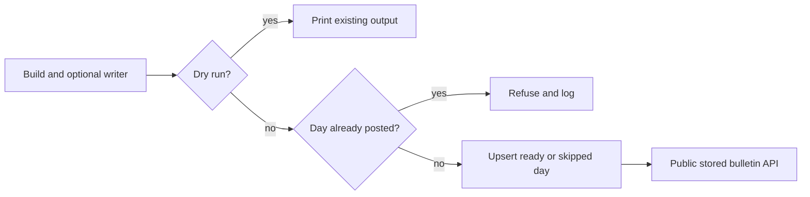

<!-- code-doc
module: src/app/storage/bulletin_store.py
covers:
  - src/app/storage/bulletin_store.py
  - src/app/storage/migrations/versions/*bulletins*.py
-->
# Bulletin storage (018 item 4a)

## Behavior

- One row per day stores status, reason, payload, numbers, versions, UTC generation time and
  nullable Telegram message id. Ready payload is exactly `Bulletin.as_dict()`; skipped payload is
  empty with its reason. Story payloads include the event's ordered digest `article_ids`.
  Tests: `test_save_and_get_ready_day`, `test_api_bulletin_by_date`,
  `test_skipped_day_is_stored_with_reason`.
- Saving replaces an unposted day. A non-null Telegram message id refuses replacement and logs
  `bulletin_stored` with date, status and refused; refusal is not a CLI error.
  Tests: `test_save_replaces_the_day`, `test_posted_day_is_never_replaced`,
  `test_cli_posted_day_exits_zero`.
- A successful replacement refreshes an already loaded identity, and the upsert SQL compiles
  for PostgreSQL as well as SQLite. Tests: `test_save_replaces_the_day`,
  `test_save_compiles_for_postgres`.
- A refused save refreshes the existing identity in the caller's session. An immediate read in
  that session sees the stored payload and Telegram id, including another session's committed id.
  Tests: `test_refused_save_refreshes_the_session`.
- Numbers contain assessed and digest article counts, plus the writer summary when it ran.
  Versions contain `BULLETIN_STORE_VERSION`, `WORLD_CHANGE_VERSION`, and `WRITER_VERSION` only
  when the writer ran. Tests: `test_save_and_get_ready_day`, `test_cli_build_stores_written_day`.
- A build without `--dry-run` saves ready and skipped results after the optional writer.
  It creates missing storage tables before saving. Tests: `test_cli_build_creates_missing_table`.
  Dry runs save nothing. The rendered text and the writer summary stay the same; `--json` gains
  `article_ids` per story (additive).
  Tests: `test_cli_build_stores_the_day`, `test_cli_build_stores_a_skipped_day`,
  `test_cli_dry_run_stores_nothing`, `test_cli_build_stores_written_day`.
- Public `GET /api/news/bulletin?date=YYYY-MM-DD` returns that stored day, including skipped days.
  Without date it returns the latest ready day. JSON contains day, status, reason, payload,
  numbers, versions and generated_at, never the Telegram message id. Missing rows return 404;
  malformed dates return 400. Tests: `test_api_bulletin_by_date`,
  `test_api_bulletin_latest_ready`, `test_api_bulletin_404_and_400`,
  `test_api_bulletin_is_public`, `test_latest_ready_skips_skipped_days`.
- A database failure returns 503. Tests: `test_api_bulletin_storage_failure_is_503`.
- The migration creates the table only when missing; downgrade drops it.
  Tests: `test_bulletins_migration_round_trip`, `test_bulletin_store_postgres`.

## Decisions

- decided 2026-11-02 (agent): `bulletins` uses day as primary key and JSON payload, numbers and
  versions, preserving the complete builder/writer object without another representation.
- decided 2026-11-02 (agent): replacing a day is allowed until a Telegram id exists; after posting,
  the stored bulletin stays equal to the posted text.
- decided 2026-11-02 (agent): skipped days are stored so absence differs from a known skip reason.
- decided 2026-11-02 (agent): the public API defaults to latest ready, omits the Telegram id and
  uses 400 for malformed dates, matching the item 4a contract.
- decided 2026-11-02 (agent): conditional database upsert protects posted rows during replacement.
  The caller owns the transaction; save flushes but does not commit.
- decided 2026-11-02 (agent): omit replaced from logs because a pre-read is inexact under races.

## Invariants

- At most one row per day; a posted row cannot be replaced by save.
- Storage and API never call a model. Writer work precedes saving.
- Dry runs do not save ready or skipped results.

## Code map

| Where | What |
| --- | --- |
| `src/app/storage/bulletin_store.py` | `BulletinRepo`, `BULLETIN_STORE_VERSION` |
| `src/app/storage/models_sql.py` | `BulletinRow`, table `bulletins` |
| `src/app/storage/migrations/versions/*bulletins*.py` | create/drop schema |
| `src/app/cli/main.py` | build, optional writer, save, print |
| `src/app/web/routes/bulletin.py` | stored row lookup and public JSON |
| `src/app/web/app.py` | router registration and public read path |

## Tests

`tests/unit/test_bulletin_store.py`: repository, CLI, public API and migration round trip.
`tests/integration/test_bulletin_store_postgres.py`: migration and save/replace/refuse on PostgreSQL;
skipped unless AINEWS_TEST_POSTGRES_URL is set, with a unique schema per test.
Builder and writer tests continue to pin output and fake all model calls.
