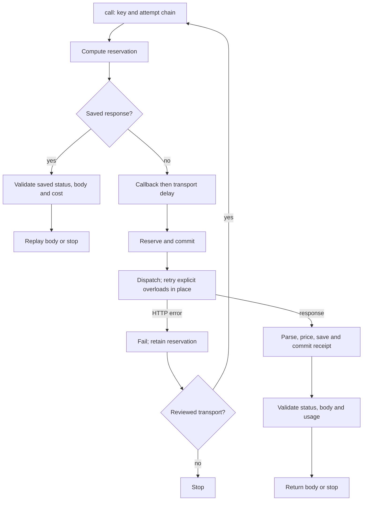

<!-- code-doc
module: src/app/storage/provider_journal.py
covers:
  - src/app/storage/provider_journal.py
-->

# Provider payment journal

## Behavior

- `PilotJournal` binds a private SQLite file to the fingerprint of its identity and all caps,
  converted by `microdollars`. The caps must be exactly total, jev and deepseek, their sum cannot exceed the total,
  and transport retry delays cannot be empty. Reopening with a different identity or caps fails.
  Tests: `test_paid_response_replays_after_process_restart_without_second_call`,
  `test_journal_configuration_guards`.
- `reserve` uses an immediate transaction. Any inflight/failed call or unknown usage blocks new
  reservations, except a reviewed transport with a review row. Both cumulative and provider caps
  include retained reservations; a duplicate key is refused. Reservation and attempt linkage are
  committed before dispatch. Tests: `test_provider_cap_refuses_dispatch`,
  `test_cumulative_limit_counts_both_providers_and_restart`,
  `test_unknown_or_failed_call_stops_resume_and_keeps_reservation`,
  `test_reservation_guards_and_rollback`, `test_dispatch_and_receipt_order`,
  `test_caps_allow_exact_boundary`, `test_total_cap_blocks_even_when_provider_has_room`,
  `test_duplicate_reservation_and_link_failure_roll_back`.
- `call` computes the configured key, resolves its attempt chain, then computes the configured
  reservation, even on replay. A saved response with unknown usage blocks without changing the
  row; a non-success status, a non-dictionary body or a cost above the reservation is failed as
  `InvalidSavedResponse` and blocked.
  An identical body replays without a callback, sleep or provider request. `has_response` uses
  the default `request_key`, even when the call key function is overridden.
  Tests: `test_paid_response_replays_after_process_restart_without_second_call`,
  `test_crash_after_receipt_before_validation_never_replays_invalid_response`,
  `test_saved_response_guards`, `test_custom_key_and_reservation_replay`.
- Before a new dispatch the optional callback runs, then the attempt's configured transport
  delay, then reservation. Explicit error-only overload answers retry in place using
  `TRANSIENT_RETRY_DELAYS`. The final response is parsed and priced before its status, raw text,
  body and usage are committed. Known usage replaces the reservation; unknown usage retains it.
  Tests: `test_dispatch_and_receipt_order`, `test_transient_retry_order_and_release`,
  `test_callback_stop_does_not_reserve_or_dispatch`,
  `test_dropped_connection_is_retried_after_one_then_five_minutes`.
- `priced_usage` accepts nonnegative integer tokens, excluding booleans, and rounds up using
  `PRICES`. Jev prices input tokens; DeepSeek prices prompt and completion tokens. Non-success
  status or a non-dictionary body fails as HTTP/JSON; missing usage stops with the reservation
  retained; excessive usage fails after committing the actual cost.
  Tests: `test_priced_usage_validation`, `test_received_response_guards`.
- A transport HTTP error records its class and retains its reservation. Only the transport
  classes named in `review_transport_failure`, with no response or actual usage, can be reviewed;
  the reason must be a nonblank string. Review records provenance without inventing an answer
  or usage. Transaction errors roll back. `review_failed_transports` reviews eligible failures
  only when a reason is configured. Tests: `test_transport_review_eligibility`,
  `test_transport_review_refuses_nontransport_or_received_rows`,
  `test_unreviewable_http_error_stops_with_reservation`,
  `test_transport_review_requires_reason`, `test_transport_review_rolls_back`,
  `test_review_failed_transports_counts_only_eligible_rows`.
- A configured transport review reason permits the next linked attempt, keeping each attempt's
  reservation. Missing provenance blocks retry. Exhaustion raises `TransportAttemptsExhausted`;
  its `dispatched` flag distinguishes exhaustion after this call's request from a later resume.
  Tests: `test_attempt_chain_requires_review_provenance`,
  `test_attempt_reviews_old_transport_before_retry`,
  `test_transport_attempt_chain_replays_and_exhausts`,
  `test_transport_retries_exhausted_fails_day_without_more_dispatch`.
- A failed recorded overload with unknown usage can be released on resume: only explicit
  error-only overloads qualify. Its call row and incoming attempt link are deleted, allowing the
  same key to be reserved again. Tests: `test_transient_retry_order_and_release`,
  `test_transient_release_guards`.
- `review_truncated_summaries` supersedes only billed DeepSeek `InvalidSummary` failures with
  success status, a length finish, an accepted model and matching price. The stored response and
  cost remain. `restore_valid_summary` instead revalidates a matching billed success with
  `parse_summary`; grounding/schema failures return false. Successful restoration records the
  fixed review reason and restores response state without changing cost.
  Tests: `test_reviewed_truncation_preserves_spend_and_old_successes`,
  `test_review_does_not_clear_unknown_billing`, `test_truncated_summary_review_guards`,
  `test_length_review_reuses_complete_response_but_preserves_grounding`,
  `test_summary_restore_guards`.
- `committed_usd` includes reservations and actual costs. `report` aggregates provider calls,
  states, retained commitments, priced usage, unknown usage and valid integer token counters;
  it includes approved caps, rates and the usage-priced (not invoice) cost label.
  Tests: `test_journal_committed_usd_counts_reservations_and_unknown_calls`,
  `test_report_filters_tokens_and_keeps_unknown_cost`.

## Decisions

- Source: the reservation comment in `reservation` uses request bytes rather than chars/4 for
  a conservative bound. Transport attempt comments retain one conservative reservation per
  reviewed retry. Transient retry comments identify explicit overloads as unbilled.
- Source: `call` saves the received bytes before inspecting model answers so resume only replays
  them. `review_transport_failure` accepts reserved expense without inventing usage or an answer.

## Invariants

- Money is stored as integer microdollars; the identity includes the approved caps.
- Every dispatch has a committed reservation. Every final received answer is committed before response
  validation. Unknown billing keeps the conservative commitment unless it is an explicit overload.
- Review never fabricates provider usage; a reviewed transport needs persisted provenance.
- Request keys, retry linkage, SQL schema and on-disk layout remain compatible across restarts.

## Code map

- `src/app/storage/provider_journal.py`: `PilotJournal`, pricing and payment stop exceptions.
  Tables: identity, calls, reviews, request_attempts. No schema version or migration is stored.
  `call` delegates replay to `_replay_response`, dispatch to `_post_with_transient_retries`,
  receipt persistence to `_record_response` and checks to `_validate_response`. `_attempt`
  delegates review/provenance/exhaustion checks to `_require_transport_review`.
  Summary reviews use `_is_priced_truncation` and `_restorable_summary`; transport eligibility
  uses `_reviewable_transport`; reporting uses `_report_tokens`.
- `src/app/core/daily/provider_requests.py`: default keys, reservations and summary parsing;
  `src/app/core/provider_costs.py`: prices and explicit overload predicate;
  `src/app/core/canonical_json.py`: canonical serialization and fingerprints.
- Callers: `src/app/core/jev.py`, `src/app/core/daily/enrichment.py`,
  `src/app/core/bulletin/world_change.py`, `src/app/core/bulletin/writer_run.py`.
  They choose journal identity, caps, retry policy and any custom key/reservation functions.

## Tests

- `tests/unit/test_provider_requests.py`: payment safety, restart replay and summary grounding.
- `tests/unit/test_provider_journal.py`: branch characterization, transactional ordering, review
  eligibility and rollback, retry provenance, pricing and report filtering. Synthetic HTTP only.
- `tests/unit/test_daily_enrichment.py`, `tests/unit/test_daily_publish_day.py`,
  `tests/unit/test_semantic_admission_pipeline.py`: publication and admission retry integration.
- `tests/unit/test_world_change.py`, `tests/unit/test_world_screen.py`,
  `tests/unit/test_world_report.py`, `tests/unit/test_bulletin_writer.py`: capped journal callers.
