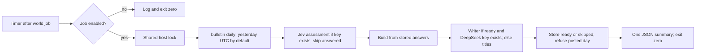

<!-- code-doc
module: src/app/usecases/bulletin/daily.py
covers:
  - src/app/usecases/bulletin/daily.py
  - scripts/run_daily_bulletin_job.sh
  - scripts/install_daily_timers.sh
  - deploy/sudoers.d/ai-news-deploy
-->
# Daily bulletin (018 item 4b)

## Behavior

- `bulletin daily [--date D]` assesses with `ASSESS_DEFAULT_MAX_USD`, skipping answers for the
  current version, builds with the existing builder, writes with `WRITER_MAX_USD_PER_DAY`, and
  saves through `BulletinRepo`. Assessment, build and writer helpers are shared with the existing
  commands. Tests: `test_daily_assesses_builds_writes_and_stores`.
- Shared assessment retains the read-only, keyless dry-run behavior of `bulletin assess`.
  Tests: `test_daily_shared_assessment_dry_run_is_read_only`.
- Without a nonblank Jev key, assessment is skipped with reason `missing_jev_key` in the log and
  summary; existing answers still build. Without a nonblank DeepSeek key, a ready bulletin stays
  title-only with logged reason `missing_ds_key`. Tests:
  `test_daily_without_jev_key_builds_from_stored_answers`,
  `test_daily_without_ds_key_stores_title_only`.
- The writer journal uses the real UTC day when writing starts, even when assessment crosses
  midnight. Tests: `test_daily_writer_uses_current_utc_day_after_assessment`.
- Builder skips are stored with their reason; a day without a digest is stored as `no_digest`.
  No writer runs for a skipped day. Tests: `test_daily_skipped_day_is_stored`,
  `test_daily_missing_digest_with_keys_is_skipped`.
- A posted day is never replaced, including a concurrent posting; refusal exits zero.
  Tests: `test_daily_posted_day_is_refused_and_exits_zero`; the atomic save is checked by
  `test_posted_day_is_never_replaced`.
- The default date is yesterday UTC. Stdout is one JSON line with date, status, reason, assess
  and writer summaries, stored and refused. Invalid dates are usage errors; operational failures
  log `bulletin_daily_failed` with date, exception type, detail bounded to 200 characters and
  the traceback, and produce a `daily_failed` summary with no stored row and exit zero.
  Tests: `test_daily_defaults_to_yesterday_utc`, `test_daily_prints_one_summary_line`,
  `test_daily_invalid_date_is_a_usage_error`, `test_daily_runtime_failure_exits_zero`.
- The job is off unless `AINEWS_BULLETIN_JOB_ENABLED` is true in the environment or `.env`.
  The script uses the release image, the same host lock as the world job with LOCK_WAIT, one
  CLI container bounded by DAILY_LIMIT, cleanup, and always exits zero. Tests:
  `test_bulletin_job_off_by_default`, `test_bulletin_job_runs_daily`,
  `test_bulletin_job_failure_is_isolated`, `test_bulletin_job_env_file`.
- The timer runs after the world timer in UTC. Bulletin start plus LOCK_WAIT must reach at least
  world start plus its service timeout, so the bulletin waits out the world's maximum lock hold.
  The service timeout covers LOCK_WAIT, DAILY_LIMIT, every timeout limit and kill grace in the
  script, including both container removals. Tests: `test_bulletin_timer_runs_after_the_world_job`,
  `test_bulletin_service_timeout_covers_lock_wait_and_steps`.
- While `world_stream_in_bulletin` is off, world screening is not an input, so a skipped or cut
  world night does not change the bulletin. Tests: `test_world_candidates_only_with_the_switch`.
- The deploy sudoers sample allows exactly the timer installer's commands, including the bulletin
  units and enable command. Tests: `test_sudoers_sample_matches_the_sudo_calls_of_the_scripts`.
- `bulletin_home_page` and `bulletin_post_channels` default off and have no consumer yet;
  their environment names are `AINEWS_BULLETIN_HOME_PAGE` and `AINEWS_BULLETIN_POST_CHANNELS`.
  Tests: `test_bulletin_switches_default_off`, `test_bulletin_switches_read_environment`.

## Decisions

- decided 2026-11-02 (agent): one daily command reuses assess/build/write logic, then stores and
  prints one summary, so scheduling and manual runs have the same behavior and existing caps.
- decided 2026-11-02 (agent): missing Jev means build from stored answers; missing DeepSeek means
  title-only, with explicit reasons, so missing keys do not discard usable data.
- decided 2026-11-02 (agent): the paid job defaults off and uses the world job's shell shape,
  release image, host lock and timeout isolation; the owner enables it.
- decided 2026-11-02 (agent): bulletin start + LOCK_WAIT >= world start + world service timeout;
  outlast the world's maximum lock hold so a long world night does not skip the bulletin.
- decided 2026-11-02 (agent): define the two FR-019 settings now; home page and posting consumers
  belong to items 6 and 8.
- decided 2026-11-02 (agent): no digest is a stored skip for the unattended command; runtime
  faults log `daily_failed` and exit zero, reserving nonzero exits for usage errors.
- The JSON formatter writes a logged exception as a `traceback` field.
- decided 2026-11-02 (agent): DAILY_LIMIT bounds the combined assess/build/write command;
  the service allows the lock wait, that limit, kill grace and cleanup.
- decided 2026-11-02 (agent): extend the sudoers sample for the new units, as required by the
  existing deploy contract; the server's root operator still applies it manually.

## Invariants

- No new provider journal or cap; existing assessment and writer caps still apply.
- The home page and channel switches do not gate building or storing.
- Stored status is ready or skipped; a Telegram message id prevents replacement.
- No change to fetch, digest, archive or world job behavior.

## Code map

- `daily.py`: shared assessment, preparation and writing helpers; daily orchestration.
- `src/app/cli/bulletin.py`: commands, date validation, JSON output, sessions and logging.
- `src/app/storage/bulletin_store.md`: save/refuse contract and versions.
- `scripts/run_daily_bulletin_job.sh`: switch, environment, release image, lock and timeout.
- `scripts/install_daily_timers.sh`: bulletin service and UTC timer.
- `deploy/sudoers.d/ai-news-deploy`: exact permitted installer commands for a non-root deploy.
- `src/app/config/settings.py`: unused FR-019 switches; operator names in `docs/configuration.md`.

## Tests

- `tests/unit/test_bulletin_daily.py`: CLI and shared helpers with isolated SQLite and fake models.
- `tests/unit/test_deepseek_digest.py`: shell job with fake docker, flock and timeout.
- `tests/unit/test_daily_timers.py`: generated timer and timeout budget.
