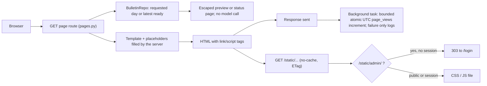

<!-- code-doc
module: src/app/web/routes/pages.py
covers:
  - src/app/web/routes/pages.py
  - src/app/web/bulletin_view.py
  - src/app/storage/page_views.py
  - src/app/storage/migrations/versions/*page_views*.py
  - src/app/web/*.html
  - src/app/web/static/**
-->
# Web pages and static assets

The HTML pages of the site: the public home `/`, digest `/daily`, weekly signals `/weekly` and monthly signals `/monthly`, the public
news stats `/news-stats`, the login page `/login` and the admin page `/admin`. Each page is a template in `src/app/web/` filled by
`build_pages_router`; its styles and scripts are files under `src/app/web/static/`, served at
`/static/`. The legacy weekly pages (`/weekly-ai-analytics`, `/weekly-ai-analytics/reports`) are
retired: they only redirect to `/weekly`.

## Behavior

**Pages and access**
- `/`, `/daily`, `/weekly`, `/monthly`, `/news-stats` and `/login` are public; `/admin` needs a session when auth is enabled and
  redirects to `/login` otherwise; `/login` with a valid session redirects to `/admin`.
  Tests: `test_unauthenticated_root_stays_public`, `test_public_digest_page_stays_public_when_auth_is_enabled`,
  `test_admin_route_is_protected_and_public_root_stays_open`, `test_login_page_redirects_when_session_valid`,
  `test_login_page_renders_login_form_when_not_authenticated`, `test_route_table_order_names_and_models_are_pinned`
  (`/weekly` and `/monthly` are in the open routes).
- Authenticated login requires both the configured username and password, returns `{"ok": true}`
  and an HttpOnly cookie; logout keeps that success JSON contract. A body that is not JSON or not
  an object is a failed login (401 `Invalid username or password`); with auth off the login answers
  200 without reading the body. Tests: `test_extracted_login_preserves_credentials_and_json`,
  `test_logout_invalidates_session`, `test_login_rejects_malformed_body`,
  `test_login_ignores_malformed_body_when_auth_disabled`, `test_login_decodes_body_like_request_json`
  (the body is decoded by stdlib json as `request.json()` did).
- `/daily` always shows the digest of the requested day (default: yesterday, UTC) and the Daily Signals block
  (`render_signals`); a signals read failure keeps the page. Tests:
  `test_public_digest_page_renders_digest_shell_with_yesterday_selected`,
  `test_public_digest_page_keeps_explicit_query_date_selected`, `test_signals_read_error_keeps_page`.
- With `bulletin_home_page` off, `/` renders byte-identical HTML to `/daily`, with the same
  query validation and storage errors. With it on, `/` reads the requested bulletin or latest
  ready day, ignoring newer skipped rows. No ready day and no explicit date falls back to the
  digest. Missing dated rows give 404 with `/daily?date=D`; bad dates give 400 and storage
  failures give 503. Home has no checking block or noindex and adds a plain GET date form;
  adjacent-day links stay on `/`. Tests: `test_daily_serves_the_digest`, `test_daily_is_public`,
  `test_home_is_digest_when_switch_off`, `test_home_shows_latest_bulletin_when_switch_on`,
  `test_home_old_date_link_shows_that_bulletin`, `test_home_without_ready_bulletin_shows_digest`,
  `test_home_missing_day_is_404_with_daily_link`, `test_home_has_no_checking_block_and_is_indexable`,
  `test_home_date_form`, `test_home_errors`, `test_digest_errors_match`.
- The optional `date` query parameter of `/` keeps the same OpenAPI schema as `/daily`
  (date format and default), even though the enabled home validates malformed dates as 400.
  Tests: `test_home_date_openapi_matches_daily`.
- Nested page handlers only delegate to module-level helpers; route registration, names,
  response models and OpenAPI stay unchanged. Tests: `test_page_router_handlers_only_delegate`,
  `test_route_table_order_names_and_models_are_pinned`, `test_auth_middleware_coverage_is_pinned`.
- Digest links from bulletin and period pages use `/daily`; Full report uses the stored
  `full_report_url` and item count. The digest date picker keeps the current path when setting
  or clearing the date. Tests: `test_full_report_links_daily`, `test_period_links_point_to_daily`,
  `test_digest_date_picker_keeps_current_path`, `test_news_stats_links_daily`.
- Only successful (200) GETs of `/` and `/daily` increment `page_views`, keyed by UTC day and
  route. FastAPI `BackgroundTasks` runs the counter after the response has been sent. One
  dialect upsert adds one atomically on SQLite and PostgreSQL; counting failures only log.
  Before the PostgreSQL upsert, the same transaction executes `PAGE_VIEWS_LOCK_TIMEOUT_SQL`
  and `PAGE_VIEWS_STATEMENT_TIMEOUT_SQL` to bound lock and statement waits; SQLite skips them.
  Tests: `test_page_views_runs_after_response`, `test_page_views_transaction_timeouts`.
  API handlers and page reads call `deps.create_all()`; it creates missing tables until it
  succeeds once per app instance, then does nothing. A storage error still answers 503 and
  the next request tries again. Both table initializers share one per-app lock, with separate
  success flags. Tests: `test_tables_requests_once`, `test_tables_retry_after_storage_error`,
  `test_tables_concurrent_calls_once`, `test_tables_new_app_calls_again`,
  `test_tables_initializers_share_lock`.
  It or the idempotent migration creates `page_views`, whichever runs first after deployment;
  production starts the app before `alembic upgrade head`.
  Tests: `test_page_views_create_all_before_background`,
  `test_page_views_migration`. Only day, route and count are stored. Read-only
  `ai-news page-views --days N` prints one JSON object for the last N UTC days including today,
  using `PAGE_VIEWS_DEFAULT_DAYS` by default. Tests: `test_page_views_counts_home_and_daily`,
  `test_page_views_failure_keeps_page`, `test_page_views_stores_no_visitor_data`,
  `test_cli_page_views_prints_json`, `test_page_views_postgres_atomic_increment`,
  `test_page_views_counts_digest_home_and_fallback`, `test_page_views_uses_utc_today`,
  `test_page_views_increment_compiles_for_postgres`, `test_page_views_sqlite_atomic_increment`,
  `test_page_views_migration`, `test_page_views_empty_cli`.
- Production compose forwards the home switch with default false. Tests:
  `test_production_compose_forwards_home_page_switch_default_off`.
- `/weekly` shows one stored week (the page states are in `src/app/core/periodic/signals_period.md`,
  "Page"); it is rendered by `period_view.py` from the same stored row the API reads, in the template
  `period.html` with `digest.css` and `period.css` and no script. `?week=` takes a Monday; another
  day redirects (303) to its Monday; a missing week, text that is not a date, no rows or an unreadable
  row give the page with a plain reason line and status 200, never 500. A picker of plain links
  (previous, next, list of stored weeks) sits under the week. Tests: `test_ready_week_shows_sections_in_order`,
  `test_week_param`, `test_no_rows_is_unavailable_200`, `test_corrupt_row_is_200`,
  `test_page_references_exactly_its_static_assets`.
- `/monthly` shows one stored month with the same template, view code and rules as `/weekly`
  (`?month=YYYY-MM`; a full date redirects 303 to `YYYY-MM`; the picker lists stored months). Its
  header links back to `/weekly`; `/weekly` links to `/monthly` only when a month row exists.
  Tests: `test_ready_month_shows_its_sections_and_month_words`, `test_month_param_and_picker`,
  `test_monthly_nav_link_needs_a_month_row`, `test_page_references_exactly_its_static_assets`.
- The digest header link "Weekly" and the line "Week of Oct 19-25: weekly signals" under the daily
  signals block appear only when at least one stored week exists; both point at `/weekly`. A failed
  read hides them and keeps the page. They are filled by the server (`__WEEKLY_NAV__`,
  `__WEEKLY_LINE__`), so the client signals renderer never touches them. They are the only
  weekly elements on the digest at `/daily` (and `/` when it shows the digest): the legacy
  "Weekly AI Analytics" preview and the "Weekly Reports" link
  are gone, and `digest.js` no longer reads `/api/news/weekly-analytics`. Tests:
  `test_public_digest_page_has_no_legacy_weekly_preview`, `test_nav_link_and_home_line_follow_stored_weeks`,
  `test_home_page_survives_a_period_read_failure`. The header link "Monthly" next to it appears
  only when a month row exists (placeholder `__WEEKLY_NAV__`); a failed read hides it. Tests:
  `test_monthly_nav_link_needs_a_month_row`, `test_monthly_nav_link_is_hidden_when_the_read_fails`.
- `GET /weekly-ai-analytics` and `GET /weekly-ai-analytics/reports` answer 308 to `/weekly` (query
  string dropped), for a logged-out reader too: they are not protected paths, so the auth middleware
  passes them. The legacy read API (`/api/news/weekly-analytics*`) and the tables stay for
  compatibility. Tests: `test_legacy_weekly_pages_redirect_308_to_weekly`,
  `test_legacy_weekly_redirect_works_with_a_session_cookie`, `test_route_table_order_names_and_models_are_pinned`,
  `test_auth_middleware_coverage_is_pinned`, `test_weekly_ai_analytics_api_returns_report_sections_for_last_7_days`
  (legacy API still answers with stored data).
- `/news-stats` has one header link, "Weekly" (`/weekly`), in place of the two legacy weekly links. No test.
- `/news-stats` defaults to the 60 days ending yesterday; `date_from` after `date_to` is a 422,
  and equal bounds are accepted. Tests: `test_news_stats_page_renders_public_shell`,
  `test_extracted_stats_preserves_dates`.

**Hidden bulletin preview (018 items 4c, 6a)**
- Public `GET /bulletin?date=YYYY-MM-DD` reads the stored row through `BulletinRepo`;
  without a date it reads the latest ready day, ignoring newer skipped days. The page is English,
  server-rendered, unlinked and has `noindex, nofollow`; neither bulletin publishing switch is
  read. Tests: `test_bulletin_page_defaults_to_latest_ready`,
  `test_bulletin_page_is_public_and_noindex`, `test_bulletin_page_is_not_linked`,
  `test_bulletin_renderer_defaults_to_preview`, `test_bulletin_preview_is_hidden_from_openapi`.
- Every rendered HTML page has the masthead THE DAILY INFERENCE and the footer "Satire. Every fact is real
  and linked." with "News discovery: GDELT Project" linked to https://www.gdeltproject.org/.
  Ready days show the stored byline, including Day N, and the date. Tests:
  `test_bulletin_page_masthead_and_byline`, `test_bulletin_page_footer_satire_and_gdelt`,
  `test_bulletin_page_status_pages_share_shell`, `test_bulletin_page_shows_ready_day`.
- A ready issue follows the stored voice: headline, opening, numbers line, Key results, named
  positive rubric, Cooperation with humanity, Isolated incidents: N (with Among them when a
  story exists), closing and Full report (N). Empty sections are omitted; counts without an
  incident story remain visible. A null issue headline falls back to "Bulletin for D"; zero
  incidents hide the incidents section even with a stored story. Stories retain stored order,
  headline or title, full site-note paragraphs, optional gloss and reaction, area and linked
  outlet names. A cut headline keeps the phrase library's footnote. Tests:
  `test_bulletin_page_issue_order`, `test_bulletin_page_null_headline_and_zero_incidents`,
  `test_bulletin_page_shows_ready_day`, `test_bulletin_page_title_only_day`,
  `test_bulletin_page_cut_headline_footnote`.
- Full report uses the stored items count and `full_report_url` pointing at `/daily?date=D`.
  Tests: `test_bulletin_page_full_report_links_digest`.
- One collapsed details block, "For checking", below the issue and date navigation contains
  each story's text_origin and origin (identified by its displayed headline) and the stored
  numbers, including writer diagnostics. These fields do not appear in reader sections.
  Tests: `test_bulletin_page_checking_block_collapsed`, `test_bulletin_page_shows_ready_day`.
- The preview uses only its public bulletin stylesheet and system fonts, without scripts or
  third-party asset requests. Its viewport and single-column default serve phones; wider screens
  get story columns, and the system colour preference selects a readable dark palette.
  Tests: `test_bulletin_page_mobile_viewport` (viewport, asset serving and isolation).
  Visual checks at phone, tablet and desktop widths and in both colour schemes are manual;
  automated HTML tests do not establish absence of overflow or visual quality.
- A skipped day uses one reason-to-sentence mapping with a generic fallback and links to
  `/daily?date=D`. Its raw reason appears only in the preview's collapsed checking block.
  Tests: `test_skipped_day_plain_sentence`, `test_skipped_day_explains_missing_digest`.
  A missing dated row says there is no bulletin and gives the digest link with HTTP 404. No latest ready row
  gives a 404 saying nothing is stored yet. Malformed dates keep the existing JSON 400; database failures give an
  HTML 503. Tests: `test_bulletin_page_skipped_day_links_digest`,
  `test_bulletin_page_missing_day_is_404`, `test_bulletin_page_empty_store_is_404`,
  `test_bulletin_page_bad_date_is_400`, `test_bulletin_page_storage_failure_is_503`.
- Previous and next links select adjacent dates; there is no next link beyond yesterday UTC.
  The earliest calendar day has no previous link. Tests: `test_bulletin_page_prev_next_links`,
  `test_bulletin_page_first_calendar_day_has_no_previous`.
- All stored text is HTML-escaped, including numbers and reasons. Only http/https source URLs
  become links; other URLs leave plain outlet text. Inserted placeholder-like text stays literal.
  Tests: `test_bulletin_page_escapes_stored_text`, `test_bulletin_page_escapes_issue_fields`.

**Placeholders**
- Digest fields, including quoted article URLs, are HTML-escaped. The renderer's default hides
  monthly navigation until requested. Tests: `test_digest_renderer_preserves_escaping_and_defaults`.
- Legacy weekly redirects stay absent from OpenAPI. Tests:
  `test_legacy_weekly_redirects_stay_hidden_from_openapi`.
- The server fills `__NAME__` placeholders of a template, never of a static file. Digest:
  `_render_digest` replaces all of them in one pass with `_PLACEHOLDER`, so placeholder names
  inside digest or signals text stay literal. News stats: `_render_news_stats`. Admin and login
  have none. Tests: `test_placeholders_in_digest_text_are_not_substituted`,
  `test_public_digest_page_keeps_explicit_query_date_selected`.
- The two digest script values that need the server (`initialDigestUrl`, `defaultReportDate`)
  stay in a small inline script right before the digest script, which reads them as globals.
  Tests: `test_digest_placeholders_stay_inline_before_its_script`.

**Static assets**
- Every page references exactly its asset files, in a fixed order, as classic scripts (no
  `defer`, `async` or modules) at the place of the former inline block; no page has an inline
  style block. Tests: `test_page_references_exactly_its_static_assets`.
- `/static/` is served by `_NoCacheStaticFiles`: correct content type, an ETag and
  `Cache-Control: no-cache`, so the browser revalidates and a deploy never mixes new HTML with
  old JS. Tests: `test_static_asset_is_served_with_type_and_no_cache`.
- `/static/admin/` has the protection of `/admin` (`is_protected_ui` in `auth_middleware`); the
  check runs on the normalized, lower-cased path (`..`, `//`, `.` and case do not bypass it);
  every other `/static/` path is public. Tests: `test_admin_assets_need_a_session_like_admin`,
  `test_admin_assets_check_uses_normalized_path`.
- The admin event wiring lives in `static/admin/sources.js` (the last admin script) because it uses
  functions of all admin files. No test.
- The asset files are package data of `app.web` and ship in the wheel. Tests:
  `test_web_package_data_includes_public_templates` (the globs and `period.html`; the wheel itself
  is not built in tests), `test_bulletin_page_template_is_packaged` (preview template).

## Decisions

- The official masthead, serif typography and wide-screen columns follow owner decision Q1;
  the footer follows Q2 and the GDELT attribution decision of 2026-10-31.
- decided 2026-11-05 (agent): system serif/sans stacks and CSS only avoid external requests,
  cookies and tracking; a warm paper palette and restrained rules distinguish issue sections.
- decided 2026-11-05 (agent): columns apply within sections, retaining voice order on every
  screen; headings and story text wrap, while source and navigation links have roomy targets.
- decided 2026-11-06 (agent): `/daily` preserves the digest, query parameters and 503, public
  regardless of the switch; route all digest links there, retaining the current path in its picker.
- decided 2026-11-06 (agent): home uses the stored requested/latest ready bulletin behind
  `bulletin_home_page`, without diagnostics or noindex; no ready day falls back to the digest.
  Dated missing rows use 404, bad dates 400 and storage errors 503 like the preview.
- decided 2026-11-06 (agent): preview stays public, hidden, noindex and diagnostic; use stored
  `full_report_url` for Full report and `/daily?date=D` for missing/skipped-day links.
- Owner yes 2026-11-06: skipped days use a plain reader sentence; decided 2026-11-06 (agent):
  one mapping covers builder reasons with a generic fallback, raw codes only in preview checking.
- decided 2026-11-06 (agent): add a native GET date form on home alongside previous/next links
  so earlier days are selectable without JavaScript.
- decided 2026-11-06 (agent): count only 200 GET home/digest requests by UTC day and route;
  defer counting with `BackgroundTasks` until after sending the response. Atomic dialect upsert,
  isolated transaction and PostgreSQL local lock/statement timeouts keep failures harmless
  without holding up the page; SQLite skips PostgreSQL-only statements.
  The read-only JSON CLI defaults to `PAGE_VIEWS_DEFAULT_DAYS`; no visitor data is collected.
- decided 2026-11-11 (agent), spec 020: `deps.create_all()` runs once per app instance;
  per-request runs added metadata queries to each request.
- decided 2026-11-06 (agent): override only the home date's schema annotation to preserve the
  original optional date OpenAPI contract while retaining the switched-on strict 400 parser.
- decided 2026-11-06 (agent): keep route handlers as thin calls to module-level helpers so the
  router factory stays below CRAP 10 without changing route names, responses or access rules.
- Source: `docs/troubleshooting.md`, case `prod-env-var-not-forwarded-by-compose`: forward
  `AINEWS_BULLETIN_HOME_PAGE` explicitly, default false. Channel posting remains phase B.
- decided 2026-11-05 (agent): show stored reactions and the phrase library's cut-headline
  footnote to preserve the complete issue's framing, without generating new text.

- decided 2026-11-02 (agent): `/bulletin` is public like `/weekly`, unlinked with a robots
  noindex/nofollow meta tag; preview does not read publishing switches.
- decided 2026-11-02 (agent): render stored rows directly via `BulletinRepo`, `bulletin_view.py`
  and `bulletin.html`; no JSON API request or model call.
- decided 2026-11-02 (agent): default to the latest ready day, matching the API; an explicit date
  selects that day, including skips, and keeps stored story order and writer fallbacks visible.
- decided 2026-11-02 (agent): show origin marks and stored numbers at the bottom for checking real
  days before the home-page design; this is an English preview like the existing public pages.
- decided 2026-11-06 (agent): skips and missing days link to `/daily?date=D`;
  use 404 for missing rows or no ready day, 400 for malformed dates and 503 for storage failure.
- decided 2026-11-02 (agent): adjacent-day navigation stops next links at yesterday UTC.
- decided 2026-11-02 (agent): escape every stored text and allow only http/https outlet links,
  because model and outlet content is untrusted.
- Static files instead of inline blocks: a script can be read, linted and diffed on its own; the
  page template holds markup only.
- Admin assets behind the admin session: the admin code lists every admin API; it stays private
  like the page.
- `no-cache` with ETag instead of hashed file names: no build step; one revalidation per asset.
- Legacy weekly pages answer 308, not 410 or a copy (owner answer 2026-10-28; decided 2026-10-28
  (agent): 308 keeps old bookmarks working and the method; the query string is dropped because
  `?date=` of the old report means nothing on `/weekly`).
- `/news-stats` links "Weekly" instead of the two retired links (decided 2026-10-28 (agent)): a link to a
  redirect would work, but two links to one page is noise.
- No framework or bundler: the pages are small and server-rendered; classic scripts in one global
  scope keep the old execution order.
- Admin JS is four classic scripts; an exception in one file no longer stops the files after it
  (before, one inline block stopped as a whole). Accepted: affects only error cases (coordinator
  decision 2026-10-24).

## Invariants

- No template, view module or static asset outside the preview itself links to `/bulletin`.
- Switch off means `/` is byte-identical to `/daily`; bulletin reads make no model or API call.
- Counter rows contain no visitor data, only day, route and count; work starts after sending the
  response and failures never change it. PostgreSQL timeouts are local to its counter transaction.
- What a visitor or an admin sees and does does not depend on whether the code is inline or in a
  file: the asset files hold the former blocks byte for byte, in the original order.
- Concatenating the admin scripts in tag order gives the former admin script block.
- Server and client renderers of the signals block stay in step (`signals_view.py` and
  `renderSignals` in `src/app/web/static/js/digest.js`). Tests: `test_client_renderer_matches_server_classes`.
  The weekly page reuses the daily classes and the trend and link markup (`signals_view.py`), but
  has no client renderer.

## Code map

| File | Holds |
| --- | --- |
| `routes/pages.py` | Thin page routes, module-level response/auth helpers, template rendering and placeholders; `_count_page` is scheduled after successful home/digest responses; `_bulletin_response` handles preview lookup, rendering and storage errors |
| `bulletin_view.py`, `bulletin.html` | Escaped stored bulletin preview, status pages and adjacent-day links |
| `../storage/page_views.py` | `PageViewRepo`: atomic increment and read-only day/route totals; table `page_views` in `models_sql.py` |
| `../storage/migrations/versions/a6b0180c0001_add_page_views.py` | Creates/drops `page_views`, composite day/route primary key |
| `../cli/main.py` | Read-only `page-views` JSON command |
| `static/css/bulletin.css` | Bulletin-only typography, responsive story columns, light/dark palette and focus states |
| `app.py` | `_NoCacheStaticFiles` mount at `/static`, `auth_middleware` (admin assets protected) |
| `routes/period.py` | `/weekly` and `/monthly` routes, `latest_week` and `has_month` (nav links and line on `/`), next to the period API |
| `period_view.py` | Server HTML of one stored week or month and the picker (`render_content`, `render_picker`, `render_page`) |
| `digest.html`, `news_stats.html`, `login.html`, `index.html`, `period.html` | Page markup; the digest also has the inline placeholder script |
| `static/css/` | `digest.css`, `news_stats.css`, `login.css`, `period.css` |
| `static/js/` | `digest.js` (digest and signals client), `news_stats.js`, `login.js` |
| `static/admin/admin.css` | Admin styles |
| `static/admin/core.js` | Shared state (`const`/`let` of the page), `setStatus`, `showPage`, page buttons |
| `static/admin/updates.js` | Settings form, run update, run status and polling (`activeScreeningMessage`) |
| `static/admin/news.js` | News view: `loadNews`, `copyVisibleLinks` |
| `static/admin/sources.js` | Source onboarding (batches, check, candidates), then event wiring and the start calls |

Where to change what: markup in the template; behavior in the asset; a new asset needs its tag in
the page, a glob in `[tool.setuptools.package-data]` of `pyproject.toml` if it is a new folder or
type, and an entry in the asset list of `tests/unit/test_web_static_assets.py`. Admin start calls and event wiring
stay in the last admin script, because they use functions of every admin file.

## Tests

- `tests/unit/test_web_static_assets.py`: asset tags per page, serving and no-cache, admin asset
  protection, digest placeholders.
- `tests/unit/test_web_period_page.py`: the `/weekly` and `/monthly` page states, escaping, `?week=`, `?month=`, nav links, line on `/`.
- `tests/unit/test_web_bulletin_page.py`: stored preview, status pages, escaping, access,
  hidden navigation and template packaging.
- `tests/unit/test_web_home_page.py`, `tests/unit/test_page_views.py`: switched home, digest,
  counters, CLI and migration; `tests/integration/test_page_views_postgres.py`: concurrent upsert.
- `tests/unit/test_web_app.py`, `tests/unit/test_web_public_digest.py`, `tests/unit/test_auth_stage1.py`:
  pages, access, signals client hooks. Tests that check moved code read the page with its assets
  (a fixture in `tests/unit/conftest.py`) or the asset file.
