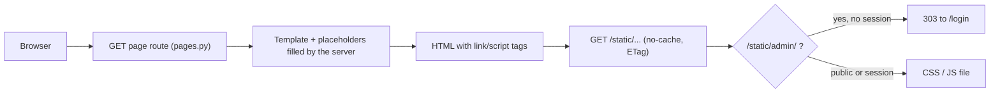

<!-- code-doc
module: src/app/web/routes/pages.py
covers:
  - src/app/web/routes/pages.py
  - src/app/web/*.html
  - src/app/web/static/**
-->
# Web pages and static assets

The HTML pages of the site: the public digest `/`, the public news stats `/news-stats`, the login
page `/login` and the admin page `/admin`. Each page is a template in `src/app/web/` filled by
`build_pages_router`; its styles and scripts are files under `src/app/web/static/`, served at
`/static/`. The weekly pages (`/weekly-ai-analytics`, `/weekly-ai-analytics/reports`) keep their
inline styles and scripts: weekly v2 is off and their fate is decided later.

## Behavior

**Pages and access**
- `/`, `/news-stats` and `/login` are public; `/admin` needs a session when auth is enabled and
  redirects to `/login` otherwise; `/login` with a valid session redirects to `/admin`.
  Tests: `test_unauthenticated_root_stays_public`, `test_public_digest_page_stays_public_when_auth_is_enabled`,
  `test_admin_route_is_protected_and_public_root_stays_open`, `test_login_page_redirects_when_session_valid`,
  `test_login_page_renders_login_form_when_not_authenticated`.
- `/` shows the digest of the requested day (default: yesterday, UTC) and the Daily Signals block
  (`render_signals`); a signals read failure keeps the page. Tests:
  `test_public_digest_page_renders_digest_shell_with_yesterday_selected`,
  `test_public_digest_page_keeps_explicit_query_date_selected`, `test_signals_read_error_keeps_page`.
- `/news-stats` defaults to the 60 days ending yesterday; `date_from` after `date_to` is a 422 (no
  test for the 422). Tests: `test_news_stats_page_renders_public_shell`.

**Placeholders**
- The server fills `__NAME__` placeholders of a template, never of a static file. Digest:
  `_render_digest` replaces all of them in one pass with `_PLACEHOLDER`, so placeholder names
  inside digest or signals text stay literal. News stats: `_render_news_stats`. Admin and login
  have none. Tests: `test_placeholders_in_digest_text_are_not_substituted`,
  `test_public_digest_page_keeps_explicit_query_date_selected`.
- The two digest script values that need the server (`initialDigestUrl`, `defaultReportDate`)
  stay in a small inline script right before the digest script, which reads them as globals.
  Tests: `test_digest_placeholders_stay_inline_before_its_script`.

**Static assets**
- Every page references exactly its asset files, in a fixed order, as classic scripts (no
  `defer`, `async` or modules) at the place of the former inline block; no page has an inline
  style block. Tests: `test_page_references_exactly_its_static_assets`.
- `/static/` is served by `_NoCacheStaticFiles`: correct content type, an ETag and
  `Cache-Control: no-cache`, so the browser revalidates and a deploy never mixes new HTML with
  old JS. Tests: `test_static_asset_is_served_with_type_and_no_cache`.
- `/static/admin/` has the protection of `/admin` (`is_protected_ui` in `auth_middleware`); the
  check runs on the normalized, lower-cased path (`..`, `//`, `.` and case do not bypass it);
  every other `/static/` path is public. Tests: `test_admin_assets_need_a_session_like_admin`,
  `test_admin_assets_check_uses_normalized_path`.
- The admin event wiring lives in `static/admin/sources.js` (the last admin script) because it uses
  functions of all admin files. No test.
- The asset files are package data of `app.web` and ship in the wheel. No test (checked by
  building the wheel).

## Decisions

- Static files instead of inline blocks: a script can be read, linted and diffed on its own; the
  page template holds markup only.
- Admin assets behind the admin session: the admin code lists every admin API; it stays private
  like the page.
- `no-cache` with ETag instead of hashed file names: no build step; one revalidation per asset.
- No framework or bundler: the pages are small and server-rendered; classic scripts in one global
  scope keep the old execution order.
- Admin JS is four classic scripts; an exception in one file no longer stops the files after it
  (before, one inline block stopped as a whole). Accepted: affects only error cases (coordinator
  decision 2026-10-24).

## Invariants

- What a visitor or an admin sees and does does not depend on whether the code is inline or in a
  file: the asset files hold the former blocks byte for byte, in the original order.
- Concatenating the admin scripts in tag order gives the former admin script block.
- Server and client renderers of the signals block stay in step (`signals_view.py` and
  `renderSignals` in `src/app/web/static/js/digest.js`). Tests: `test_client_renderer_matches_server_classes`.

## Code map

| File | Holds |
| --- | --- |
| `routes/pages.py` | Page routes, template rendering and placeholders, login/logout, health, collection status |
| `app.py` | `_NoCacheStaticFiles` mount at `/static`, `auth_middleware` (admin assets protected) |
| `digest.html`, `news_stats.html`, `login.html`, `index.html` | Page markup; the digest also has the inline placeholder script |
| `static/css/` | `digest.css`, `news_stats.css`, `login.css` |
| `static/js/` | `digest.js` (digest, signals and weekly preview client), `news_stats.js`, `login.js` |
| `static/admin/admin.css` | Admin styles |
| `static/admin/core.js` | Shared state (`const`/`let` of the page), `setStatus`, `showPage`, page buttons |
| `static/admin/updates.js` | Settings form, run update, run status and polling (`activeScreeningMessage`) |
| `static/admin/news.js` | News view: `loadNews`, `copyVisibleLinks` |
| `static/admin/sources.js` | Source onboarding (batches, check, candidates), then event wiring and the start calls |

Where to change what: markup in the template; behavior in the asset; a new asset needs its tag in
the page, a glob in `[tool.setuptools.package-data]` of `pyproject.toml` if it is a new folder or
type, and an entry in the asset list of `tests/unit/test_web_static_assets.py`. Admin start calls and event wiring
stay in the last admin script, because they use functions of every admin file.

## Tests

- `tests/unit/test_web_static_assets.py`: asset tags per page, serving and no-cache, admin asset
  protection, digest placeholders.
- `tests/unit/test_web_app.py`, `tests/unit/test_web_public_digest.py`, `tests/unit/test_auth_stage1.py`:
  pages, access, signals client hooks. Tests that check moved code read the page with its assets
  (a fixture in `tests/unit/conftest.py`) or the asset file.
